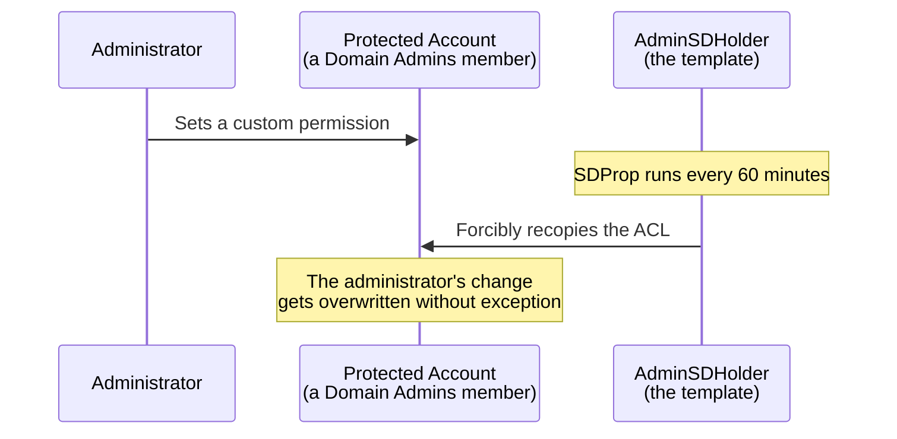

## Introduction

- **What You'll Learn From This Article**: You set a custom permission on a member of a privileged group like `Domain Admins`, and **somehow, about an hour later, the change you made reverts back on its own.** This article helps you understand the reality that this isn't a bug — it's **`AdminSDHolder`, a template object, whose ACL gets forcibly recopied onto every protected account by a process called `SDProp` (Security Descriptor Propagator), every 60 minutes** — before systematically covering the **deliberate but widely misunderstood behavior where the `adminCount` flag never automatically resets, even after an account gets removed from a privileged group.**
- **Intended Audience**: Readers who've tried customizing a privileged group member's permissions individually, and run into the phenomenon where the change inexplicably reverts after a delay.
- **Estimated Reading Time**: About 18 minutes

This article is part of the [Top 1% Series Complete Article Guide](/en/sitemap), and article 23.1 in the [Active Directory Series](/en/sitemap#series-list).

## Prerequisite Knowledge

- [The Difference Between AD, DC, Domains, and Forests](/en/articles/ad-dc-fundamentals-guide): The premise that every object in AD DS carries its own Access Control List (ACL).
- [What Is FSMO (Flexible Single Master Operations)?](/en/articles/fsmo-guide): The premise that the DC holding the PDC emulator role takes on special processing within the domain.

## Getting the Big Picture

**Members of privileged groups — `Domain Admins`, `Enterprise Admins`, `Schema Admins`, `Account Operators`, `Backup Operators`, and the like — get treated as "Protected," subject to a special permission-management rule different from ordinary objects.** **`AdminSDHolder` is a single, special object that exists within AD DS, functioning as the "correct" permission template that should apply to every protected account.** **A process called `SDProp` (Security Descriptor Propagator) runs, by default, every 60 minutes, and forcibly recopies this `AdminSDHolder`'s ACL onto every protected account and group.** In other words, even if you set a custom permission individually on a protected account, **the next time SDProp runs, that change gets overwritten without exception, by `AdminSDHolder`'s own ACL.**

## Deep Dive Into the Fundamentals

### Why Does This Forced Overwrite Mechanism Exist?

**This mechanism exists to prevent privilege-escalation attacks against privileged accounts.** Without this automatic recopying, an attacker who somehow gains temporary elevated access could quietly add an entry to a privileged account's ACL, granting access to themselves. **`AdminSDHolder`'s forced overwrite functions as an organizational defense mechanism, automatically invalidating this kind of unauthorized change within, at most, about an hour.** This shares the exact same underlying purpose as **the Tier 0 management model concept covered in [the hands-on reproducing a Kerberoasting attack](/en/articles/ad-kerberoasting-handson-guide) and [the hands-on auditing replication rights abused by DCSync](/en/articles/ad-dcsync-audit-handson-guide)** — the idea of clearly separating and protecting the most critical accounts from other, ordinary administrative work.

### The adminCount Flag: a "Mark" Indicating Protected Status

**Once an account becomes subject to `AdminSDHolder`'s protection, a value of `1` gets set on that account's `adminCount` attribute.** This is a mark indicating "this account is currently being treated as protected."

Why adminCount Never Automatically Resets, Even After Removal From a Privileged Group

**This is the single most commonly misunderstood point in real-world practice.** Even after you remove a user from a privileged group like `Domain Admins`, **that user's `adminCount` attribute stays at `1` — it never automatically resets.** This is deliberate behavior. According to Microsoft's own explanation, this behavior **was deliberately designed this way back in the Windows 2000 era, in response to customer feedback.** **As long as `adminCount=1` lingers, permission inheritance from parent objects onto that account stays disabled.** The result is a confusing state: "I removed them from the privileged group, but this account's permissions still don't behave like an ordinary user's." **Resolving this requires additional work: explicitly resetting the `adminCount` attribute back to `0`, and manually re-enabling permission inheritance.**

## What a Pro Sees Here (Top 1% Understanding)

### adminCount=1 Is Not Reliable Proof of "Currently Protected"

**A common real-world mistake is treating `adminCount=1` as proof that "this account is still a member of a privileged group right now."** But as covered above, **`adminCount=1` only shows that the account became protected at some point in the past — it doesn't necessarily reflect the current group membership reality.** **Microsoft itself explicitly warns that confirming whether an account is actually still a member of a privileged group right now requires checking the group membership itself, not the `adminCount` attribute.** **Treating `adminCount=1` accounts as "the current list of privileged accounts" during an audit or inventory risks an inaccurate result, including old accounts that have already lost their privileges.**

## Common Misconceptions and Pitfalls

- **Misconception 1: "A custom permission set on a privileged group member that disappears after some time is some kind of bug."**
  This isn't a bug — it's deliberate design, where SDProp forcibly recopies AdminSDHolder's ACL every 60 minutes.
- **Misconception 2: "Removing a user from a privileged group fully restores that account's state."**
  The adminCount attribute never automatically resets, and permission inheritance deliberately stays disabled.
- **Misconception 3: "An account with adminCount=1 set is currently a member of a privileged group."**
  adminCount=1 only shows a past history of having been protected — it doesn't guarantee the current membership reality.

## Troubleshooting Perspective

1. **A custom permission set on a privileged group member reverts after a delay**: Check whether that change conflicts with AdminSDHolder's ACL, and if needed, change AdminSDHolder's own ACL instead.
2. **A user removed from a privileged group still has permission inheritance disabled**: Check that user's adminCount attribute, and if it's still 1, explicitly reset it to 0 and re-enable inheritance.
3. **You want to build a list of privileged accounts for an audit or inventory**: Don't rely purely on the adminCount attribute — use actual group membership as your basis.

## Summary

- AdminSDHolder is a special object functioning as the correct permission template that should apply to every protected account.
- SDProp runs, by default, every 60 minutes, forcibly recopying AdminSDHolder's ACL onto every protected account.
- A protected account gets adminCount=1 set, but this value never automatically resets, even after removal from a privileged group.
- adminCount=1 only shows a past history of having been protected — it doesn't guarantee the current group membership reality.

**Takeaways to Apply Today**
1. Make permission changes for privileged group members against AdminSDHolder itself, not individual accounts.
2. When building a list of privileged accounts, don't rely purely on the adminCount attribute — check actual group membership.

## References

- [Five common questions about AdminSdHolder and SDProp | Microsoft](https://techcommunity.microsoft.com/blog/askds/five-common-questions-about-adminsdholder-and-sdprop/396293)
- [Active Directory Security: Understanding the AdminSDHolder Object | Petri](https://petri.com/active-directory-security-understanding-adminsdholder-object/)
