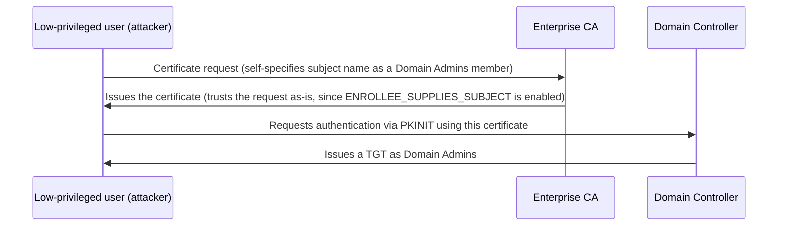

## Introduction

- **What You'll Learn From This Article**: Using the CA environment built in [Building an Enterprise CA With AD CS Hands-On](/en/articles/ad-cs-handson-guide), you'll reproduce, for educational and defensive purposes, an abuse pattern known as **ESC1** — a misconfigured certificate template.
- **Intended Audience**: Readers who know how to build a CA with AD CS, but can't explain exactly how a certificate template misconfiguration leads to privilege escalation.
- **Estimated Reading Time**: About 20 minutes

This article is part of the [Top 1% Series Complete Article Guide](/en/sitemap), and article 43.4 in the [Active Directory Series](/en/sitemap#series-list).

**This article is a security hands-on for educational and defensive purposes. Never run it outside an environment you personally control for testing.**

## Prerequisite Knowledge

- [Building an Enterprise CA With AD CS Hands-On](/en/articles/ad-cs-handson-guide): Understanding the concepts of a CA, a certificate template, and certificate issuance is a prerequisite.
- [Reproducing the Shadow Credentials Attack Abusing msDS-KeyCredentialLink](/en/articles/ad-shadow-credentials-handson-guide): Understanding the concept of PKINIT public-key authentication is a prerequisite.

## Getting the Big Picture

**ESC1 abuses a certificate template with the ENROLLEE_SUPPLIES_SUBJECT flag enabled — a misconfiguration that lets the certificate requester themselves freely specify the identity (subject name) that gets written into the certificate.** **If a template has this flag enabled, has a client authentication EKU (Extended Key Usage) configured, requires no manager approval, and grants enrollment rights to a low-privileged user, an attacker can legitimately submit a certificate request to the CA claiming "I am a member of Domain Admins."** **The CA processes this request as a legitimate procedure and issues a certificate that genuinely impersonates Domain Admins, and the attacker uses this certificate to authenticate via PKINIT, obtaining a TGT as Domain Admins.**

## Deep Dive Into the Fundamentals

### Four Conditions Required for Abuse

**For ESC1 to work, all four of the following conditions must hold simultaneously.** **(1) ENROLLEE_SUPPLIES_SUBJECT is enabled, letting the requester freely specify the subject name. (2) One of Client Authentication, Smart Card Logon, or Any Purpose is configured as the Extended Key Usage (EKU). (3) Manager approval isn't required. (4) A low-privileged user (often all of Domain Users) is granted enrollment rights for that template.** **A template left with all four of these loosely configured — either intentionally or for legacy compatibility reasons — remains surprisingly common in real-world AD environments.**

### Why a Password Reset Doesn't Invalidate It

**A fraudulent certificate issued through this attack remains valid and usable even after the target user's password is reset, unless the certificate itself is explicitly revoked.** **This shares the same root principle as the structure covered in [the Golden Ticket article](/en/articles/ad-golden-ticket-handson-guide), where resetting the krbtgt password alone wasn't sufficient.** **Any certificate already issued from a template suspected of compromise must be explicitly added to the CA's certificate revocation list (CRL).**

## What a Pro Sees Here (Top 1% Understanding)

### "Writing" a Key and "Getting" a Certificate Issued Are Two Different Paths to Hijacking the Same Authentication

**The shadow credentials attack hijacked PKINIT public-key authentication by writing an attacker-prepared key into the msDS-KeyCredentialLink attribute. ESC1 hijacks that same PKINIT authentication through an entirely different path: not by writing a key, but by getting the CA itself to legitimately issue a certificate with whatever content the attacker wants.** **Understanding that "writing to an attribute isn't the only path to hijacking PKINIT authentication," and treating a certificate template's ACL and flag configuration itself as another critical attack surface to audit in an AD CS environment** — that's the perspective a top-1% engineer carries.

## Common Misconceptions and Pitfalls

- **Misconception 1: "As long as AD CS is deployed, leaving certificate templates at their defaults is fine."**
  A default or loosely configured template meeting all four conditions, including ENROLLEE_SUPPLIES_SUBJECT, becomes a direct privilege escalation path from a low-privileged user.
- **Misconception 2: "Resetting a compromised user's password also invalidates any fraudulently issued certificates."**
  A certificate remains valid for use even after a password reset, unless it's explicitly revoked.
- **Misconception 3: "Defending against the shadow credentials attack is enough to prevent PKINIT authentication abuse."**
  ESC1 hijacks PKINIT authentication through an entirely different path that never touches attribute writes at all, so a separate countermeasure — auditing templates — is required.

## Troubleshooting Perspective

1. **A low-privileged user manages to obtain a certificate claiming membership in a privileged group**: Check the certificate template's ENROLLEE_SUPPLIES_SUBJECT flag and which groups hold enrollment rights.
2. **Compromise is suspected, but unauthorized access continues even after a password reset**: Identify any certificates already issued under that username and explicitly add them to the CRL to revoke them.
3. **You can't tell which templates are dangerous**: Use a tool like Certify or Certipy to inventory every template against the four conditions — ENROLLEE_SUPPLIES_SUBJECT, EKU, approval requirement, and enrollment rights.

## Summary

- ESC1 abuses a misconfigured certificate template with ENROLLEE_SUPPLIES_SUBJECT enabled, getting the CA to legitimately issue a certificate that lets a low-privileged user impersonate a privileged user.
- Abuse requires four conditions: free subject specification, an appropriate EKU, no approval requirement, and broad enrollment rights.
- A fraudulently issued certificate isn't invalidated by a password reset alone — explicit revocation is required.
- The shadow credentials attack and ESC1 are two separate attacks that hijack the same PKINIT authentication through different paths.

**Takeaways to Apply Today**
1. After deploying AD CS, always inventory every existing template's combination of the ENROLLEE_SUPPLIES_SUBJECT flag and enrollment rights.
2. For incident response, include checking for certificates issued under the compromised username — not just a password reset — in your checklist.

## References

- [ESC1 – Misconfigured Certificate Templates | SpecterOps Certify Documentation](https://docs.specterops.io/ghostpack-docs/Certify.wik-mdx/esc1-misconfigured-client-authentication)
- [ESC4 – Vulnerable Certificate Template Access Control | SpecterOps Certify Documentation](https://docs.specterops.io/ghostpack-docs/Certify.wik-mdx/esc4-vulnerable-certificate-template-access-control.md)
