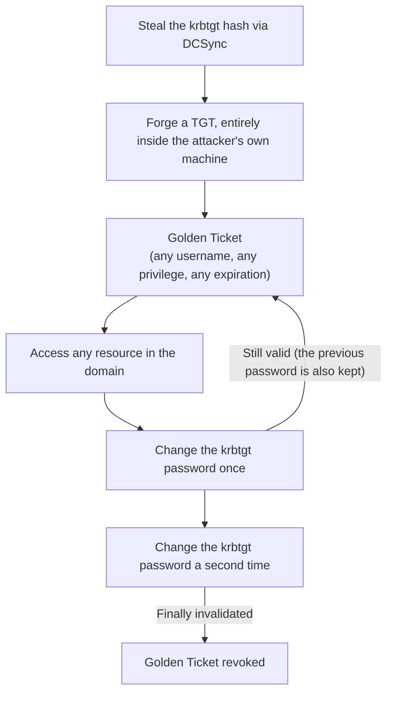

## Introduction

- **What You'll Learn From This Article**: DCSync, covered in the [DCSync Hands-On](/en/articles/ad-dcsync-audit-handson-guide), is a technique for stealing every user's password hash, including the `krbtgt` account's. In this article, you'll get hands-on and systematically understand **how a stolen `krbtgt` hash actually gets turned into a Golden Ticket, a forged TGT, and why that can't be invalidated by a single password change**.
- **Intended Audience**: Readers who know DCSync can steal the `krbtgt` hash, but can't explain exactly what that hash gets used for afterward.
- **Estimated Reading Time**: About 25 minutes
- **This hands-on is for auditing and defensive purposes, to strengthen your own organization's environment.**

This article is part of the [Top 1% Series Complete Article Guide](/en/sitemap), and article 43.05 in the [Active Directory Series](/en/sitemap#series-list).

## Prerequisite Knowledge

- [DCSync Hands-On](/en/articles/ad-dcsync-audit-handson-guide): Understanding that the `krbtgt` account's hash can be stolen via DCSync is a prerequisite.
- [How Kerberos Authentication Works](/en/articles/ad-kerberos-guide): Understanding the role of a TGT (Ticket Granting Ticket) is a prerequisite.

## Getting the Big Picture

**The `krbtgt` account's secret key is the key used to sign every single TGT issued within the domain.** **Get hold of that key, and an attacker can freely forge a TGT, entirely inside their own machine, with no query to the real domain controller at all.** **That TGT can claim a nonexistent username, membership in the Domain Admins group, and an expiration date years in the future — and this is called a Golden Ticket.**

## Deep Dive Into the Fundamentals

### Why a Single Password Change Can't Invalidate a Golden Ticket

**AD DS keeps both the current password and the previous password for the `krbtgt` account, simultaneously.** **This is Kerberos's own key-rollover design, meant to stop a ticket already being validated at the exact moment of a password change from suddenly failing.** **But because of this design, changing the `krbtgt` password just once still leaves a Golden Ticket, signed with the stolen "previous password," valid.** **A genuine invalidation requires changing the password twice in a row, and the second change should ideally happen only after the default Kerberos ticket lifetime (10 hours) has elapsed** (doing the second change immediately after the first risks a separate problem: some DCs may still be on the old password before replication completes).

### Why Golden Tickets Are Hard to Detect, and What Anomalies to Watch For

**Because a Golden Ticket is correctly signed with the genuine `krbtgt` key, the domain controller accepts it as a cryptographically valid ticket.** **What's worth watching for detection isn't the ticket's content itself, but anomalies in how the ticket gets used.** **Three well-known anomaly patterns are: an implausibly long ticket lifetime, access under a username that doesn't actually exist in the domain, and the use of an outdated encryption method like RC4 despite running a modern domain.**

From Stealing the krbtgt Hash to Generating a Golden Ticket, With mimikatz

**Using the `krbtgt` NTLM hash obtained via DCSync, an attacker can generate a forged TGT, with any username, any SID history, and any expiration date, using mimikatz's `kerberos::golden` command.** **Load the generated ticket into memory with `kerberos::ptt` (Pass the Ticket), and every subsequent Kerberos authentication succeeds with that ticket's content.**

## What a Pro Sees Here (Top 1% Understanding)

### "The Hash Was Stolen" and "Changing the Password Makes It Safe" Are Two Separate Things

**With most leaked credentials, changing the password invalidates the leaked credential. But for an account like `krbtgt`, designed to simultaneously hold two generations of a secret — current and previous — this intuition doesn't hold.** **The habit of digging one layer deeper to check that credential's own design** is the perspective a top-1% engineer uses to avoid stopping at the incomplete response of "I changed the password, so it's safe now."

## Common Misconceptions and Pitfalls

- **Misconception 1: "Changing the `krbtgt` password once invalidates a Golden Ticket."**
  Because AD DS keeps both the current and previous `krbtgt` passwords, a single change still leaves a Golden Ticket signed with the previous password valid.
- **Misconception 2: "A Golden Ticket gets rejected by the DC as a cryptographically invalid ticket."**
  Because a Golden Ticket is correctly signed with the genuine `krbtgt` key, the DC accepts it as a cryptographically valid ticket.
- **Misconception 3: "The two `krbtgt` password changes should happen back-to-back, with no gap."**
  The second change should ideally happen only after the default Kerberos ticket lifetime has elapsed; doing it with no gap risks a separate problem from incomplete replication.

## Troubleshooting Perspective

1. **You've determined the `krbtgt` hash may have been leaked**: Don't stop at a single password change — change it twice in a row, with the default ticket lifetime as a gap between the two.
2. **You want to investigate whether a Golden Ticket is in use**: Check for the three anomaly patterns — an implausible ticket lifetime, access under a nonexistent username, and use of an outdated encryption method.
3. **Suspicious access continues even after changing the `krbtgt` password**: Check whether the second change happened with a sufficient gap after the first.

## Summary

- A Golden Ticket is a technique for forging a TGT, using a stolen `krbtgt` secret key, with any username, any privilege, and any expiration date.
- Because AD DS simultaneously keeps two generations of the `krbtgt` password, current and previous, a single password change alone can't invalidate a Golden Ticket.
- A genuine invalidation requires changing the password twice in a row, with the default ticket lifetime as a gap.
- Detecting a Golden Ticket means watching anomalies in how a ticket is used — lifetime, nonexistent usernames, outdated encryption — not the ticket's content.

**Takeaways to Apply Today**
1. When credentials leak, check whether the premise "changing the password makes it safe" genuinely holds for that specific account's design.
2. Build regular `krbtgt` password rotation into your ongoing operations.

## References

- [Steal or Forge Kerberos Tickets: Golden Ticket | MITRE ATT&CK T1558.001](https://attack.mitre.org/techniques/T1558/001)
- [Golden Ticket Attack Explained | Semperis](https://www.semperis.com/blog/golden-ticket-attack-explained/)
