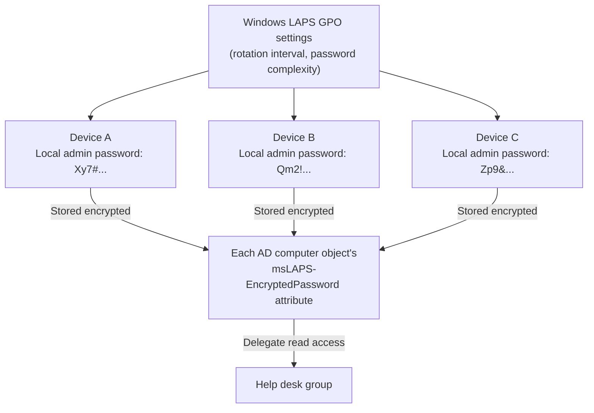

## Introduction

- **What You'll Learn From This Article**: [gMSA (Group Managed Service Account)](/en/articles/ad-gmsa-handson-guide) was a mechanism that freed you from **service account password management**. But each device's **local Administrator account** password still remains as a separate problem. In this hands-on, you'll build the full flow yourself: using **Windows LAPS** to automatically generate a different, random local administrator password per device and rotate it on a schedule, then delegating read access to that password to only the help desk group through the [OU delegation](/en/articles/ad-delegation-handson-guide) mechanism.
- **Intended Audience**: Readers who've experienced both gMSA's service-account password management and OU delegation, and want to tackle another real-world challenge: local administrator account password management.
- **Estimated Reading Time**: About 22 minutes

This article is part of the [Top 1% Series Complete Article Guide](/en/sitemap), and article 31.1 in the [ActiveDirectory Series](/en/sitemap#series-list).

## Prerequisite Knowledge

- [gMSA (Group Managed Service Account) Frees You From Service Account Password Management](/en/articles/ad-gmsa-handson-guide): The premise of automatic password rotation itself.
- [OU Delegation of Control](/en/articles/ad-delegation-handson-guide): Understanding the delegation mechanism — letting only a specific group read a specific attribute.

## Getting the Big Picture

**Many organizations set the exact same password on the local administrator account of every single device.** This practice carries a fatal risk. **The moment one device's local admin password leaks through some means, an attacker can use that password's hash (pass-the-hash) to log in as that account on every other device in the organization.**

**Windows LAPS (Local Administrator Password Solution) automatically generates a completely different, random password for each device, and stores it encrypted as an attribute on the device object in AD.** This means that even if one device's password leaks, it can't be used for lateral movement to any other device.

## Hands-On: Build Windows LAPS and Delegate Password Read Access

### Step 1: Confirm the Schema Extension

Windows LAPS needs to add new attributes (such as `msLAPS-EncryptedPassword`) to AD's schema, for storing the encrypted password. Depending on your forest functional level and OS versions, run the `Update-LapsADSchema` cmdlet in advance to apply the schema extension.

### Step 2: Enable Windows LAPS via GPO

Link a new GPO to the OU the target computers belong to, and configure the policies under Computer Configuration → Administrative Templates → LAPS. Specify **the password's complexity, length, and rotation interval** (30 days by default), and select "Active Directory" as the backup destination.

### Step 3: Confirm the Behavior on the Device

On a device the GPO has applied to, **a background task wakes up roughly every hour and checks the policy's state.** When it's time to rotate, a new random password is generated, set on the local administrator account, and then written to AD in encrypted form.

The Decisive Difference From Legacy Microsoft LAPS

**The older "Microsoft LAPS" (a separately distributed tool) actually stored the password in AD's `ms-Mcs-AdmPwd` attribute as plaintext, unencrypted.** While it did restrict read access through an access control list (ACL), this carried a structural risk: if an account with any read permission on AD was compromised, the password itself could be read straight out, with no encryption at all. **Windows LAPS, by contrast — built natively into Windows — encrypts the password using DPAPI-NG before storing it in AD, and only principals explicitly granted permission can decrypt it.** Legacy LAPS and Windows LAPS can't manage the same account on the same device at the same time.

### Step 4: Delegate Password Read Access to Only the Help Desk Group

By default, only highly privileged groups like Domain Admins can decrypt and read the password. Using the same approach as [OU delegation of control](/en/articles/ad-delegation-handson-guide), use the `Set-LapsADReadPasswordPermission` cmdlet to **delegate read access to the `msLAPS-EncryptedPassword` attribute, on the target OU, to only the help desk group.** This lets help desk staff retrieve just the local administrator password for the devices they're responsible for, using the `Get-LapsADPassword` cmdlet, without holding Domain Admins privileges at all.

## What a Pro Sees Here (Top 1% Understanding)

### gMSA and LAPS Are Two Different Applications of the Same Idea: Automatic Password Rotation

**[gMSA](/en/articles/ad-gmsa-handson-guide) was a mechanism where AD automatically rotates the password of a domain account a service uses. Windows LAPS is a mechanism that automatically rotates the local administrator account's password each device holds, in exactly the same way.** The two are nothing more than **two different applications of the same design philosophy: driving the number of passwords a human manages manually as close to zero as possible.** Making sure the answer to "who's rotating this account's password, when, and how" is anything other than "an IT staffer, manually" is the consistent direction of improvement across this entire field.

## Common Misconceptions and Pitfalls

- **Misconception 1: "LAPS is automatically enabled on Windows 11 or Windows Server 2022 and later, with nothing to do."**
  Windows LAPS's capability itself is built into the OS, but enabling it requires explicit GPO configuration and a schema extension.
- **Misconception 2: "Legacy Microsoft LAPS and Windows LAPS store passwords with the same level of security."**
  Legacy LAPS stored the password in AD as plaintext, while Windows LAPS encrypts it with DPAPI-NG before storing it.
- **Misconception 3: "Any domain administrator should be able to read every device's password."**
  In practice, read access should be delegated, scoped to the necessary OUs, only to the staff who actually provide device support, such as the help desk.

## Troubleshooting Perspective

1. **You applied the GPO, but the password never gets written to AD**: Check whether the schema extension (`Update-LapsADSchema`) was run beforehand.
2. **Help desk staff can't retrieve the password with `Get-LapsADPassword`**: Check whether `Set-LapsADReadPasswordPermission` delegation was correctly configured for the target OU.
3. **You migrated from legacy Microsoft LAPS, but the password is being managed twice**: Check whether the legacy LAPS client agent is still installed on the device.

## Summary

- Windows LAPS is a mechanism that automatically generates a different, random local administrator password per device, and stores it encrypted in AD.
- This prevents one device's password leak from leading to lateral movement to other devices via pass-the-hash.
- Legacy Microsoft LAPS stored the password as plaintext, while Windows LAPS encrypts it with DPAPI-NG.
- Password read access should be delegated, scoped to only the groups that actually need it, using the delegation mechanism.

**Takeaways to Apply Today**
1. If you find a practice of setting the same local administrator password across every device, consider deploying Windows LAPS.
2. Make it a habit to view gMSA and LAPS along the same axis: who is manually managing this password?

## References

- [LAPS concepts overview | Microsoft Learn](https://learn.microsoft.com/en-us/windows-server/identity/laps/laps-concepts-overview)
- [Windows LAPS schema extensions reference | Microsoft Learn](https://learn.microsoft.com/en-us/windows-server/identity/laps/laps-technical-reference)
