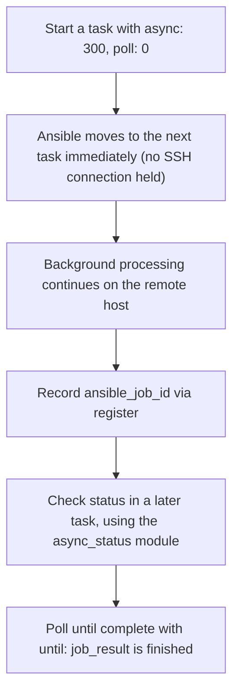

## Introduction

- **What You'll Learn From This Article**: Beyond the idempotence testing covered in the [Molecule Automated-Testing Hands-On](/en/articles/ansible-molecule-testing-handson-guide), you'll get hands-on and systematically understand **`async`/`poll` — the mechanism for running a long task without holding open the SSH connection**.
- **Intended Audience**: Readers who know an Ansible task holds its SSH connection open until processing completes by default, but can't explain exactly how `async`/`poll` actually work.
- **Estimated Reading Time**: About 25 minutes (budget about 40 minutes if you're building this hands-on as you go)

This article is part of the [Top 1% Series Complete Article Guide](/en/sitemap), and article 11.4 in the [Ansible/IaC Series](/en/sitemap#series-list).

## Prerequisite Knowledge

- [Molecule Automated-Testing Hands-On](/en/articles/ansible-molecule-testing-handson-guide): Understanding `changed_when`, the mechanism for judging whether a task changed anything, is a prerequisite.

## Getting the Big Picture

**An Ansible task, by default, keeps the SSH connection open until processing on the remote host finishes.** **For a task that takes a long time, this connection carries the risk of getting interrupted by a timeout or disconnect.** **`async: N` specifies the maximum time (in seconds) a task is allowed to run in the background, and `poll: N` specifies how often, in seconds, Ansible checks back on its completion.** **And only when you specify `poll: 0` does Ansible move on to the next task right after starting it, with no wait for completion at all.**



## Deep Dive Into the Fundamentals

### Hands-On: Running a Long Task Without Holding the SSH Connection Open

1. **Specify `poll: 0` and start a long-running command in the background.**

```yaml
- name: Start a long-running operation in the background
  ansible.builtin.command: /opt/scripts/long-running-task.sh
  async: 300
  poll: 0
  register: job_result
```

2. **Use the `async_status` module in a separate task to check on that job's completion.**

```yaml
- name: Check the job's completion
  ansible.builtin.async_status:
    jid: "{{ job_result.ansible_job_id }}"
  register: job_status
  until: job_status.finished
  retries: 30
  delay: 10
```

**Between these two tasks, Ansible never once holds an SSH connection open.** **The task specifying `poll: 0` completes Ansible's own side of things the instant it starts, and only the background processing on the remote host keeps going, independently.**

### A Typical Pitfall: an async Task Always Reports as Changed

**A task using `async` carries a specification-level quirk: it always gets reported as `changed`, even when nothing actually changed.** **This directly collides with the idempotence testing covered in the [Molecule Hands-On](/en/articles/ansible-molecule-testing-handson-guide).** **When testing a role containing an `async` task for idempotence with Molecule, you need to either exclude just that task from the test, or explicitly override it with `changed_when: false`.**

<details>
<summary>Other Pitfalls: Manually Cleaning Up the Job Cache File, and an Exclusive-Lock Conflict</summary>

**The status file for a job run with `poll: 0` doesn't get cleaned up automatically by Ansible — you need to call the `async_status` module with `mode: cleanup` to manually remove it.** **Also, using `poll: 0` against an operation requiring an exclusive lock, like yum or apt, carries the risk of a conflict: a later task trying to access the same resource while the backgrounded process still holds that lock.**

</details>

## What a Pro Sees Here (Top 1% Understanding)

### "A Setting That Looks Asynchronous" and "a Setting That Genuinely Fires and Forgets" Are Different Things

**Specifying only `async` and omitting `poll` still has Ansible waiting for completion at its default polling interval. Only the explicit, deliberate `poll: 0` genuinely achieves "fire and forget."** **The habit of digging one layer deeper, when several settings exist, to check which exact value is genuinely the boundary for the behavior you actually want** is the perspective a top-1% engineer carries.

## Common Misconceptions and Pitfalls

- **Misconception 1: "Specifying async automatically disconnects the SSH connection."**
  Omitting poll, or specifying a value greater than 0, still has Ansible waiting for completion at its default polling interval. Genuinely firing and forgetting, with a disconnect, requires explicitly specifying `poll: 0`.
- **Misconception 2: "An async task can pass idempotence testing just like a regular task."**
  An async task always gets reported as `changed`, even when nothing actually changed, which collides directly with idempotence testing.
- **Misconception 3: "The status file for a job run with poll: 0 gets deleted automatically."**
  The job's status file doesn't get cleaned up automatically — it requires explicitly calling the `async_status` module with `mode: cleanup`.

## Troubleshooting Perspective

1. **A checking task using `async_status` fails with a "file not found" error**: Check whether the original task's `async` value was shorter than the actual processing time, causing the job itself to time out and fail.
2. **A role containing an async task fails Molecule's idempotence test**: Either explicitly set `changed_when: false` on that task, or exclude it from the idempotence test.
3. **A job's status file run with poll: 0 keeps lingering on the remote host**: Call `async_status` with `mode: cleanup` to manually clean it up.

## Summary

- `async: N` specifies the maximum background execution time, and `poll: N` specifies the interval for checking completion.
- Only when `poll: 0` is specified does Ansible move on to the next task right after starting one, with no wait for completion at all.
- An async task always gets reported as `changed`, even when nothing actually changed, which collides with idempotence testing.
- The status file for a job run with `poll: 0` needs to be manually cleaned up by calling `async_status` with `mode: cleanup`.

**Takeaways to Apply Today**
1. When handling a long-running task, don't omit `poll` — explicitly specify the behavior you actually intend (waiting, or firing and forgetting).
2. When testing a role containing an async task with Molecule, always check how `changed_when` is handled.

## References

- [Asynchronous Actions and Polling | Ansible Documentation](https://docs.ansible.com/ansible/latest/playbook_guide/playbooks_async.html)
- [How to Run Async Tasks in Ansible With async and poll | OneUptime](https://oneuptime.com/blog/post/2026-02-21-how-to-run-async-tasks-in-ansible-with-async-and-poll/markdown)
