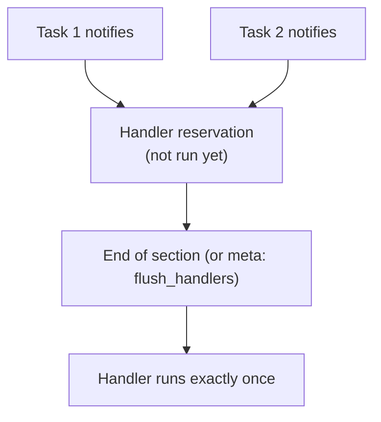

## Introduction

- **What You'll Learn From This Article**: Beyond invoking a handler via notify, covered in [Roles, Handlers, and Templates: A Real-World Configuration Management Hands-On](/en/articles/ansible-roles-handson-guide), you'll systematically understand **exactly when a handler actually runs**.
- **Intended Audience**: Readers who know a handler can be invoked via notify, but can't explain exactly when it actually runs.
- **Estimated Reading Time**: About 16 minutes

This article is part of the [Top 1% Series Complete Article Guide](/en/sitemap), and article 3.1 in the [Ansible/IaC Series](/en/sitemap#series-list).

## Prerequisite Knowledge

- [Roles, Handlers, and Templates: A Real-World Configuration Management Hands-On](/en/articles/ansible-roles-handson-guide): Understanding the concepts of notify and a handler is a prerequisite.

## Getting the Big Picture

**When a task notifies a handler, that handler doesn't run the instant it's notified.** **Ansible's default behavior is to flush notified handlers all at once, immediately after each section of a play finishes — pre_tasks, roles/tasks, and post_tasks.** **This is a "reservation," not "execute immediately" — and by design, no matter how many times the same handler gets notified, it only ever runs once.**

## Deep Dive Into the Fundamentals

### flush_handlers Clears the Reservation Immediately

**If you need an already-notified handler to run right now, mid-play, without waiting for the end of the section, insert a task with `meta: flush_handlers`.** **This task triggers whatever handlers have been notified up to that point, right on the spot.** **And don't forget: a handler that's already been flushed can still be notified again later in the play, making it eligible to run once more.**

### A Failed Task Stops the Play, Along With Any Notified Handlers

**If a task fails partway through, the entire play stops, and any handlers notified before that point never run.** **Enabling the `force_handlers` setting (in the playbook itself, in ansible.cfg, or via `--force-handlers`) forces already-notified handlers to run even when a task has failed** — useful when you still want cleanup to happen even after a failure.

Note: a variable in a handler name can backfire because of how early it gets templated

**A handler's name gets templated very early in the play, so if a variable used inside that name isn't yet available at that point, the entire play can fail.**

## What a Pro Sees Here (Top 1% Understanding)

### "Notified" and "Executed" Happen at Different Moments

**notify isn't a command to run a handler on the spot — it's a command that registers a reservation: "run this later, all together."** **Dropping the assumption that "the service must already be restarted after this task" and instead checking "when will the handler actually be processed next" — weighing both section boundaries and flush_handlers** — is the perspective a top-1% engineer carries.

## Common Misconceptions and Pitfalls

- **Misconception 1: "The handler runs the instant notify is called."**
  A handler is flushed all at once, at the end of each section — pre_tasks, roles/tasks, post_tasks.
- **Misconception 2: "If the same handler is notified three times, it runs three times."**
  No matter how many times the same handler is notified, it only runs once at the end of that section.
- **Misconception 3: "Even if a task fails partway through, the handlers notified before that point should still run."**
  If a task failure stops the play, already-notified handlers don't run either — unless force_handlers is enabled, no cleanup happens.

## Troubleshooting Perspective

1. **A task right after a config-file change ends up accessing the service while it's still running on the old config**: Insert `meta: flush_handlers` right after that task to settle the service restart immediately.
2. **A task fails partway through the play, leaving the service in a half-restarted state**: Enable `force_handlers` so already-notified handlers still run even on failure.
3. **A play fails entirely when using a variable inside a handler name**: Check whether that variable is already available at the point the handler name gets templated.

## Summary

- notify is a "reservation" — handlers are flushed all at once at the end of each section: pre_tasks, roles/tasks, post_tasks.
- meta: flush_handlers lets you settle execution immediately, without waiting for the end of a section.
- If a task failure stops the play, notified handlers don't run either — force_handlers can address this.
- The same handler only ever runs once, no matter how many times it's notified.

**Takeaways to Apply Today**
1. If a task right after a config change accesses that same service, always check whether meta: flush_handlers is needed.
2. For a play that needs cleanup after a failure, consider the force_handlers setting.

## References

- [Handlers: running operations on change | Ansible Documentation](https://docs.ansible.com/ansible/latest/playbook_guide/playbooks_handlers.html)
