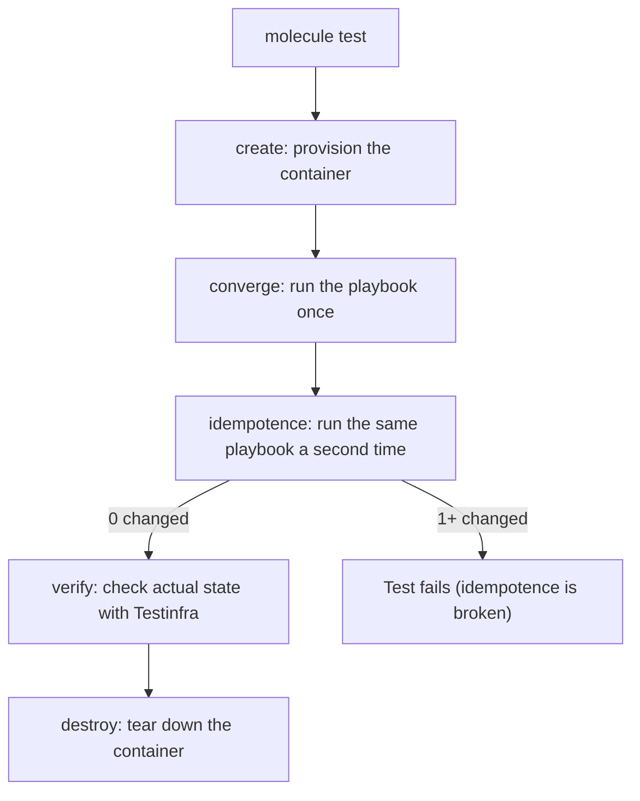

## Introduction

- **What You'll Learn From This Article**: The [Error Handling Hands-On](/en/articles/ansible-error-handling-handson-guide) covered `changed_when` and `failed_when`, mechanisms for controlling a single task's own behavior. In this article, you'll get hands-on and systematically understand **Molecule**, a framework for automatically testing an entire role on disposable Docker containers.
- **Intended Audience**: Readers who can write Ansible roles, but don't know how to automatically test the role itself.
- **Estimated Reading Time**: About 25 minutes
- **Hands-On Prerequisite Environment**: A Linux environment running Docker (or Podman), Python 3, `pip install molecule molecule-plugins[docker] pytest-testinfra`

This article is part of the [Top 1% Series Complete Article Guide](/en/sitemap), and article 11.3 in the [Ansible/IaC Series](/en/sitemap#series-list).

## Prerequisite Knowledge

- [Error Handling Hands-On](/en/articles/ansible-error-handling-handson-guide): Understanding the basic usage of `changed_when` and `failed_when`.
- [Ansible Roles Hands-On](/en/articles/ansible-roles-handson-guide): Understanding a role's directory structure.

## Getting the Big Picture

**Molecule is a framework that spins up a disposable Docker container as a test environment, automating a full sequence — create, prepare, converge, idempotence test, verify, destroy — behind a single `molecule test` command.** **Among these, the "idempotence test" is a mechanism that verifies Ansible's own design philosophy directly: it runs the same playbook a second time, and fails the test itself the instant even one single task gets reported as `changed`.**



## Deep Dive Into the Fundamentals

### Three Typical Causes of an Idempotence Test Failure

**There are three typical causes behind an idempotence test failure.** **The first is a task using the `command` or `shell` module with no `changed_when` set, so it always gets reported as `changed` even when nothing actually changed.** **The second is a template containing a dynamic value, such as the execution timestamp, so the file's content differs every single time.** **The third is a package-installation task specifying `state: latest`, which triggers an update every single time a newer version happens to exist.** The `changed_when` covered in the [Error Handling Hands-On](/en/articles/ansible-error-handling-handson-guide) is exactly the direct countermeasure for that first cause.

### Hands-On: Testing an Nginx-Installing Role With Molecule

1. **Initialize a Molecule scenario** (since `molecule init role` was removed in Molecule 6.0 and later, create the role itself with `ansible-galaxy role init`, and add only the test scenario separately).

```bash
ansible-galaxy role init nginx_role
cd nginx_role
molecule init scenario --driver-name docker
```

2. **In `molecule/default/converge.yml`, write a playbook that applies the role under test.**

```yaml
- name: Converge
  hosts: all
  tasks:
    - name: "Include nginx_role"
      ansible.builtin.include_role:
        name: "nginx_role"
```

3. **Run `molecule test`**, and container creation, playbook execution, the idempotence test, verification, and teardown all execute automatically, in sequence.

```bash
molecule test
```

4. **In `molecule/default/tests/test_default.py`, write verification code using Testinfra.**

```python
def test_nginx_is_running_and_enabled(host):
    nginx = host.service("nginx")
    assert nginx.is_running
    assert nginx.is_enabled

def test_nginx_listening_on_port_80(host):
    assert host.socket("tcp://0.0.0.0:80").is_listening
```

**A successful `converge` alone only tells you "it ran without an error." Only the `verify` stage, confirming Nginx is actually running and listening on port 80, guarantees that the state is actually what you intended.**

<details>
<summary>molecule test's Standard Test Sequence</summary>

**The default `molecule test` automatically runs a full sequence in order: lint, dependency, syntax, create, prepare, converge, idempotence, verify, destroy.** **In real-world practice, it's common to repeatedly run just `molecule converge` while developing and adjusting the role, then run the full sequence with `molecule test` at the end.**

</details>

## What a Pro Sees Here (Top 1% Understanding)

### "The Playbook Succeeded" and "The Role Is Correct" Are Entirely Different Guarantees

**The fact that a playbook ran without an error guarantees neither that it reached the intended state, nor that re-running it produces the same result.** **The habit of setting up a Molecule-based automated test environment at the same time you write a role** is the perspective a top-1% engineer uses to escape the reactive pattern of only noticing a broken idempotence after hitting an unexpected `changed` in production.

## Common Misconceptions and Pitfalls

- **Misconception 1: "If the playbook runs without an error, the role is written correctly."**
  Running without an error, reaching the intended state, and reproducing the same result on a re-run are three entirely separate guarantees, and Molecule verifies all three at separate stages.
- **Misconception 2: "`molecule init role` creates the role and adds a test scenario at the same time."**
  `molecule init role` was removed in Molecule 6.0 and later — create the role itself with `ansible-galaxy role init`, and add the test scenario separately with `molecule init scenario`.
- **Misconception 3: "If converge (the first run) succeeds, the idempotence test is unnecessary."**
  Even if the first run succeeds, the second run can still report a `changed` task, and the idempotence test is a separate, independent stage that catches exactly this automatically.

## Troubleshooting Perspective

1. **`molecule test`'s idempotence test fails**: Check for missing `changed_when` on `command`/`shell` tasks, dynamic values in templates, and use of `state: latest`.
2. **`converge` succeeds but `verify` fails**: Even though the playbook ran without an error, the intended state (a service's running state, a port's listening state) may not actually have been reached.
3. **The `molecule init role` command can't be found**: It was removed in Molecule 6.0 and later — use `ansible-galaxy role init` combined with `molecule init scenario` instead.

## Summary

- Molecule is a framework that spins up a disposable Docker container as a test environment and automatically tests an entire role.
- The idempotence test runs the same playbook twice and fails if the second run reports a `changed` task, verifying Ansible's own design philosophy directly.
- The three typical causes of an idempotence test failure are a `command`/`shell` task missing `changed_when`, a dynamic value in a template, and use of `state: latest`.
- The `verify` stage uses Testinfra to confirm a service has actually reached its intended state.

**Takeaways to Apply Today**
1. When you write a new role, set up a Molecule-based automated test environment for it at the same time.
2. When an idempotence test fails, suspect a missing `changed_when` setting first.

## References

- [How to Test Ansible with Molecule | OneUptime](https://oneuptime.com/blog/post/2026-01-22-ansible-molecule-testing/view)
- [How to Test Ansible Playbook/Role Using Molecule With Docker | Opstree](https://opstree.com/blog/how-to-test-ansible-playbook-role-using-molecule-with-docker/)
