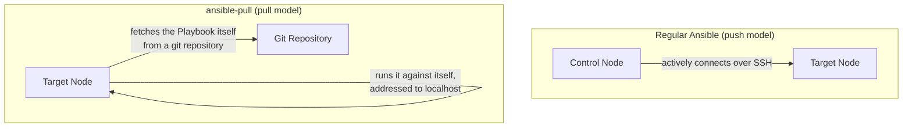

## Introduction

- **What You'll Learn From This Article**: Starting from the basic Ansible model covered in [What Is Ansible?](/en/articles/ansible-guide) — **a control node connects to a target server over SSH and pushes configuration onto it** — you'll notice a problem: **in an environment like an auto-scaling group, where new instances appear dynamically, the control node may have no way of even knowing a target's IP address ahead of time, and that premise itself breaks down.** This article systematically covers **`ansible-pull`**, an entirely reversed mechanism where the target node itself fetches a Playbook from a git repository and runs it against itself, locally.
- **Intended Audience**: Readers who understand [Ansible's basic usage](/en/articles/ansible-handson-guide), but can't explain how to use Ansible in a setup that can't assume an inbound SSH connection.
- **Estimated Reading Time**: About 16 minutes

This article is part of the [Top 1% Series Complete Article Guide](/en/sitemap), and article 1.1 in the [Ansible Series](/en/sitemap#series-list).

## Prerequisite Knowledge

- [What Is Ansible?](/en/articles/ansible-guide): The premise that Ansible is an agentless mechanism, where the control node connects over SSH to a target server and applies configuration.

## Getting the Big Picture

**Ansible's basic model is a push-based mechanism: the "control node" actively connects to the "target node" via SSH, and pushes and executes the Playbook's content.** This premise requires **the control node to already know every target node's IP address (or hostname) ahead of time, and the target node's side to have an inbound SSH port open.** **But in an environment like an auto-scaling group, where new instances launch dynamically and autonomously, there's no guarantee the control node's side knows that new instance's IP address at launch time.** There are also scenarios where, as a security requirement, you simply don't want to allow an inbound SSH connection from the control node on the target node's side in the first place. **`ansible-pull` resolves these problems by inverting this very premise.**



## Deep Dive Into the Fundamentals

### What ansible-pull Actually Does, on the Target Node Itself

**`ansible-pull` is a command you run on the target node itself.** When run, it first clones or pulls (fetches updates for) the specified git repository (where the Playbook is stored), onto that node itself. It then runs `ansible-playbook`, **as a local execution with the connection fixed to `localhost`, against the fetched Playbook.** **Throughout this entire process, an SSH connection from the control node to the target node never happens, not even once.** All the target node needs is **outbound reachability to the git repository.**

<details>
<summary>A Concrete Example</summary>

```bash
# Run this on the target node itself
ansible-pull -U https://github.com/example/playbooks.git site.yml
```

In real-world practice, this command is typically **not run manually, but built into a cron job, or into a cloud instance's user data (a script that runs automatically at launch).** This achieves **a fully self-contained initial configuration, where the instance, the moment it launches, fetches the latest Playbook from the git repository itself and autonomously applies its own configuration.**

</details>

### Why This Inversion Is Especially Effective in Auto-Scaling Environments

**The moment a new instance launches in an auto-scaling group, the control node's side often isn't even aware that instance exists yet.** With a push-based setup, you'd need several steps: receive notification that "a new instance launched," reflect its IP address into a dynamic inventory, and only then finally connect over SSH to apply configuration. **With the pull model (`ansible-pull`), the new instance itself just runs `ansible-pull` from its launch-time user data, completing configuration with zero intervention from the control node's side at all.** The structural simplification of the steps between an instance launching and its configuration completing is this approach's real-world strength.

## What a Pro Sees Here (Top 1% Understanding)

### The Pull Model Carries Trade-Offs the Push Model Doesn't

**In exchange for not needing inbound SSH, `ansible-pull` carries several important trade-offs.** First, **the control node's side has no way to know the execution results on individual target nodes in real time.** Since each node runs autonomously, on its own schedule, there's no built-in mechanism, by default, to centrally check "which node just finished, with what result, right now." Also, **decrypting secrets with [Ansible Vault](/en/articles/ansible-vault-handson-guide) needs to happen on the target node itself, with no human in the loop** — creating a separate design challenge of how to safely place the decryption password itself on the target node's side. **It's important to understand that the centralized visibility into execution results, which a central management system like [Ansible Tower/AWX](/en/articles/ansible-tower-awx-overview-guide) provides, is something you consciously give up the moment you choose the pull model.**

## Common Misconceptions and Pitfalls

- **Misconception 1: "ansible-pull is a different version of Ansible, or a separate product."**
  ansible-pull is a command included standard in the same Ansible as regular ansible-playbook — only the execution direction (push/pull) differs, and how you write the Playbook itself doesn't change.
- **Misconception 2: "Using ansible-pull eliminates the need for the concept of a control node entirely."**
  The role of a control node still exists, in the form of the git repository storing the Playbook — only the entity actively making the SSH connection changes.
- **Misconception 3: "ansible-pull is always superior to the push model."**
  ansible-pull carries trade-offs compared to the push model or a central management system like Ansible Tower, when it comes to centralized visibility into execution results and safely distributing secrets.

## Troubleshooting Perspective

1. **Configuration isn't applied to a new instance launched by auto-scaling**: Check that instance's logs (like `cloud-init`'s log) to confirm the `ansible-pull` command set in the user data actually ran correctly at launch.
2. **`ansible-pull` fails to fetch the git repository**: Check outbound reachability (network, credentials) from the target node to the git repository.
3. **You want to centrally check execution results across multiple target nodes**: ansible-pull alone doesn't provide this, so you need a separate mechanism (like a log-shipping service) to aggregate logs from each node.

## Summary

- Ansible's basic model is a push-based mechanism, where the control node actively connects to the target node over SSH.
- ansible-pull is a pull-based mechanism, where the target node itself fetches the Playbook from a git repository and runs it locally, addressed to localhost.
- The pull model needs no inbound SSH connection to the target node at all, making it especially effective in environments like auto-scaling, where the control node can't know its targets ahead of time.
- The pull model carries trade-offs the push model doesn't, when it comes to centralized visibility into execution results and safely distributing secrets.

**Takeaways to Apply Today**
1. When you want to use Ansible in an environment that can't assume inbound SSH, consider ansible-pull as an option.
2. When adopting ansible-pull, be aware early in your design that you'll need a separate mechanism to cover visibility into execution results and secrets distribution.

## References

- [ansible-pull | Ansible Documentation](https://docs.ansible.com/ansible/latest/cli/ansible-pull.html)
- [Pull-based Ansible playbooks | Ansible Documentation](https://docs.ansible.com/ansible/latest/playbook_guide/playbooks_pull.html)
