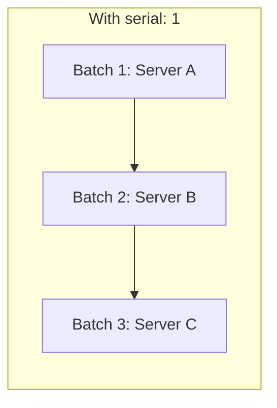

## Introduction

- **What You'll Learn From This Article**: Running a Playbook applies changes to nearly every host in the inventory at almost the same time, by default. For a change involving a service restart, this means **every single host goes down simultaneously, for an instant.** In this hands-on, you'll build a procedure yourself, limiting how many hosts get processed at once with the **`serial` keyword**, and building in removal from and return to the load balancer with **`delegate_to`**, to achieve a zero-downtime rolling update. You'll experience firsthand **why `serial` alone isn't enough, and why you need an explicit drain from the load balancer too.**
- **Intended Audience**: Readers who've finished [the hands-on automating configuration deployment to multiple servers with Ansible](/en/articles/ansible-handson-guide), but can't explain how to safely apply a change involving a service restart to a fleet of production servers.
- **Estimated Reading Time**: About 20 minutes

This article is part of the [Top 1% Series Complete Article Guide](/en/sitemap), and article 11.1 in the [Ansible Series](/en/sitemap#series-list).

## Prerequisite Knowledge

- [The Hands-On Automating Configuration Deployment to Multiple Servers With Ansible](/en/articles/ansible-handson-guide): The premise that a Playbook, by default, applies each task to every target host in parallel (up to the fork limit).
- [Safely Removing a Server From a Load Balancer — Connection Draining](/en/articles/load-balancing-connection-draining-guide): The premise of the DRAIN state mechanism, which stops only new connections while letting existing ones continue until they naturally finish.

## Getting the Big Picture

**By default, a Playbook runs each task against every target host in parallel (simultaneously, up to the fork limit).** For a change with no service interruption, like distributing a config file, this is never a problem. But **for a change involving an application deployment or a service restart, it means nearly every host in the inventory stops its service at almost the same instant.** **The `serial` keyword solves this problem.** `serial` splits a single Playbook run into "batches" of the specified size, forcing sequential execution where one batch must fully complete before the next one begins.



**But `serial` alone still doesn't achieve zero downtime.** `serial` only limits the "count" of hosts being processed — if that host keeps receiving traffic from the load balancer while it's being processed, an in-flight request gets lost the moment the service restarts. **Only by combining `serial`'s count limiting with an explicit removal (drain) from the load balancer** does a practical, zero-downtime rolling update actually come together.

## Let's Try It

### Step 1: Specify the Batch Size With serial

At the top of the Playbook, use the `serial` keyword to specify how many hosts get processed at once.

```yaml
---
- name: Rolling update of the application servers
  hosts: appservers
  serial: 1  # Process one host at a time (a percentage works too: "25%")
  max_fail_percentage: 0  # Abort the remaining batches if even one host fails
  tasks:
    # ...
```

**Strongly recommended: also set `max_fail_percentage`.** This setting aborts execution of the remaining batches if the failure rate within a batch exceeds the specified value. Without it, even if something goes wrong while processing the first host, Ansible won't notice and will keep moving on to the second, third host, and so on — risking **putting every single host into the same broken state.**

### Step 2: Build In Removal From the Load Balancer With delegate_to

Add a task to `pre_tasks` that **removes the currently-processing host from the load balancer.** This task needs to **call an API against the load balancer**, not run on the server currently being processed, so you use `delegate_to`.

```yaml
  pre_tasks:
    - name: Set this host to the DRAIN state via HAProxy's Runtime API
      community.general.haproxy:
        state: drained
        host: "{{ inventory_hostname }}"
        socket: /var/run/haproxy.sock
      delegate_to: haproxy_server  # Run on the load balancer's own host

  tasks:
    - name: Deploy the application and restart the service
      # ...(the actual deploy/restart work goes here)

  post_tasks:
    - name: Wait until the health check passes
      ansible.builtin.wait_for:
        port: 8080
        delay: 5

    - name: Set this host back to READY via HAProxy's Runtime API
      community.general.haproxy:
        state: enabled
        host: "{{ inventory_hostname }}"
        socket: /var/run/haproxy.sock
      delegate_to: haproxy_server
```

**`delegate_to` is an instruction to run that specific task on a different, specified host, instead of the host Ansible is currently looping over (`inventory_hostname`).** Here, the actual operation of "putting one application server into the DRAIN state" needs to call the load balancer's own Runtime API, as covered in [HAProxy's DRAIN state](/en/articles/load-balancing-connection-draining-guide) — so you delegate it to the load balancer's host, instead of the host being processed.

<details>
<summary>How Does This Change for AWS's ALB?</summary>

When targeting an AWS ALB, as covered in [the hands-on for Application Load Balancer (ALB)](/en/articles/aws-alb-handson-guide), you use the AWS CLI or the `amazon.aws.elb_target` module instead of HAProxy's Runtime API, to deregister and re-register the target EC2 instance from the target group. **This still boils down to the same thing: sending a request to the load balancer (AWS's API endpoint)**, so you'd specify `delegate_to: localhost` (the machine actually running Ansible, where the AWS CLI can run). Even when the load balancer implementation changes, the underlying structure — "remove it from the host being processed, and delegate the operation to the load balancer" — stays exactly the same.

</details>

## What a Pro Sees Here (Top 1% Understanding)

### Don't Be Satisfied With Just "Setting serial"

A common real-world mistake is **thinking that setting `serial` alone "implements a rolling update."** `serial` is purely a **control over concurrency — "how many hosts get processed at once"** — an entirely separate axis from **the control over the actual flow of traffic — "whether the host being processed keeps receiving traffic from users."** **A practical, production-usable, zero-downtime rolling update is only complete once you combine both.** This is worth always keeping in mind. The design philosophy you learned in [the Load Balancing Department](/en/articles/load-balancing-connection-draining-guide) — "stop new inflow" and "wait for existing work to complete" — shows up here as a concrete implementation, through Ansible's `pre_tasks`/`post_tasks`.

## Common Misconceptions and Pitfalls

- **Misconception 1: "Setting serial automatically achieves zero downtime."**
  serial only limits how many hosts get processed — without separately building in an explicit removal from the load balancer, an in-flight request can still be lost.
- **Misconception 2: "delegate_to changes which host a Playbook targets."**
  delegate_to runs just a specific task on a different host — it doesn't change the target hosts for the Playbook as a whole.
- **Misconception 3: "serial alone is safe enough, even without max_fail_percentage."**
  Without max_fail_percentage, even if something goes wrong in the very first batch, Ansible won't notice and will keep processing the remaining batches, risking putting every host into the same broken state.

## Troubleshooting Perspective

1. **Error reports come in from users during a rolling update**: Check the logs to confirm the removal from the load balancer in pre_tasks actually succeeded.
2. **The second batch started even though the first batch failed**: Check whether max_fail_percentage is set, and whether the value is appropriate.
3. **A task with delegate_to specified runs on a different host than intended**: Check whether the hostname specified in delegate_to actually resolves correctly within the inventory.

## Summary

- The serial keyword splits a Playbook run into batches of the specified size, forcing sequential execution.
- serial alone can't achieve zero downtime, since the host being processed keeps receiving traffic from the load balancer.
- Using delegate_to to delegate the removal and return requests to the load balancer itself, instead of the host being processed, achieves a practical, zero-downtime rolling update.
- Combining this with max_fail_percentage prevents a problem in an early batch from spreading to the remaining batches.

**Takeaways to Apply Today**
1. Always pair serial with max_fail_percentage, for any Playbook involving a service restart.
2. When updating a server behind a load balancer, always pair serial with an explicit removal and return via pre_tasks/post_tasks.

## References

- [Delegation, rolling updates, and local actions | Ansible Documentation](https://docs.ansible.com/ansible/latest/playbook_guide/playbooks_delegation.html)
- [community.general.haproxy module | Ansible Documentation](https://docs.ansible.com/ansible/latest/collections/community/general/haproxy_module.html)
