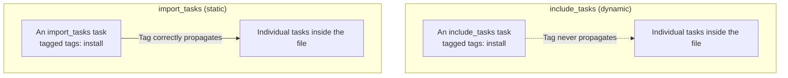

## Introduction

- **What You'll Learn From This Article**: Ansible's `tags` keyword only ever labels a task — whether it actually runs is decided purely by the `--tags`/`--skip-tags` options on the command line. In this article, you'll systematically understand this basic rule, along with a real-world pitfall you run into often: **when you load an external file with `include_tasks`, the tag on that include task never propagates to the individual tasks written inside it.**
- **Intended Audience**: Readers who can write a Playbook or role, but have never used the `--tags` option to selectively run only a subset of tasks.
- **Estimated Reading Time**: About 18 minutes

This article is part of the [Top 1% Series Complete Article Guide](/en/sitemap), and article 11.2 in the [Ansible/IaC Series](/en/sitemap#series-list).

## Prerequisite Knowledge

- [Ansible Roles, Handlers, and Templates](/en/articles/ansible-roles-handson-guide): A basic understanding of role and task file structure.

## Getting the Big Picture

**The `tags` keyword only ever labels a task or play — selecting or excluding which tasks actually run is handled purely by the `--tags`/`--skip-tags` options at execution time.** There's an easily overlooked pitfall here. **When you use `include_tasks` (a dynamic include) to load a group of tasks from another file, the tag you put on that include task itself only applies to the include task, never propagating to the individual tasks written inside the file.** **With `import_tasks` (a static import), by contrast, the tag correctly propagates down to each individual imported task.**

## Deep Dive Into the Fundamentals

### `always` and `never`: Two Special Tags

**Ansible has two tags with special meaning: `always` and `never`.** **A task tagged `always` runs every single time, no matter which tag you specify with `--tags`** (unless you explicitly exclude it with `--skip-tags always`). **A task tagged `never` is always skipped, unless you explicitly request it with something like `--tags never`.** The fact-gathering task carries an internal `always` tag, which is exactly why fact gathering itself never gets skipped by default, no matter what value you specify with `--tags`.

### `include_tasks` vs `import_tasks`: Dynamic or Static Decides How Tags Behave

**`include_tasks` loads a file dynamically, during the Playbook's execution. Because of this "only loaded at execution time" nature, Ansible doesn't automatically propagate the include task's own tag down to the individual tasks inside the file.** **`import_tasks` statically expands the file's content when the Playbook is parsed, before execution. Because of this "expanded ahead of time" nature, the tag correctly propagates all the way down to each individual task.**

There's a Way to Make a Tag Propagate Even With an Include Task

**If you want a tag to propagate to the tasks inside, while still using `include_tasks`, there are two workarounds: using the `apply` keyword, or wrapping the include task itself inside a tagged `block`.** Both are less about "changing how the include mechanism itself behaves" and more about "explicitly re-declaring the range a tag should actually reach."

## What a Pro Sees Here (Top 1% Understanding)

### When "the Tag Isn't Working," Check Include vs Import First

**When you run into the real-world problem "I specified `--tags`, but the task I expected never ran," in most cases the cause is that the target task gets loaded through `include_tasks`.** **Mixing include and import within the same Playbook is a combination Ansible's own documentation warns can lead to hard-to-diagnose bugs.** When you hit a symptom where a tag doesn't seem to work, **checking first whether the target task is loaded dynamically (include) or statically (import)** is the perspective a top-1% engineer carries.

## Common Misconceptions and Pitfalls

- **Misconception 1: "Writing the tags keyword automatically selects or excludes that task."**
  The tags keyword only labels a task — what actually selects or excludes it is the `--tags`/`--skip-tags` option at execution time.
- **Misconception 2: "include_tasks and import_tasks behave the same way regarding tags."**
  A tag on include_tasks only applies to the include task itself and never propagates to individual tasks inside the file, while with import_tasks it correctly propagates.
- **Misconception 3: "Specifying `--skip-tags` lets you skip every task, fact gathering included."**
  Fact gathering carries an internal always tag, so it never gets skipped by default unless you explicitly specify `--skip-tags always`.

## Troubleshooting Perspective

1. **You specified `--tags`, but the task you expected never ran**: Check whether the target task is loaded via include_tasks.
2. **You want to skip only fact gathering**: Consider explicitly specifying `--skip-tags always`, or whether `gather_facts: false` is the better fit.
3. **Include and import are mixed, and tag behavior is unpredictable**: Consider unifying your policy for when to use include versus import within a single Playbook.

## Summary

- The `tags` keyword only labels a task — the actual selecting and excluding is handled by the `--tags`/`--skip-tags` options at execution time.
- A task tagged `always` always runs, and one tagged `never` is always skipped unless explicitly requested.
- A tag on `include_tasks` (dynamic) never propagates to the individual tasks inside, while on `import_tasks` (static) it correctly propagates.
- When you hit a problem where a tag doesn't seem to work, first check whether the target task is loaded via include or import.

**Takeaways to Apply Today**
1. When you feel "the tag isn't working," make it a habit to first check whether the target task is loaded via include or import.
2. When tagging an include task, think through whether propagation is genuinely needed, and use the `apply` keyword if it is.

## References

- [Tags | Ansible Documentation](https://docs.ansible.com/ansible/latest/playbook_guide/playbooks_tags.html)
- [Ansible tags for fast playbook runs | Red Hat](https://www.redhat.com/de/blog/ansible-tags-fast-playbook-runs)
