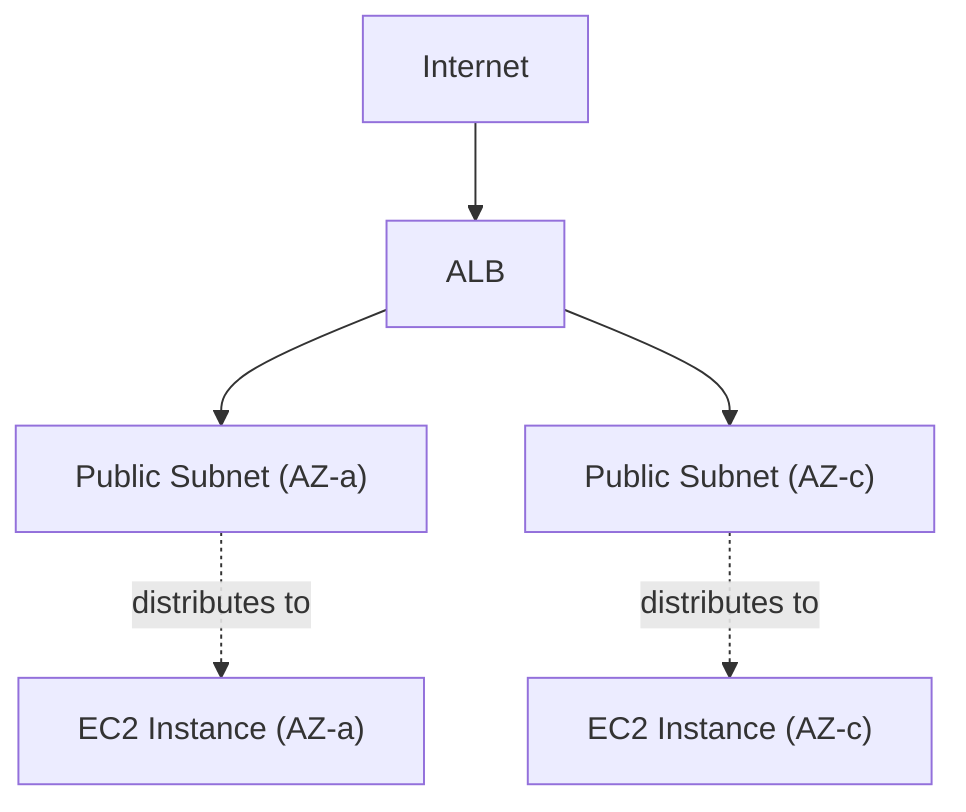

## Introduction

- **What You'll Learn From This Article**: Building on the VPC from [the hands-on building a VPC with public and private subnets](/en/articles/aws-vpc-handson-guide), you'll build a setup yourself where an **Application Load Balancer (ALB)** distributes traffic across multiple EC2 instances placed across multiple Availability Zones (AZs). You'll experience firsthand **why ALB mandates at least two AZs**, and **how to design security groups so the EC2 instances are never directly exposed to the internet.**
- **Intended Audience**: Readers who've finished [the hands-on publishing a web server with EC2](/en/articles/aws-ec2-webserver-handson-guide) and [the VPC hands-on](/en/articles/aws-vpc-handson-guide), but have never built a setup themselves that distributes traffic across multiple EC2 instances.
- **Estimated Reading Time**: About 22 minutes

This article is part of the [Top 1% Series Complete Article Guide](/en/sitemap), and article 5.1 in the [AWS Fundamentals Series](/en/sitemap#series-list).

## Prerequisite Knowledge

- [The Hands-On Building a VPC With Public and Private Subnets](/en/articles/aws-vpc-handson-guide): The premise of understanding the division of roles between a public subnet and a private subnet.
- [The Difference Between Security Groups and Network ACLs (NACL)](/en/articles/aws-nacl-security-group-guide): The premise that a security group is a stateful firewall operating at the instance level.
- [The Difference Between L4 and L7 Load Balancers](/en/articles/load-balancing-fundamentals-guide): Understanding that ALB is an L7 load balancer that distributes traffic by understanding HTTP content will help you go deeper here.

## Getting the Big Picture

**Running a web server on just a single EC2 instance means the service goes down completely the moment that instance fails.** To avoid this, you need a setup that **distributes traffic across multiple EC2 instances, so the remaining instances keep responding even if one goes down.** On AWS, this role belongs to **ALB** (Application Load Balancer). ALB receives requests from the internet and distributes them, based on health check results, across multiple registered EC2 instances (targets). **What matters here is a constraint: by design, ALB requires subnets in at least two different Availability Zones (AZs).** This constraint is at the very core of AWS's high-availability design — it ensures that even if an entire AZ goes down, the service can keep running in another AZ.

## Let's Try It

### Prerequisite: Add Subnets in a Second Availability Zone

The VPC you built in [the VPC hands-on](/en/articles/aws-vpc-handson-guide) only has public and private subnets in a single AZ. **To build an ALB, you need to add one more matching pair of subnets in a different AZ.** Associate the same route table used by your existing public subnet (the one with a route to the IGW) with the new public subnet in the second AZ as well.

Why Does the "At Least Two AZs" Constraint Exist?

If you try to proceed with creating an ALB while selecting only a single subnet, you'll get an error: "**At least two subnets in two different Availability Zones must be specified**." **This is because ALB itself is a distributed resource, built internally by AWS across multiple AZs.** If ALB could be built in just a single AZ, the moment that AZ went down, ALB itself would lose its function too, defeating the entire purpose of high availability. You should understand this constraint not as an arbitrary ALB implementation detail, but as **a deliberate AWS mechanism that enforces high availability at the design level.**

### Step 1: Launch One EC2 Instance in Each of the Two AZs

Following the same procedure as [the hands-on publishing a web server with EC2](/en/articles/aws-ec2-webserver-handson-guide), launch a simple web server returning an HTTP response, **one in each AZ's private subnet**, for a total of two instances. Including something like the instance ID in each response makes it easier to tell which instance responded, later on.

### Step 2: Design Security Groups as a Two-Layer Setup

This is the core of this hands-on. **When creating the security group for the EC2 instances, restrict the inbound rule's allowed source to the ALB's own security group, instead of `0.0.0.0/0` (anywhere).**

| Security Group | Inbound Rule |
|---|---|
| ALB's SG | Allows port 80 from `0.0.0.0/0` (the entire internet) |
| EC2's SG | Allows port 80 **only from the ALB's SG** |

**This two-layer setup means the EC2 instances never accept any direct access from the internet that bypasses the ALB, in the first place.** Combined with placing the EC2 instances in private subnets, this forms a double layer of defense.

### Step 3: Create a Target Group and an ALB

Register the two EC2 instances to a single target group, and configure the health check path. Then, create an ALB spanning the public subnets in the two AZs, and specify this target group as the forwarding destination for the listener (port 80).

### Step 4: Confirm the Distribution

Access the ALB's DNS name in your browser, and **reload a few times to confirm the responding instance ID alternates (or switches randomly) between the two instances.** Next, stop one instance, and once the target group's health check flips to `unhealthy`, **confirm that only the remaining instance keeps responding, with no errors occurring at all.**

## What a Pro Sees Here (Top 1% Understanding)

### ALB's "Deregistration Delay" Is the Universal Load-Balancing Concept Itself

The target group's advanced settings have an item called "**Deregistration Delay**." This is a setting that, when deregistering a target from a target group, **lets it keep responding to its existing connections for the configured number of seconds.** This is exactly [the connection draining (DRAIN) mechanism](/en/articles/load-balancing-connection-draining-guide) — **the widely shared design philosophy across the load-balancing world, "stop new inflow, but watch existing work through to completion," appearing under this specific name, inside AWS's ALB implementation.** When swapping out instances for a deployment, setting this deregistration delay longer than your application's maximum response time is the standard practice in real-world work.

## Common Misconceptions and Pitfalls

- **Misconception 1: "It's fine to allow the EC2 instance's security group from `0.0.0.0/0` too, just like the ALB's."**
  In a setup that routes through an ALB, the EC2 instances themselves should only allow traffic from the ALB's security group. Allowing `0.0.0.0/0` permits direct access that bypasses the ALB entirely.
- **Misconception 2: "ALB can be built in just a single AZ."**
  To guarantee high availability at the design level, ALB mandates subnets in at least two different AZs.
- **Misconception 3: "Deregistration delay is a feature unique to ALB, with no equivalent elsewhere."**
  Deregistration delay holds exactly the same design philosophy as "connection draining" in other load balancer implementations — it's simply AWS's concrete implementation name for it.

## Troubleshooting Perspective

1. **Creating the ALB gives the error "At least two subnets in two different Availability Zones must be specified"**: Check whether the subnets you selected actually belong to two different AZs.
2. **The target group's health check stays `unhealthy` indefinitely**: Check whether the EC2 security group allows health-check traffic from the ALB's security group.
3. **The ALB's DNS name is reachable, but errors return at specific moments**: If this is during a deployment, check whether the deregistration delay setting is shorter than the application's actual processing time.

## Summary

- ALB distributes traffic across multiple EC2 instances, so a single instance's failure never directly means the entire service goes down.
- ALB mandates subnets in at least two different AZs, guaranteeing high availability at the design level.
- The EC2 instances' security group should only allow traffic from the ALB's security group, blocking direct internet access.
- ALB's "deregistration delay" is AWS's concrete implementation of connection draining — a design philosophy widely shared across the load-balancing world.

**Takeaways to Apply Today**
1. Always restrict the security group on EC2 instances behind an ALB to traffic from the ALB's own security group only.
2. When swapping out instances for a deployment, always set the deregistration delay longer than your application's maximum response time.

## References

- [What is an Application Load Balancer? | AWS Documentation](https://docs.aws.amazon.com/elasticloadbalancing/latest/application/introduction.html)
- [Availability Zones for your Application Load Balancer | AWS Documentation](https://docs.aws.amazon.com/elasticloadbalancing/latest/application/application-load-balancers.html#availability-zones)
