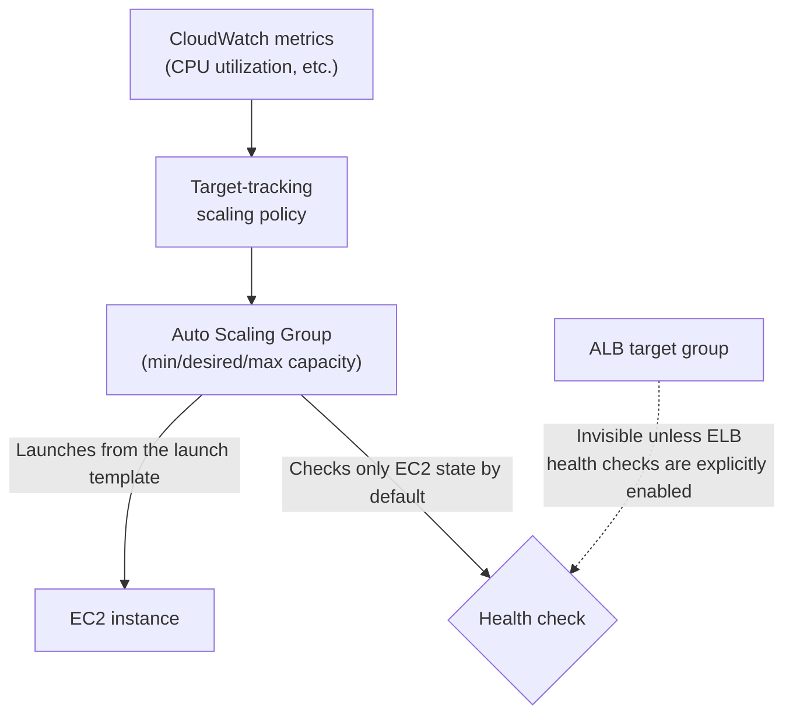

## Introduction

- **What You'll Learn From This Article**: [The Application Load Balancer (ALB) hands-on](/en/articles/aws-alb-handson-guide) distributed traffic across several EC2 instances you'd already launched ahead of time. In this hands-on, you'll use an **Auto Scaling Group (ASG)** to experience **automatically scaling the number of instances itself up and down based on load.** You'll also confirm a blind spot you run into often in real-world practice: the ASG's default health check **never looks at the ALB's health check result at all.**
- **Intended Audience**: Readers who've already experienced distributing traffic via ALB, and want to know how to automatically scale the number of instances itself up and down.
- **Estimated Reading Time**: About 24 minutes (hands-on)

This article is part of the [Top 1% Series Complete Article Guide](/en/sitemap), and article 5.3 in the [AWS Series](/en/sitemap#series-list).

## Prerequisite Knowledge

- [The Application Load Balancer (ALB) Hands-On](/en/articles/aws-alb-handson-guide): Understanding the premise mechanism of registering an EC2 instance to a target group.

## Getting the Big Picture

**An ASG specifies a "launch template" (the blueprint for what kind of EC2 instance to launch) and a "minimum, desired, and maximum capacity" (how many instances to keep running), and automatically maintains and scales that count.** Set up a "target-tracking scaling policy" based on a metric like CPU utilization, and the count automatically goes up when load rises and down when it falls. **Here's an important caveat. The ASG's default health check only ever looks at whether the EC2 instance itself is running — by default, it never looks at the ALB target group's health check result at all.**

## Hands-On: Build an ASG and Confirm Its Integration With ALB Health Checks

### Step 1: Create a Launch Template

Save the exact same configuration you used in [the ALB hands-on](/en/articles/aws-alb-handson-guide) (AMI, instance type, security group) as a launch template. **A launch template can't be edited directly after creation — any change requires creating a new version** — an immutable design.

### Step 2: Create the ASG, Setting a Minimum, Desired, and Maximum Capacity

Set it to, say, a minimum of 1, a desired of 2, and a maximum of 4, and associate this ASG with the ALB's target group.

### Step 3: Set Up a Target-Tracking Scaling Policy

Specify a target CPU utilization value (e.g., 50%), setting up a target-tracking scaling policy that scales out when actual usage exceeds this and scales in when it falls below.

### Step 4: Deliberately Apply Load and Confirm Scale-Out

Run a command on an EC2 instance that artificially raises CPU utilization, and confirm the CloudWatch metric climbing, followed shortly by the ASG automatically launching a new instance.

The ASG's Default Health Check Only Ever Looks at EC2 State

**The ASG's default health check type is "EC2," which only checks whether the instance is running correctly from AWS's own perspective.** **Even if the application itself has crashed and the ALB's health check keeps failing, the EC2 instance itself is still running fine — so under the ASG's default setting, this instance is judged "healthy" and never gets replaced.** Fixing this requires **explicitly changing the ASG's health check type to "ELB,"** folding the ALB target group's health check result into the judgment too.

### Step 5: Switch the Health Check Type to ELB and Confirm the Grace Period

Switching the health check type to ELB applies a "health check grace period" (300 seconds by default) — the span between when a new instance launches and when it actually becomes subject to health check judgment. This is a buffer that prevents a temporary unhealthy state right after launch, when the application is still slow to start, from being mistakenly judged as a failure.

## What a Pro Sees Here (Top 1% Understanding)

### A Lifecycle Hook Is the ASG's Own Version of "Connection Draining"

**[Connection draining, covered in the Load Balancing Department](/en/articles/load-balancing-connection-draining-guide), was a mechanism for safely removing a server. An ASG has a mechanism serving exactly the same purpose: a "lifecycle hook," letting you insert custom processing (such as waiting for in-flight work to finish) before an instance terminates.** If an instance gets terminated abruptly, a request in progress can get lost — a lifecycle hook lets you insert a "wait" state before termination, so you can run a safe shutdown process. **The same challenge — "safely remove it" — keeps reappearing, in a different shape, at a different department and a different layer of abstraction** — a perspective that keeps confirming itself across this whole series.

## Common Misconceptions and Pitfalls

- **Misconception 1: "Setting up an ASG means it automatically detects application-level problems and replaces the instance."**
  The default health check type is EC2, so an application-layer problem (an ALB health check failure) goes undetected unless you explicitly switch to the ELB health check type.
- **Misconception 2: "A launch template can always be edited directly, anytime."**
  A launch template can't be edited directly after creation — any change requires creating a new version.
- **Misconception 3: "Terminating an instance should always happen immediately."**
  A lifecycle hook lets you insert a safe process (such as waiting for in-flight requests to finish) before termination.

## Troubleshooting Perspective

1. **An application is unhealthy, but the ASG never replaces the instance**: Check whether the health check type is still left at EC2.
2. **A new instance keeps getting judged unhealthy and replaced right after launch**: Check whether the health check grace period is too short relative to the application's actual startup time.
3. **An in-flight request gets lost when an instance terminates**: Consider setting up a lifecycle hook to insert a safe process before termination.

## Summary

- An ASG specifies a launch template and a minimum, desired, and maximum capacity, automatically maintaining and scaling the instance count.
- A target-tracking scaling policy automatically adjusts that count based on a metric like CPU utilization.
- The ASG's default health check type is EC2 — the ALB's health check result goes unseen unless you explicitly switch to the ELB health check type.
- A lifecycle hook is a mechanism for inserting a safe process before an instance terminates.

**Takeaways to Apply Today**
1. When combining an ASG with an ALB, always check that the health check type is switched to ELB.
2. Set the health check grace period appropriately, based on how long the application actually takes to start up.

## References

- [Amazon EC2 Auto Scaling | AWS Documentation](https://docs.aws.amazon.com/autoscaling/ec2/userguide/what-is-amazon-ec2-auto-scaling.html)
- [Auto Scaling Groups | dev.to](https://dev.to/aws-builders/auto-scaling-groups-4690)
