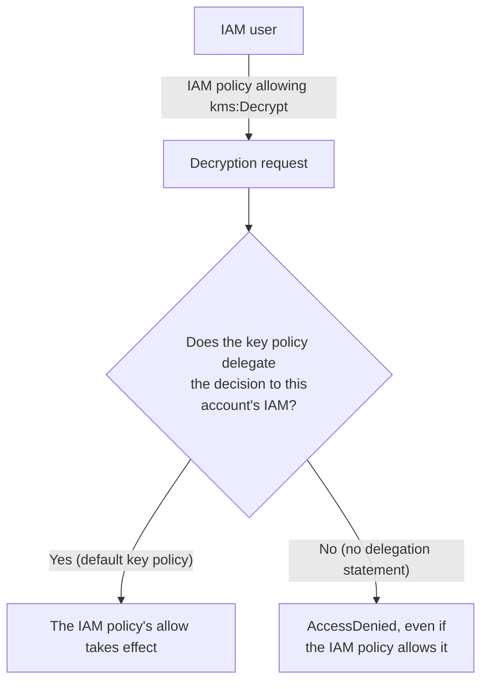

## Introduction

- **What You'll Learn From This Article**: [How IAM Policy Evaluation Logic Works](/en/articles/aws-iam-policy-evaluation-guide) covered how allow and deny get decided when multiple IAM policies exist. In this article, you'll systematically understand **AWS KMS (Key Management Service)**'s **key policy** — another absolute gate entirely, separate from an IAM policy.
- **Intended Audience**: Readers who understand IAM policy evaluation logic, but can't explain why "my IAM policy allows kms:Decrypt, so why do I still get AccessDenied."
- **Estimated Reading Time**: About 18 minutes

This article is part of the [Top 1% Series Complete Article Guide](/en/sitemap), and article 14.1 in the [AWS Series](/en/sitemap#series-list).

## Prerequisite Knowledge

- [How IAM Policy Evaluation Logic Works](/en/articles/aws-iam-policy-evaluation-guide): Understanding the basic evaluation rules for allow and deny when multiple policies exist.

## Getting the Big Picture

**With most AWS services, an action gets executed as long as an IAM policy allows it. But a KMS customer managed key carries another absolute gate entirely — a "key policy" tied to that specific key itself.** **No matter how explicitly an IAM policy allows `kms:Decrypt`, decryption is completely impossible unless the key policy itself also allows that action (or declares a delegation of the decision to IAM).**

## Deep Dive Into the Fundamentals

### The Default Key Policy Includes "Delegation to the Root Account"

**When you create a new customer managed key, its default key policy automatically includes a statement granting full access to that AWS account's root account (`arn:aws:iam::<account-id>:root`).** **It's exactly this one statement that lets an IAM policy within that same account effectively handle the allow/deny decision for this key at all.** **If this delegation statement to the root account ever gets removed from the key policy, no matter how much access the IAM policy grants, it never has any effect at all.**

### Envelope Encryption: What KMS Directly Encrypts Is Only a Small "Data Key"

**KMS never directly encrypts an entire S3 object or an RDS database itself. In reality, it only generates and protects a "data key" — a small symmetric key.** **The actual data body gets encrypted locally, using that data key, by each AWS service (or the client side), and the encrypted data key itself gets stored alongside the encrypted data.** **To decrypt the data, you need permission (`kms:Decrypt`) to send the encrypted data key to KMS and have it decrypted.**

KMS Grants: Dynamically Delegating Permission Without Editing the JSON Key Policy

**KMS Grants are a separate mechanism for dynamic, fine-grained permission delegation, without ever editing the JSON-format key policy itself.** **Internal AWS services like EBS use this Grants mechanism internally, to obtain the encryption/decryption permission they need, without a user ever having to edit the key policy directly.**

## What a Pro Sees Here (Top 1% Understanding)

### The Assumption "the IAM Policy Is the Final Decision-Maker" Doesn't Hold for KMS

**Experience with most other AWS services tends to leave you with the premise "if the IAM policy allows it, the action executes" — but a KMS customer managed key has another independent layer (the key policy) where this premise simply doesn't hold.** **The habit of digging one layer deeper, per service, to check "does this particular service's permission decision really complete with the IAM policy alone"** is the perspective a top-1% engineer brings to handling an unexplained AccessDenied, despite an IAM policy allowing it.

## Common Misconceptions and Pitfalls

- **Misconception 1: "If the IAM policy allows kms:Decrypt, decryption always works."**
  Decryption never works with the IAM policy's allow alone, unless the key policy itself also allows that action (or declares delegation to IAM).
- **Misconception 2: "KMS directly encrypts the entire data."**
  All KMS directly encrypts and protects is a small data key — the data body itself gets encrypted locally, elsewhere, using that data key.
- **Misconception 3: "Changing a key policy always requires directly editing JSON."**
  Using KMS Grants makes dynamic permission delegation possible, without ever editing the JSON-format key policy.

## Troubleshooting Perspective

1. **An IAM policy allows kms:Decrypt, but you still get AccessDenied**: Check whether that key's key policy includes delegation to the root account, or directly allows the relevant principal.
2. **You can't decrypt encrypted data**: Check whether you have `kms:Decrypt` permission on the specific data key itself (access permission on the data alone is never enough).
3. **Changing the key policy frequently is making operations cumbersome**: Consider switching to dynamic permission delegation via KMS Grants.

## Summary

- A KMS customer managed key carries an absolute gate — the key policy — entirely separate from an IAM policy.
- The default key policy includes delegation to the root account, which is what lets an IAM policy effectively handle the decision.
- KMS only protects a small symmetric key, the data key — the data body itself gets encrypted locally using that data key (envelope encryption).
- Using KMS Grants makes dynamic permission delegation possible, without editing the JSON key policy.

**Takeaways to Apply Today**
1. When you hit a KMS-related AccessDenied, always check the key policy, not just the IAM policy.
2. When adopting a new AWS service, dig one layer deeper and check whether its permission decision really completes with an IAM policy alone.

## References

- [IAM Policy Examples - AWS Key Management Service | AWS Documentation](https://docs.aws.amazon.com/kms/latest/developerguide/customer-managed-policies.html)
- [Unlocking AWS KMS: The Security Professional's Guide to Encryption | DEV Community](https://dev.to/arandomguy/unlocking-aws-kms-the-security-professionals-guide-to-encryption-37np)
