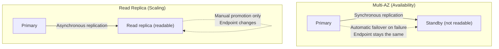

## Introduction

- **What You'll Learn From This Article**: Beyond RDS and Secrets Manager: Letting Your App Hold Zero Hardcoded Passwords, covered in [this hands-on](/en/articles/aws-rds-secrets-handson-guide), you'll systematically understand RDS's two mechanisms for having "another DB instance" — **Multi-AZ** and **read replicas**.
- **Intended Audience**: Readers who know RDS can have "another backup" or "a copy," but can't explain the difference between Multi-AZ and a read replica.
- **Estimated Reading Time**: About 17 minutes

This article is part of the [Top 1% Series Complete Article Guide](/en/sitemap), and article 6.1 in the [AWS Fundamentals Series](/en/sitemap#series-list).

## Prerequisite Knowledge

- [RDS and Secrets Manager: Letting Your App Hold Zero Hardcoded Passwords](/en/articles/aws-rds-secrets-handson-guide): Understanding the concept of an RDS instance and its endpoint is a prerequisite.

## Getting the Big Picture

**Multi-AZ is a mechanism for availability (failover), maintaining a standby in a different Availability Zone via synchronous replication.** **A read replica is a mechanism for read scaling, creating a copy via asynchronous replication that can be used directly as a read-only query target.** **Both share the surface-level trait of creating "another DB instance," but their purpose, replication method, and failover behavior are all entirely different.**

## Deep Dive Into the Fundamentals

### Multi-AZ: the Standby Is Not Readable by Default

**The official AWS documentation explicitly states that the standby in a Multi-AZ DB instance deployment cannot serve read traffic, and recommends using a Multi-AZ DB cluster deployment or a read replica when read scaling is needed.** **Writes to the primary are synchronously replicated to the standby, so on failure, RDS can fail over automatically without any data loss, and because the endpoint itself never changes, the application never needs to be aware of a connection target change at all.**

Note: a newer Multi-AZ DB cluster deployment with readable standbys

**For MySQL and PostgreSQL, AWS also offers a Multi-AZ DB cluster deployment option with one primary and two readable standby instances — but this is a separate deployment type from the traditional single-standby configuration.**

### Read Replicas: Asynchronous Replication and Manual Failover

**Because a read replica uses asynchronous replication, replication lag can occur, meaning writes to the primary take time to be reflected on the read replica.** **And if the primary fails, a read replica never fails over automatically — you must manually promote the read replica and rewrite the application's connection endpoint, and forgetting this manual promotion step or misconfiguring it becomes a typical cause of real-world incidents.**

## What a Pro Sees Here (Top 1% Understanding)

### "There's Another One" and "What It's For" Are Separate Axes

**Multi-AZ and read replicas get confused because of the superficial common trait that "there's another DB instance," but Multi-AZ exists for automatic failover for availability, while read replicas exist for manual promotion for read scaling — entirely different purposes.** **Never settle for "this DB has redundancy" alone — always separately check "is this for availability or for scaling" and "is failover automatic or manual."** This is the perspective a top-1% engineer carries. And don't forget: in real-world practice, Multi-AZ and read replicas aren't competing options — they're often combined.

## Common Misconceptions and Pitfalls

- **Misconception 1: "Since it's Multi-AZ, I can distribute read load across multiple instances."**
  A traditional Multi-AZ DB instance deployment's standby cannot serve read traffic at all. Read scaling requires a read replica or a Multi-AZ DB cluster deployment.
- **Misconception 2: "As long as I have a read replica, I'm automatically safe if the primary goes down."**
  A read replica's failover is manual. If automatic failover on primary failure is required, you need Multi-AZ.
- **Misconception 3: "Multi-AZ and read replicas are mutually exclusive — you can only use one."**
  These aren't competing options; when both availability and read scaling are needed, combining them is the common practice.

## Troubleshooting Perspective

1. **Trying to distribute read load, but performance doesn't improve**: Check whether reads are being directed at a Multi-AZ standby, and create a separate read replica instead.
2. **The application stays stuck in a connection error after a primary failure and never recovers**: If only a read replica is configured, confirm that manual promotion and an endpoint rewrite are required.
3. **A replica's query results don't match the primary's latest writes**: Design with the assumption that a read replica's asynchronous replication can cause temporary inconsistency due to replication lag.

## Summary

- Multi-AZ is synchronous replication for availability; the standby isn't readable by default, and failover is automatic on failure.
- A read replica is asynchronous replication for read scaling; failover requires manual promotion.
- Checking "there's another one" separately from "what it's for" is an important perspective.
- In real-world practice, combining both is common.

**Takeaways to Apply Today**
1. When you see a redundant RDS configuration, always check whether it's Multi-AZ or a read replica, and whether failover is automatic or manual.
2. If the goal is read scaling, set up a separate read replica rather than relying on a Multi-AZ standby.

## References

- [Configuring and managing a Multi-AZ deployment for Amazon RDS | AWS Documentation](https://docs.aws.amazon.com/AmazonRDS/latest/UserGuide/Concepts.MultiAZ.html)
- [Multi-AZ DB instance deployments for Amazon RDS | AWS Documentation](https://docs.aws.amazon.com/AmazonRDS/latest/UserGuide/Concepts.MultiAZSingleStandby.html)
