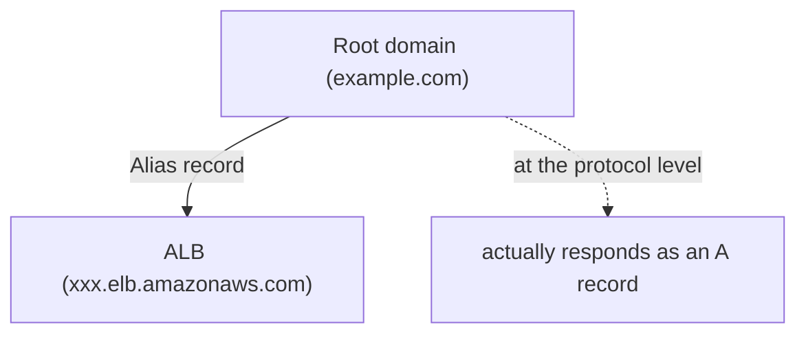

## Introduction

- **What You'll Learn From This Article**: After building an ALB in [the Application Load Balancer (ALB) hands-on](/en/articles/aws-alb-handson-guide), a real-world requirement always comes up: **assigning the root domain (`example.com` itself) to that ALB.** But as covered in [Why Can't You Put a CNAME at a Root Domain?](/en/articles/dns-cname-apex-guide), under the DNS specification, you can never put a CNAME at a zone apex. This article systematically covers how **a Route 53 Alias record** works around this constraint by actually responding as an A record at the protocol level, and **the decisive difference from a CNAME.**
- **Intended Audience**: Readers who've built an ALB or CloudFront distribution, but can't explain what Route 53's "Alias" option actually differs in from a regular CNAME.
- **Estimated Reading Time**: About 16 minutes

This article is part of the [Top 1% Series Complete Article Guide](/en/sitemap), and article 5.2 in the [AWS Fundamentals Series](/en/sitemap#series-list).

## Prerequisite Knowledge

- [The Application Load Balancer (ALB) Hands-On](/en/articles/aws-alb-handson-guide): The premise that an ALB doesn't have a fixed DNS name.
- [Why Can't You Put a CNAME at a Root Domain?](/en/articles/dns-cname-apex-guide): The premise of the DNS specification's constraint — a CNAME can't coexist with other records, colliding with the zone apex's mandatory SOA/NS requirement.

## Getting the Big Picture

**An ALB, when created, doesn't carry a fixed IP address — it's provided with a DNS name that can change, something like `xxx.elb.amazonaws.com`.** If you want to assign the root domain to this ALB, you'd normally reach for a CNAME record, but you run straight into **the structural DNS constraint that [you can't place a CNAME at a zone apex](/en/articles/dns-cname-apex-guide).** Route 53 offers **the Alias record**, a Route 53-specific mechanism, to address this problem. **At the DNS protocol level, an Alias record actually responds as an A record, so placing it at the zone apex never conflicts with the coexistence constraint against SOA/NS records.**

## Deep Dive Into the Fundamentals

### The Range of AWS Resources an Alias Record Supports

**What an Alias record can point at is limited to resources AWS explicitly supports.** Typical targets include **load balancers (ALB, NLB, CLB), CloudFront distributions, S3 static website endpoints, API Gateway, and VPC interface endpoints.** All of these are resources with a mechanism integrated into AWS's own infrastructure, letting [Route 53 resolve their IP address directly](/en/articles/dns-cname-apex-guide). **If you want to point at an arbitrary domain outside AWS, you need a regular CNAME record instead of an Alias record** (though that still can't sit at a zone apex).

### Why an Alias Record Needs One Fewer Round Trip Than a Regular CNAME

**With a regular CNAME record, a client's name resolution happens in two stages.** First, it queries `example.com`'s CNAME record, gets back a target name (`xxx.elb.amazonaws.com`), and then needs a separate query to forward-look that up, finally getting the actual IP address — two queries in total. **With an Alias record, by contrast, Route 53 itself already internally knows the target's (an ALB's, say) IP address, so it can return the IP address directly, right on the client's very first query.** As a result, **an Alias record needs one fewer round trip for name resolution than a regular CNAME**, which makes resolution slightly faster, especially in environments where latency to the DNS resolver is high.

Queries to an Alias Record Aren't Charged

**Queries to an Alias record targeting an AWS resource are exempt from Route 53's query billing (free).** By contrast, **queries to regular records (A records, CNAME records, and so on) incur charges based on query count** (roughly $0.40 per million queries, for the first billion queries per month). For a website receiving heavy traffic, this difference becomes a non-negligible factor from an operational cost perspective too.

## What a Pro Sees Here (Top 1% Understanding)

### "Alias Is a Kind of CNAME" Is Wrong — It's a Route 53-Specific Mechanism Outside the Protocol

**Recall ALIAS/ANAME, the provider-specific mechanism covered in [the article on DNS's zone apex](/en/articles/dns-cname-apex-guide), which doesn't exist in the standard DNS protocol at all.** Route 53's Alias record is **exactly AWS's concrete implementation of this very ALIAS/ANAME concept.** **The name "Alias" easily leads to the misconception that it's just another name for CNAME, or a superset of it — but in reality, it's a Route 53-provided abstraction that doesn't exist at the DNS protocol level at all.** With this understanding, you can quickly get to the heart of it when you notice the same concept offered under a different name by another cloud provider (GCP's "CNAME flattening," Cloudflare's "CNAME flattening," and so on).

## Common Misconceptions and Pitfalls

- **Misconception 1: "An Alias record is just another name for a CNAME, and either one gives the same result."**
  An Alias record is a Route 53-specific mechanism that actually responds as an A record at the protocol level — it differs from a CNAME on multiple points, including whether it can sit at the zone apex, whether it's billed, and how many round trips name resolution needs.
- **Misconception 2: "An Alias record can point at any domain whatsoever."**
  What an Alias record can point at is limited to resources AWS explicitly supports (ALB, CloudFront, and so on) — pointing at an arbitrary domain outside AWS requires a regular CNAME.
- **Misconception 3: "There's no way to assign an ALB to the root domain."**
  The standard DNS constraint (you can't place a CNAME at the zone apex) can be concretely worked around using a Route 53 Alias record.

## Troubleshooting Perspective

1. **You want to assign the root domain to an ALB, but saving with a regular CNAME setting fails**: In Route 53's record creation screen, enable the "Alias" toggle, and select the ALB as the target.
2. **The resource you want to target with an Alias record doesn't show up as an option**: Check whether that resource is included among Alias record's supported targets (ALB, CloudFront, S3 static website, and so on).
3. **You want to assign the root domain to an AWS resource the same way, using a DNS provider other than Route 53**: Check that provider's own ALIAS/ANAME-equivalent feature (the name differs by provider).

## Summary

- A Route 53 Alias record actually responds as an A record at the protocol level, so placing it at the zone apex never conflicts with a constraint like CNAME's.
- What an Alias record can point at is limited to resources AWS explicitly supports, like ALB, CloudFront, and S3 static websites.
- An Alias record needs one fewer round trip for name resolution than a regular CNAME, and queries are free when targeting an AWS resource.
- An Alias record doesn't exist in the standard DNS protocol — it's a Route 53-specific mechanism, the concrete AWS implementation of the ALIAS/ANAME concept.

**Takeaways to Apply Today**
1. When assigning the root domain to an AWS resource, use a Route 53 Alias record, not a CNAME.
2. When you work with a different cloud provider, make it a habit to check "what's the equivalent of a Route 53 Alias record in this service?"

## References

- [Choosing between alias and non-alias records | AWS Documentation](https://docs.aws.amazon.com/Route53/latest/DeveloperGuide/CreatingAliasRRSets.html)
- [Amazon Route 53 FAQs | AWS](https://aws.amazon.com/route53/faqs/)
