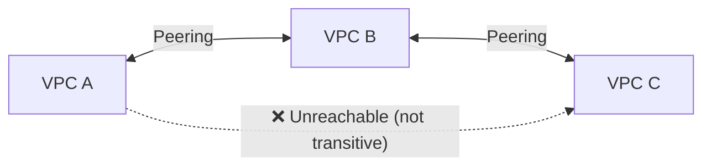

## Introduction

- **What You'll Learn From This Article**: Beyond subnet design within a single VPC, covered in the [VPC Hands-On](/en/articles/aws-vpc-handson-guide), you'll systematically understand **VPC peering — the mechanism for connecting multiple VPCs together — and Transit Gateway, which resolves its limits**.
- **Intended Audience**: Readers who understand single-VPC design, but can't judge whether VPC peering or Transit Gateway is the right choice when connecting multiple VPCs.
- **Estimated Reading Time**: About 18 minutes

This article is part of the [Top 1% Series Complete Article Guide](/en/sitemap), and article 5.4 in the [AWS Series](/en/sitemap#series-list).

## Prerequisite Knowledge

- [VPC Hands-On](/en/articles/aws-vpc-handson-guide): Understanding subnet design within a single VPC is a prerequisite.

## Getting the Big Picture

**VPC peering is a mechanism that creates a direct, one-to-one connection between two VPCs.** **But this connection carries an easily overlooked constraint: it isn't transitive. If VPC A peers with VPC B, and B also peers with VPC C, A still can't reach C through B at all.** **To communicate between A and C, you need a separate, direct peering connection created specifically between A and C.**

## Deep Dive Into the Fundamentals

### Connection Count Explodes as the Number of VPCs Grows

**Making N VPCs all directly reachable from each other (a full mesh) requires N × (N-1) / 2 peering connections.** **For example, connecting 52 VPCs in a full mesh needs 1,326 peering connections, plus at least 2,652 entries across each VPC's own route table** — a scale that genuinely becomes unmanageable in real-world operations.

### Transit Gateway: a Hub-and-Spoke Design That Achieves Transitive Connectivity

**Transit Gateway is a hub-and-spoke design where each VPC creates just one attachment to a central hub gateway, and Transit Gateway's own route tables decide which attachments can communicate with each other.** **Connectivity through Transit Gateway is transitive, and adding a new VPC never requires creating an individual peering connection with every existing VPC — just one new attachment to the Transit Gateway is enough.**

Inserting a Security Appliance Is Possible Only Because of the Hub Design

**Under VPC peering, traffic flows directly between peers, so there's simply no place at all to insert a security appliance, like a firewall or Gateway Load Balancer, into the path.** **With a hub design like Transit Gateway, you can place a security appliance in a hub inspection VPC, and route every inter-segment communication through it, mandatorily.**

## What a Pro Sees Here (Top 1% Understanding)

### "Being Connected" and "Being Transitively Connected" Are Two Separate Understandings

**Right after setting up VPC peering, it's tempting to think "the whole network is now connected" — but in reality, connectivity never extends past your direct peer, to whatever lies beyond it.** **The habit of digging one layer deeper, when looking at a network diagram, to check "is this connection genuinely transitive, or just a chain of one-to-one links"** is the perspective a top-1% engineer carries.

## Common Misconceptions and Pitfalls

- **Misconception 1: "If VPC A peers with VPC B, and B peers with VPC C, A can also reach C."**
  VPC peering isn't transitive, so communicating between A and C requires a separate, direct peering connection.
- **Misconception 2: "Managing peering connections doesn't get much more complex as the number of VPCs grows."**
  Connecting N VPCs in a full mesh requires N × (N-1) / 2 peering connections, so management complexity grows sharply as the VPC count increases.
- **Misconception 3: "VPC peering can insert a security appliance into the traffic path, just like Transit Gateway."**
  Under VPC peering, traffic flows directly between peers, so there's no place to insert a security appliance at all.

## Troubleshooting Perspective

1. **VPC A can't communicate with VPC C (A peers with B, and B peers with C)**: Confirm that VPC peering isn't transitive, and consider whether a direct peering connection is needed between A and C.
2. **Managing peering connections and route tables is becoming unwieldy as VPCs multiply**: Consider migrating to Transit Gateway.
3. **You want to inspect and control traffic between multiple VPCs at a single point**: Consider Transit Gateway's hub design, placing a security appliance in an inspection VPC.

## Summary

- VPC peering creates a direct, one-to-one connection between two VPCs, but this connection isn't transitive.
- Connecting N VPCs in a full mesh requires N × (N-1) / 2 peering connections, with management growing more complex as the VPC count increases.
- Transit Gateway's hub-and-spoke design achieves transitive connectivity, and adding a new VPC requires just one attachment.
- Inserting a security appliance into the traffic path is possible only with a hub design like Transit Gateway.

**Takeaways to Apply Today**
1. When connecting multiple VPCs, consider whether peering or Transit Gateway is more appropriate, accounting for the possibility that the VPC count grows later.
2. When looking at a network diagram, always check whether a connection is genuinely transitive.

## References

- [VPC Peering or Transit Gateway | Barking Iguana](https://barkingiguana.com/writing/vpc-peering-or-transit-gateway/)
