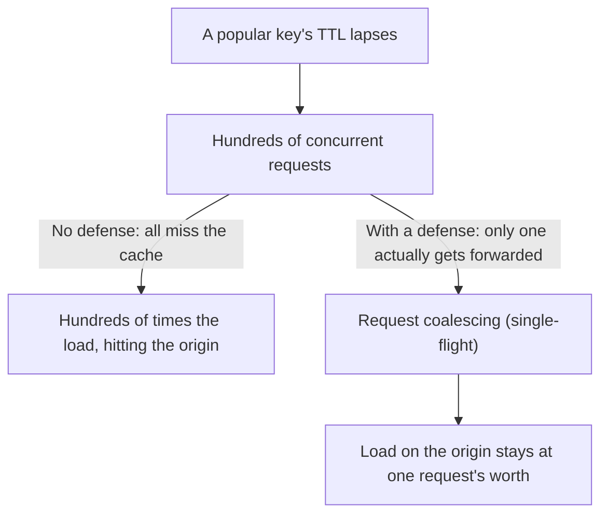

## Introduction

- **What You'll Learn From This Article**: [How Cache-Control and the Vary Header Work](/en/articles/cache-control-vary-guide) was a mechanism deciding how long a cache entry gets stored. In this article, you'll systematically understand **cache stampede** — a phenomenon that strikes the instant a popular cache entry's expiration lapses — and three countermeasures that prevent it.
- **Intended Audience**: Readers who understand setting a cache's storage duration via Cache-Control, but can't explain why "a cache simply expiring" — completely normal behavior — turns into an incident at the origin server.
- **Estimated Reading Time**: About 18 minutes

This article is part of the [Top 1% Series Complete Article Guide](/en/sitemap), and article 6.1 in the [Web Proxy / Caching Fundamentals Series](/en/sitemap#series-list).

## Prerequisite Knowledge

- [How Cache-Control and the Vary Header Work](/en/articles/cache-control-vary-guide): Understanding the basic mechanism of a cache's storage duration (TTL).

## Getting the Big Picture

**The instant a popular cache entry's expiration (TTL) lapses, every single one of the concurrent requests for that same key misses the cache all at once.** **If all of these requests get forwarded to the origin server at the same time, with no cache in place, the load on the origin — which would normally be handled by just a single request — can spike hundreds or thousands of times in an instant, potentially taking the origin server itself down.** This is **cache stampede** (the caching-specific manifestation of the thundering herd problem, also called the dogpile effect). **A cache simply expiring, completely normal behavior, unintentionally turns into a self-inflicted DDoS attack against the origin server.**

## Deep Dive Into the Fundamentals

### Request Coalescing (Single-Flight): Letting Only One Through

**When multiple concurrent requests arrive for the same key, the proxy forwards only the very first one to the origin server, and makes all the remaining requests wait until that result comes back.** Once the result arrives, it distributes that same result to every waiting request. **With this mechanism, no matter how many hundreds of concurrent requests arrive for one single key, the load forwarded to the origin server always stays capped at just one.**

### Stale-While-Revalidate: Returning the Old Data Instantly, While Refreshing It Behind the Scenes

**`stale-while-revalidate` is an extension to the Cache-Control directive — for a set period right after the TTL lapses, it immediately returns the old (stale) data to the client as-is, while sending just one single revalidation request to the origin server behind the scenes.** **With this approach, most of the simultaneously arriving requests never trigger a synchronous query to the origin server at all.** The client receives slightly stale data in exchange, but never experiences any drop in response speed whatsoever.

TTL Jitter: Preventing Expiration From Lining Up All at Once

**If multiple cache entries' TTLs are all set to the exact same value, they can all expire at once together, triggering multiple cache stampedes simultaneously.** **TTL jitter is a simple yet effective countermeasure — adding a small random variation (jitter) to the configured TTL value, slightly staggering when different cache entries expire, preventing a mass simultaneous expiration.** In real-world practice, combining all three — request coalescing, stale-while-revalidate, and TTL jitter — is recommended.

## What a Pro Sees Here (Top 1% Understanding)

### The Trap of Collective Behavior: "Each Individual Request Is Working Correctly," Yet the Whole System Becomes an Incident

**What makes cache stampede so dangerous is that looking at any individual request, or any individual cache's behavior, nothing is actually wrong at all.** **Missing the cache once the TTL expires is correct behavior, and querying the origin server once you miss the cache is also correct behavior. The problem only shows up when this exact "correct behavior" happens in massive numbers, all at once.** Carrying **a habit of imagining the behavior of the collective — something that never shows up just by verifying each individual component's correctness** — is the perspective a top-1% engineer brings to preventing this kind of incident before it happens.

## Common Misconceptions and Pitfalls

- **Misconception 1: "The origin server went down because the cache wasn't working correctly."**
  Cache stampede is a phenomenon that strikes the exact instant a cache "correctly" expires — it isn't a cache malfunction.
- **Misconception 2: "Request coalescing alone makes stale-while-revalidate unnecessary."**
  Request coalescing only ever rescues concurrent requests for the same key — when many different keys expire at the same time, you need to combine it with stale-while-revalidate and TTL jitter.
- **Misconception 3: "Setting all TTLs to the exact same value simplifies operations."**
  Aligning TTLs raises the risk that multiple cache entries expire all at once together, triggering multiple cache stampedes simultaneously.

## Troubleshooting Perspective

1. **Load on the origin server spikes suddenly during a specific time window**: Check whether popular content's TTL all happens to lapse during that same window.
2. **The caching mechanism itself should be working correctly, yet the origin server frequently goes down**: Check whether request coalescing (single-flight) is actually working on the proxy side.
3. **You want to put cache-stampede countermeasures in place**: Consider combining request coalescing, stale-while-revalidate, and TTL jitter together.

## Summary

- Cache stampede is a phenomenon where, the instant a popular cache entry's TTL lapses, a flood of concurrent requests all miss the cache at once and rush the origin server.
- Request coalescing (single-flight) limits concurrent requests for the same key to just one, making the rest wait.
- Stale-while-revalidate returns the old data instantly while sending just one revalidation request behind the scenes.
- TTL jitter staggers when different cache entries expire, preventing a mass simultaneous expiration.

**Takeaways to Apply Today**
1. When designing a cache for popular content, build in cache-stampede countermeasures from the start.
2. Avoid setting the exact same TTL across multiple cache entries, and consider TTL jitter.

## References

- [Cache Stampede: When TTL Expiry Becomes a Self-Inflicted DDoS | Codemia](https://codemia.io/archive/cache-stampede-protection)
- [Varnish Cache Stampede & Thundering Herd | Netdata](https://www.netdata.cloud/guides/varnish/varnish-cache-stampede-thundering-herd/)
