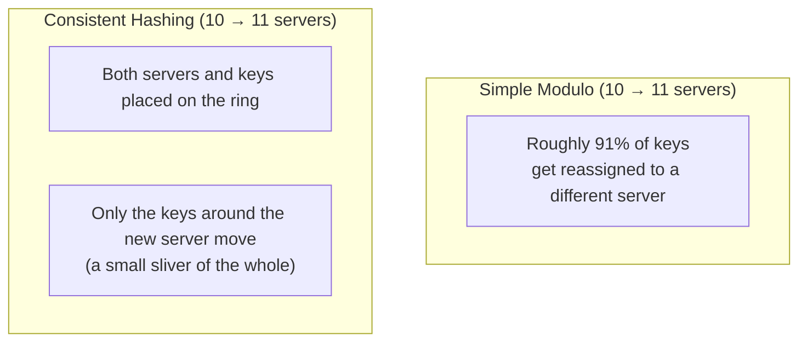

## Introduction

- **What You'll Learn From This Article**: The IP hash method covered in [load balancing algorithms and health checks](/en/articles/load-balancing-algorithms-guide) pinned the same client to the same server through a simple calculation: `hash(key) % number of servers`. In this article, you'll systematically understand **the fatal weakness this simple calculation carries when the number of servers changes**, and **consistent hashing**, the mechanism that solves it.
- **Intended Audience**: Readers who understand how the IP hash method achieves session persistence, but have never thought through what happens when the number of servers changes.
- **Estimated Reading Time**: About 17 minutes

This article is part of the [Top 1% Series Complete Article Guide](/en/sitemap), and article 2.1 in the [Load Balancing Fundamentals Series](/en/sitemap#series-list).

## Prerequisite Knowledge

- [Load Balancing Algorithms and Health Checks](/en/articles/load-balancing-algorithms-guide): The basic understanding of session persistence via the IP hash method.

## Getting the Big Picture

**The simple modulo-based hashing method, `hash(key) % number of servers`, carries a fatal weakness: adding or removing just one server changes the assigned server for almost every single key.** For example, simply growing from 10 servers to 11 **reassigns roughly 91% of keys to a different server.** Add just one cache server, and most of the existing cache gets invalidated, spiking access to the origin server — a serious real-world incident. **Consistent hashing solves this by placing both servers and keys on a single ring.**

## Deep Dive Into the Fundamentals

### Placing Both Servers and Keys on the Ring

**Consistent hashing converts each server and each key into a position on a single ring, using the same hash function for both.** **Which server a given key gets assigned to is decided by this rule: "walk clockwise around the ring from that key's position, and the first server you encounter."** When a server is added or removed, **only the keys that were positioned around that server move to the neighboring server** — keys at every other position on the ring stay completely unaffected.

### Virtual Nodes: Addressing the Load-Imbalance Problem When There Are Few Physical Servers

**When the number of physical servers is small, their placement on the ring tends to be random, causing an imbalance where some servers end up responsible for a wider range (more keys) than others.** To address this, **one physical server gets placed repeatedly at multiple positions on the ring (virtual nodes).** The more virtual nodes you use, the closer each server's assigned key range gets to even, and the smoother the rebalancing becomes when servers are added or removed.

Consistent Hashing Is Widely Used in Caching Clusters and NoSQL Databases

**Consistent hashing is widely adopted by distributed caches and distributed databases, including Memcached client libraries, Amazon DynamoDB, Apache Cassandra, and Redis Cluster.** In these systems, nodes get added or removed frequently during operation (scaling out, scaling in, or dropping out due to failure), so simple modulo hashing would place a heavy load on the entire system every time rebalancing happens — making it impractical.

## What a Pro Sees Here (Top 1% Understanding)

### The Goal — "Pin the Same Key to the Same Server" — Is Identical, but Resilience to Change Is Completely Different

**The IP hash method and consistent hashing share exactly the same goal: pinning the same key to the same server as much as possible.** **But there's a decisive difference in how much of the key space gets reassigned when the number of servers changes — almost all of it, versus just a small sliver.** When you hear the explanation "this system distributes using a hash," **digging one layer deeper to check "what percentage of keys get affected when the server configuration changes"** is the perspective a top-1% engineer carries.

## Common Misconceptions and Pitfalls

- **Misconception 1: "As long as it's distributing via a hash, adding or removing servers isn't a particular problem."**
  With simple modulo-based hashing, adding or removing just one server changes the assigned server for almost every single key.
- **Misconception 2: "With consistent hashing, no keys ever move at all when a server is added."**
  Even with consistent hashing, keys positioned around the new server do move — it's just that the range that moves stays down to a small sliver of the whole.
- **Misconception 3: "More virtual nodes is always strictly better."**
  More virtual nodes improve load balance, but also increase the metadata to manage, so real-world practice calls for an appropriate balance.

## Troubleshooting Perspective

1. **Access to the origin server spiked right after you added one cache server**: Check whether you're using simple modulo-based hashing, and consider migrating to consistent hashing.
2. **One specific server's load is clearly higher than the others**: Check whether too few virtual nodes are causing an imbalance in the ring's placement.
3. **You added a server, but load isn't distributed as evenly as expected**: Check whether the hash function itself tends to cluster keys unevenly.

## Summary

- With the simple method `hash(key) % number of servers`, adding or removing just one server changes the assigned server for almost every single key.
- Consistent hashing places both servers and keys on a ring, keeping the range of keys that move when a server is added or removed down to a small sliver.
- Virtual nodes address the load imbalance that occurs when there are few physical servers.
- Consistent hashing is widely adopted by distributed caches and distributed databases like Memcached, DynamoDB, and Cassandra.

**Takeaways to Apply Today**
1. When you hear "it's distributing using a hash," make it a habit to check the impact when the server configuration changes.
2. When selecting a caching cluster or NoSQL database, check whether it uses consistent hashing internally.

## References

- [Consistent Hashing Explained | AlgoMaster](https://blog.algomaster.io/p/consistent-hashing-explained)
- [Understanding Consistent Hashing | LevelUp](https://levelup.gitconnected.com/understanding-consistent-hashing-concepts-pitfalls-and-real-world-use-cases-2b0571689330)
