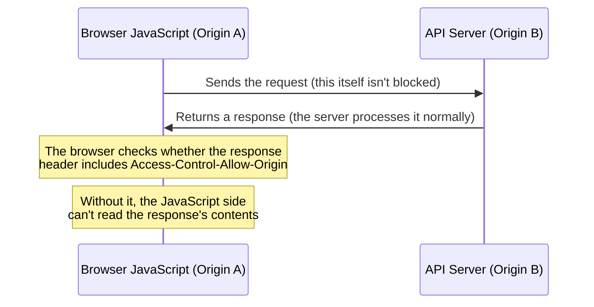

## Introduction

- **What You'll Learn From This Article**: The API you built in [the hands-on building a simple RESTful API yourself](/en/articles/restful-api-handson-guide) calls fine from curl or Postman, but can sometimes **fail with a "CORS error" when called from JavaScript in a browser.** This article helps you understand the reality that this happens **not because the server is down, but because the browser's own defense mechanism, the same-origin policy, is kicking in.** You'll systematically understand **that CORS isn't a mechanism for protecting the server — it protects the user** — and why simply using `Content-Type: application/json` triggers a **preflight** check by default.
- **Intended Audience**: Readers who've confirmed an API works fine from curl or Postman, but have hit an error called "CORS" when calling the same API from browser JavaScript, without being able to explain what's actually happening.
- **Estimated Reading Time**: About 17 minutes

This article is part of the [Top 1% Series Complete Article Guide](/en/sitemap), and article 3.1 in the [Web/API Series](/en/sitemap#series-list).

## Prerequisite Knowledge

- [The Hands-On Building a Simple RESTful API Yourself](/en/articles/restful-api-handson-guide): The basics of HTTP methods and status codes are a prerequisite.

## Getting the Big Picture

**The first thing to understand about a CORS error is that "the server is rejecting the request" is NOT what's happening — rather, "the browser is refusing to let JavaScript read the response from the server."** These are two entirely different phenomena. **Browsers have a default defense mechanism built in, called the Same-Origin Policy.** This rule never stops JavaScript loaded from one origin (a scheme/host/port combination) from actually **sending** a request to a different origin — but it **prohibits reading the contents of that response, by default.** CORS (Cross-Origin Resource Sharing) is the mechanism that lets the server side safely lift this default prohibition as an exception, by explicitly declaring "reads from this origin are allowed."

## Deep Dive Into the Fundamentals

### Why It Succeeds With curl or Postman, But Only Fails in the Browser

**The Same-Origin Policy is a constraint belonging to the browser software itself — not a constraint of the HTTP protocol itself.** curl and Postman aren't browsers at all, so the concept of a Same-Origin Policy doesn't even apply to them — they just receive the server's response as-is and display it. **This constraint only ever kicks in when JavaScript running inside a browser sends a request via `fetch` or `XMLHttpRequest`.** In other words, "it succeeds with curl, but only fails in the browser" isn't a server-side problem at all — it's **the result of an entirely different behavior, purely due to the difference in what kind of client is sending the request.**

### CORS Protects the User, Not the Server

**Many people misunderstand the reason CORS exists as "protecting the server from unauthorized access."** But in reality, **what CORS protects is the "user" operating the browser.** Imagine this: without this constraint, merely opening a malicious website would let that page's JavaScript send a request, using the user's own cookies, to another site the user happens to be logged into (a bank, a social network) — and **read that response (personal information, account balance)** right back. The Same-Origin Policy is the browser's own defense mechanism, protecting the user's browser session from exactly this kind of attack.

### `Content-Type: application/json` Triggers a Preflight by Default

A cross-origin request falls into one of two categories: a "**simple request**" or a "**request requiring a preflight**." A request only qualifies as simple when its method is GET, POST, or HEAD, it includes no custom headers, and its `Content-Type` is one of `application/x-www-form-urlencoded`, `multipart/form-data`, or `text/plain`. **What surprises many practitioners here is the fact that `Content-Type: application/json` — the most common choice for modern APIs — isn't included in these simple-request conditions at all.** In other words, **a modern API call sending JSON gets classified, almost without exception, as "a request requiring a preflight."**

What Concretely Happens During a Preflight?

For a request requiring a preflight, the browser **automatically sends a preliminary request using the `OPTIONS` method, before the actual request the JavaScript is trying to send.** This preflight request includes information like `Access-Control-Request-Method` (the method it actually wants to send) and `Access-Control-Request-Headers` (the headers it actually wants to send), and **the server needs to respond to this preliminary check with response headers indicating "access with this method/these headers is allowed."** Only once this preliminary check succeeds does the browser actually send the real request (a POST, PUT, etc.). **This entire exchange is completely hidden from the JavaScript code itself** — a real-world pitfall, since a developer can easily remain unaware a preflight is even happening, unless they open the browser's developer tools and check the network tab.

## What a Pro Sees Here (Top 1% Understanding)

### `Access-Control-Allow-Origin: *` and a Request Carrying Credentials Can't Coexist

If you want to allow a cross-origin request carrying credentials, like cookies (`credentials: 'include'` in `fetch`), the server side needs to return `Access-Control-Allow-Credentials: true`. **There's a critical constraint here: when using `Access-Control-Allow-Credentials: true`, you can never specify a wildcard (`*`) for the `Access-Control-Allow-Origin` value.** You must always explicitly specify the requesting origin's concrete value. **This is a deliberate constraint built into the browser specification itself**, preventing the single most dangerous misconfiguration — "unconditionally allowing a credentialed request from any unspecified origin whatsoever" — at the specification level.

## Common Misconceptions and Pitfalls

- **Misconception 1: "A CORS error happens because the server is rejecting the request."**
  In most cases, the server processes the request normally and returns a response. A CORS error happens because the browser refuses to let JavaScript read that response.
- **Misconception 2: "Adding a specific header on the client side fixes a CORS error."**
  The headers that grant CORS permission (like `Access-Control-Allow-Origin`) need to be included in the server's response — adding them to the client's request has no effect at all.
- **Misconception 3: "A simple request that just sends JSON won't trigger a preflight."**
  `Content-Type: application/json` isn't included in the simple-request conditions, so most API calls that send JSON do trigger a preflight.

## Troubleshooting Perspective

1. **It succeeds with curl or Postman, but only fails from browser JavaScript**: Check, in the browser's developer tools' network tab, whether the server's response includes an `Access-Control-Allow-Origin` header.
2. **The network tab shows an OPTIONS request you never intended to send**: This is a preflight, not an error. Check whether the response to that OPTIONS request returns the appropriate `Access-Control-Allow-*` headers.
3. **Only a request carrying credentials gets a CORS error**: Check whether `Access-Control-Allow-Origin` has a wildcard (`*`) specified, instead of the concrete origin explicitly.

## Summary

- A CORS error happens not because the server is rejecting the request, but because the browser is refusing to let JavaScript read the response.
- The Same-Origin Policy exists not to protect the server, but to protect the user themselves from an attack abusing the user's own browser session.
- `Content-Type: application/json` isn't included in the simple-request conditions, so most modern API calls sending JSON trigger a preflight.
- When allowing a request carrying credentials, you can never use a wildcard for `Access-Control-Allow-Origin`.

**Takeaways to Apply Today**
1. When you hit a CORS error, first check the browser's developer tools' network tab for the server's response headers and whether an OPTIONS request occurred.
2. Remember that the setting granting CORS permission always belongs on the server side, and can never be resolved from the client side.

## References

- [Cross-Origin Resource Sharing (CORS) | MDN Web Docs](https://developer.mozilla.org/en-US/docs/Web/HTTP/Guides/CORS)
- [Fetch Standard - CORS protocol | WHATWG](https://fetch.spec.whatwg.org/#http-cors-protocol)
