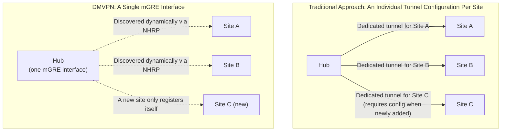

## Introduction

- **What You'll Learn From This Article**: [The fundamentals of site-to-site VPN](/en/articles/site-to-site-vpn-guide) touched on the challenge that site-to-site VPN operations get more complex the more sites you add. In this article, you'll systematically understand **DMVPN (Dynamic Multipoint VPN)**, a Cisco-developed extension to site-to-site VPN that **ensures adding a new site only ever requires configuring that one new site.**
- **Intended Audience**: Readers who can build a point-to-point IPsec tunnel between two sites, but don't understand how configuration management changes once the number of sites grows into the dozens or hundreds.
- **Estimated Reading Time**: About 19 minutes

This article is part of the [Top 1% Series Complete Article Guide](/en/sitemap), and article 3.1 in the [Site-to-Site VPN Series](/en/sitemap#series-list).

## Prerequisite Knowledge

- [The Fundamentals of Site-to-Site VPN](/en/articles/site-to-site-vpn-guide): Understanding the traditional approach — building a point-to-point IPsec tunnel individually, per site.

## Getting the Big Picture

**In traditional IPsec site-to-site VPN, every time you add one new site, you have to individually add a tunnel configuration dedicated to that site, on the hub side (headquarters).** Once the number of sites grows into the dozens or hundreds, this **operational pattern of "an individual tunnel configuration per site" itself becomes the scalability wall.** **DMVPN combines mGRE (multipoint GRE) — a single tunnel interface on the hub side that can reach any site — with NHRP (Next Hop Resolution Protocol), which dynamically maps a virtual IP to each site's actual public IP address**, so that adding a new site is completed entirely through that site's own configuration alone.

## Deep Dive Into the Fundamentals

### mGRE: the Hub Holds Just One "Reaches Anyone" Tunnel Interface

**In traditional site-to-site VPN, the hub side needed an individual tunnel interface (or tunnel configuration) per site, as many as there were sites.** **mGRE (multipoint GRE) is a mechanism that prepares just one single tunnel interface on the hub side, and that one interface accepts connections from multiple sites all at once.** Adding more sites requires no change at all to this interface itself, on the hub side.

### NHRP: a Mechanism That Dynamically Resolves a Virtual IP Into an Actual Public IP Address

**NHRP (Next Hop Resolution Protocol) is a mechanism that dynamically manages the mapping between DMVPN's virtual tunnel IP address and each site's actual (sometimes dynamic) public IP address.** When a new site comes online, that site registers the mapping between its own virtual IP and its actual public IP to the hub (an NHRP registration). When another site wants to communicate with that new site, it can dynamically resolve the actual destination address by querying NHRP. **This mechanism is exactly what makes a hub-side configuration change unnecessary when adding a new site.**

DMVPN Has Three Phases, Differing in How Spoke-to-Spoke Communication Gets Established

**DMVPN has three Phases, differing in whether spokes (sites) can communicate directly with each other.** **In Phase 1, every communication always goes through the hub** — a direct tunnel between spokes never forms. **In Phase 2, a direct tunnel between spokes forms dynamically, but because next-hop information is preserved, every spoke needs detailed route information to every other spoke, and route summarization isn't possible.** **In Phase 3, the hub uses an NHRP redirect message to prompt the originating spoke to establish a direct tunnel, achieving a direct spoke-to-spoke tunnel while letting every spoke hold only a default route to the hub — making route summarization possible.** Phase 3 is the recommended approach in current real-world practice.

## What a Pro Sees Here (Top 1% Understanding)

### DMVPN Solves Two Independent Problems Separately: "Establishing/Discovering the Tunnel" and "Encryption"

**The single name "DMVPN" is actually a combination of two independent mechanisms: mGRE and NHRP, solving the problem of "which site to establish a tunnel with, and how," and IPsec, solving the entirely separate problem of "how to encrypt the inside of that tunnel."** **[SD-WAN and edge router selection](/en/articles/sdwan-edge-router-guide) covered a modern approach, SD-WAN, which can be understood as carrying forward the exact challenge DMVPN was already solving — dynamic tunnel management that scales as sites are added — through a more refined form: a vendor-specific, centrally managed controller.** Seeing it this way connects the historical arc of VPN technology into a single, continuous line.

## Common Misconceptions and Pitfalls

- **Misconception 1: "DMVPN is an independent encryption method, separate from IPsec."**
  DMVPN is a combination of two independent mechanisms — tunnel establishment/discovery (mGRE/NHRP) and encryption (IPsec) — with encryption itself still handled by IPsec as always.
- **Misconception 2: "With DMVPN, direct spoke-to-spoke communication is always possible."**
  In Phase 1, every communication always goes through the hub — a direct tunnel between spokes never forms.
- **Misconception 3: "Both Phase 2 and Phase 3 support route summarization."**
  Phase 2 preserves next-hop information, so route summarization isn't possible — only Phase 3's NHRP redirect mechanism makes route summarization possible at all.

## Troubleshooting Perspective

1. **You added a new site, but it can't communicate with other sites**: Check whether that site's NHRP registration completed correctly against the hub.
2. **Spoke-to-spoke communication always goes through the hub**: Check whether DMVPN is set to Phase 1, and whether Phase 2/3 settings are correctly configured.
3. **Each spoke's routing table bloated after adding more sites**: You may be using Phase 2 — consider migrating to Phase 3, which supports route summarization.

## Summary

- In traditional site-to-site VPN, every time you added a site, you needed to add an individual tunnel configuration on the hub side.
- DMVPN combines mGRE (a single tunnel interface) with NHRP (dynamic IP address resolution), so adding a new site is completed entirely through that site's own configuration alone.
- DMVPN has three Phases, differing in how spoke-to-spoke communication gets established, and Phase 3 is the recommended approach today.
- DMVPN solves the problem of establishing/discovering a tunnel and the problem of encryption through separate mechanisms — mGRE/NHRP and IPsec.

**Takeaways to Apply Today**
1. When designing a site-to-site VPN where the number of sites may grow going forward, consider an approach like DMVPN that supports dynamically adding sites.
2. When you encounter the term "DMVPN," first separate out the tunnel-establishment method (mGRE/NHRP) from the encryption method (IPsec).

## References

- [Introduction to DMVPN | NetworkLessons](https://networklessons.com/vpn/introduction-to-dmvpn)
- [DMVPN Phase 3: Overview & Configuration | INE](https://blog.ine.com/2008/12/23/dmvpn-phase-3)
