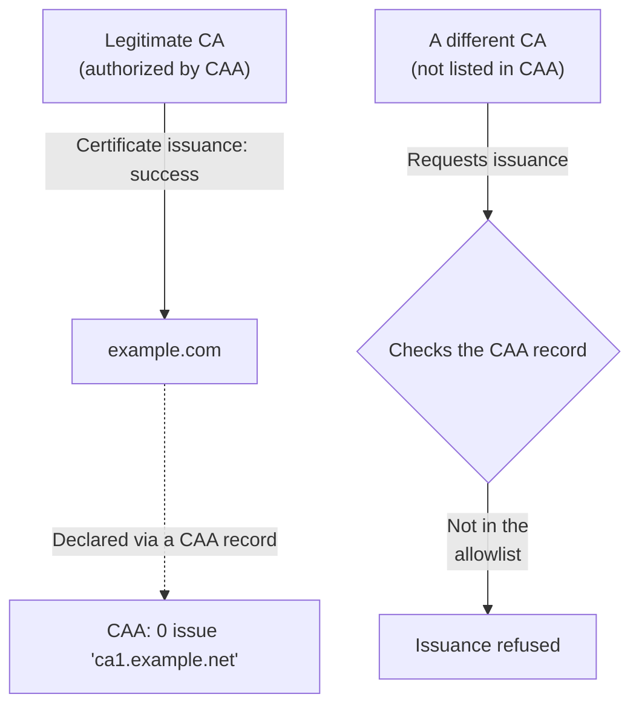

## Introduction

- **What You'll Learn From This Article**: [How DNSSEC works](/en/articles/dns-dnssec-fundamentals-guide) was a mechanism proving that a DNS response itself is genuine. In this article, you'll systematically understand **the CAA (Certification Authority Authorization) record** — another, almost entirely overlooked DNS security record. It's a mechanism declaring, in DNS, "only this CA is allowed to issue a certificate for this domain" as an allowlist.
- **Intended Audience**: Readers who've gone through issuing an HTTPS certificate themselves, but have never heard the term "CAA record," or can't explain what it exists for.
- **Estimated Reading Time**: About 16 minutes

This article is part of the [Top 1% Series Complete Article Guide](/en/sitemap), and article 4.1 in the [DNS Server Fundamentals Series](/en/sitemap#series-list).

## Prerequisite Knowledge

- [How DNSSEC Works](/en/articles/dns-dnssec-fundamentals-guide): Understanding this other mechanism — guaranteeing the trustworthiness of DNS responses — will make the difference between these two security records clearer.

## Getting the Big Picture

**In theory, you can request an HTTPS certificate from any certificate authority (CA) in the world.** There's a surprisingly overlooked risk here. **The possibility structurally exists that an entirely different CA, with no involvement from the domain's owner at all, could mistakenly (or through improper procedure) issue a certificate for that domain.** **The CAA record is a mechanism declaring, in DNS, "only this CA is allowed to issue a certificate for this domain" as an allowlist.**

## Deep Dive Into the Fundamentals

### Without a CAA Record, Any CA Can Issue a Certificate

**If a domain has no CAA record set at all, by default, any certificate authority can issue a certificate for that domain.** That's because the CAA record is an **opt-in** mechanism, meant to restrict issuance to one specified CA. Declare nothing, and no restriction applies at all.

### The Three Tags: issue, issuewild, and iodef

The CAA record has three main tags. **The `issue` tag specifies which CAs are authorized to issue an ordinary certificate** (including a wildcard certificate). **The `issuewild` tag is a narrower authorization, applying only to wildcard certificates** — when this tag is present, the contents of the `issue` tag are ignored for wildcard certificates. **The `iodef` tag specifies a contact (an email address or URL) to notify, when an issuance attempt violates the policy.**

Checking CAA Became Mandatory for Every CA Starting September 2017

**The CAA record mechanism itself existed before this, but whether a CA actually checked it remained optional for a long time.** This changed with "Ballot 187," a resolution the CA/Browser Forum adopted in March 2017: **starting September 8, 2017, every public certificate authority has been required to check the CAA record before issuing a certificate.** Since this mandate, a CA not listed in the CAA record must refuse to issue the certificate. **Even if the DNS query itself fails (such as with SERVFAIL), the design fails safe — refusing issuance** rather than erring toward allowing it.

## What a Pro Sees Here (Top 1% Understanding)

### A Real-World Pitfall: a CAA Record Set in the Past, Then Forgotten

**A common real-world pitfall is a CAA record set back when the domain used a different CA, left sitting there, unchanged, forever.** Later, when you try to switch to a different certificate authority (say, Let's Encrypt), **if the CAA record still only authorizes the old CA and was never updated, issuance from the new CA gets refused, for a reason that looks mysterious at first.** When you hit a certificate issuance error, checking **whether the domain's CAA record correctly authorizes the CA you're currently using** — not just the certificate's own configuration — is one of the items a top-1% engineer keeps on their checklist.

## Common Misconceptions and Pitfalls

- **Misconception 1: "There's no security problem in leaving the CAA record unset."**
  Without a CAA record, by default, any certificate authority can issue a certificate for that domain — there's no way to prevent issuance by an unintended CA.
- **Misconception 2: "Setting the `issue` tag automatically restricts wildcard certificate issuance too."**
  When the `issuewild` tag is present, the contents of the `issue` tag are ignored for wildcard certificates, so both need to be set as intended.
- **Misconception 3: "The CAA record serves the same purpose as DNSSEC."**
  DNSSEC proves the authenticity of the DNS response itself, while CAA restricts which CA is allowed to issue a certificate — the two serve entirely different purposes.

## Troubleshooting Perspective

1. **You tried issuing a certificate from a new CA, but it got refused for no clear reason**: Check the domain's CAA record, and confirm that CA is included in the allowlist.
2. **Only wildcard certificate issuance fails**: Check whether the `issuewild` tag is set, and whether that CA is missing from the wildcard-specific allowlist.
3. **You never notice an improper certificate issuance attempt**: Check whether you've set the `iodef` tag, to receive notifications of policy violations.

## Summary

- The CAA record is a mechanism declaring, in DNS, "only this CA is allowed to issue a certificate for this domain" as an allowlist.
- Without a CAA record set, by default, any certificate authority can issue a certificate.
- The three tags — `issue`, `issuewild`, and `iodef` — each serve a different role.
- Since September 2017, every public certificate authority has been required to check the CAA record before issuing a certificate.

**Takeaways to Apply Today**
1. When you hit a certificate issuance error, add checking the domain's CAA record to your checklist.
2. When switching certificate authorities, always check whether an old CAA record is still sitting there.

## References

- [DNS Certification Authority Authorization | Wikipedia](https://en.wikipedia.org/wiki/CAA_record)
- [CAA Records Explained | Encryption Consulting](https://www.encryptionconsulting.com/caa-records-explained-defining-which-certificate-authorities-can-issue-for-your-domain/)
