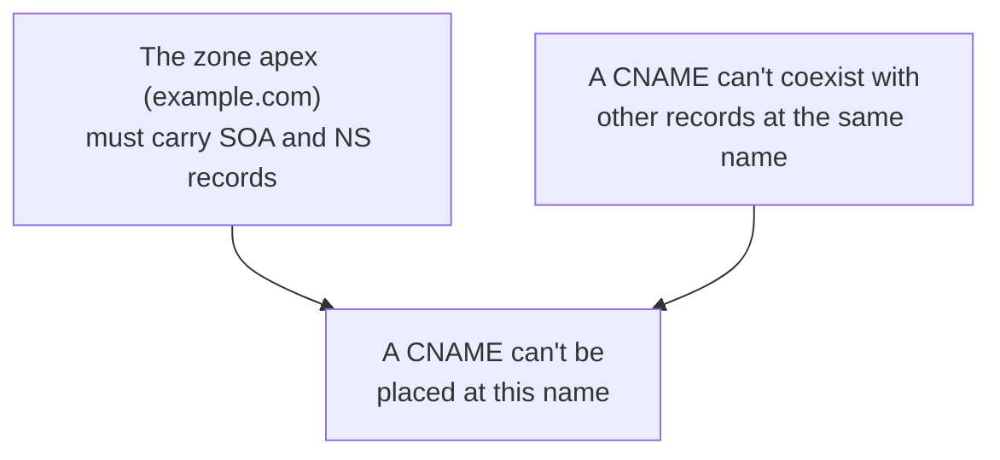

## Introduction

- **What You'll Learn From This Article**: A CDN or load balancer's documentation often says, "point a CNAME record at the hostname we've assigned you." But try doing this **at your root domain (`example.com` itself), and most DNS providers reject the setting.** This article helps you understand that this constraint arises from a collision between **the DNS rule that a CNAME can't coexist with any other record at the same name**, and **another requirement — that the zone apex must always carry SOA and NS records** — before systematically understanding **how ALIAS/ANAME records work around this constraint.**
- **Intended Audience**: Readers who understand a zone file's structure from [The Fundamentals of a DNS Server](/en/articles/dns-server-fundamentals-guide), but can't explain, from the underlying mechanism, why a root domain can't take a CNAME.
- **Estimated Reading Time**: About 16 minutes

This article is part of the [Top 1% Series Complete Article Guide](/en/sitemap), and article 1.1 in the [DNS Server Fundamentals Series](/en/sitemap#series-list).

## Prerequisite Knowledge

- [The Fundamentals of a DNS Server](/en/articles/dns-server-fundamentals-guide): The premise that a zone file holds multiple record types, like SOA, NS, A, and CNAME.

## Getting the Big Picture

**A CNAME record carries a constraint built into the DNS specification itself (RFC 1034): "no other record type whatsoever can coexist at the same name where this record exists."** Meanwhile, **a domain's zone apex (the domain's own name, with no subdomain portion, like `example.com`) must always carry an SOA record and an NS record, for that zone to function at all.** **Layer these two requirements together, and it becomes clear: placing a CNAME at a zone apex is structurally impossible.** The moment you place a CNAME there, the mandatory SOA and NS records at that same name can no longer coexist with it.

## Deep Dive Into the Fundamentals

### Why Can't a CNAME Coexist With Other Records?

A CNAME (Canonical Name) record is **a declaration of an alias for the name itself** — "treat a query for this name as a query for a different name (the canonical name)." **When a name holds a CNAME, every query for that name gets substituted entirely with the information at the name the CNAME points to** — so if that same name also held another record, like an A record, you'd get a contradictory state: "should it use the information at the CNAME's target, or the A record written directly at this name?" **DNS's specification establishes a clear rule to prevent this contradiction from ever arising in the first place: no other record type at all can coexist at a name that holds a CNAME.**

### Why Must a Zone Apex Carry SOA and NS?

**An SOA record holds that zone's management information (serial number, retry interval, etc.) — a single mandatory record that exists exactly once per zone.** **An NS record indicates the name servers that authoritatively manage that zone.** These two are **foundational records that must always exist at the zone apex, for the zone itself to function at all.** If you actually look at a zone file, as covered in [The Fundamentals of a DNS Server](/en/articles/dns-server-fundamentals-guide), you can confirm the SOA record always appears at the very top of the file, immediately followed by the NS record.

What Concretely Happens When You Actually Try to Set One?

Try creating a CNAME record at the root domain (`@` or the zone name itself) in most DNS providers' management consoles, and **you'll get an error along the lines of "a CNAME record can't be created at the zone apex," and the save itself gets rejected.** Some providers, though, allow the save without validating this constraint at all — and in that case, **the existing MX record (mail delivery destination) or other records at the zone apex can get implicitly lost, or end up in a contradictory state, leading to a confusing failure like mail delivery stopping some time later.**

## What a Pro Sees Here (Top 1% Understanding)

### ALIAS/ANAME Records Are a Provider-Specific Mechanism That Works Around CNAME's Constraint

To meet **the strong real-world demand of assigning a CDN or load balancer to a root domain**, many DNS providers offer a **provider-specific record type that doesn't exist in the standard DNS protocol at all, called ALIAS (or ANAME).** At the DNS protocol level, an ALIAS/ANAME record actually responds as **an A record (not a CNAME).** **The DNS server itself periodically resolves, behind the scenes, the hostname the ALIAS points to, and returns the resulting IP address to the client as if an A record were written directly there** — a mechanism of **server-side pre-resolution and synthesis.** This is sometimes called "**CNAME flattening**." **This mechanism lets the zone apex keep its other coexisting records — SOA, NS, MX, and so on — intact, while that same name continues to point at the actual substance of the hostname the CDN provides.**

## Common Misconceptions and Pitfalls

- **Misconception 1: "A CNAME can be freely set at any name."**
  A CNAME can only be set where no other record exists at that same name. Since a zone apex mandatorily carries SOA and NS, you structurally can't place a CNAME there.
- **Misconception 2: "ALIAS/ANAME records are just a kind of CNAME."**
  ALIAS/ANAME is a provider-specific mechanism that doesn't exist in the standard DNS protocol at all — at the protocol level, it actually responds as an A record.
- **Misconception 3: "If some provider allows setting a CNAME at the root domain, it's safe to use."**
  Even if it's allowed, other mandatory records at the zone apex (like MX) can get implicitly lost, risking a confusing failure that only shows up later.

## Troubleshooting Perspective

1. **Trying to set a CNAME at the root domain gives an error when saving**: Since a zone apex mandatorily requires SOA and NS to coexist, check whether your provider offers a way around this constraint itself (an ALIAS/ANAME feature).
2. **Mail that used to arrive stopped arriving at some point**: Check whether a CNAME (or a change conflicting with one) was recently added to the zone apex's records, using something equivalent to `dig example.com ANY`.
3. **You want to assign a CDN to the root domain**: Use your DNS provider's ALIAS/ANAME feature, or CNAME flattening feature, instead of a CNAME.

## Summary

- Under DNS's specification, a CNAME record can't coexist with any other record type at the same name.
- A zone apex must always carry SOA and NS records, for the zone to function at all.
- Because these two requirements collide, placing a CNAME at a zone apex is structurally impossible.
- ALIAS/ANAME records are a provider-specific mechanism that works around CNAME's constraint, through server-side pre-resolution and synthesis.

**Takeaways to Apply Today**
1. When you want to assign a CDN or load balancer to a root domain, use an ALIAS/ANAME feature, not a CNAME.
2. When changing records at a zone apex, always check the impact on other mandatory records coexisting at that same name, like SOA, NS, and MX.

## References

- [RFC 1034: Domain Names - Concepts and Facilities](https://www.rfc-editor.org/rfc/rfc1034)
- [CNAME record | Wikipedia](https://en.wikipedia.org/wiki/CNAME_record)
