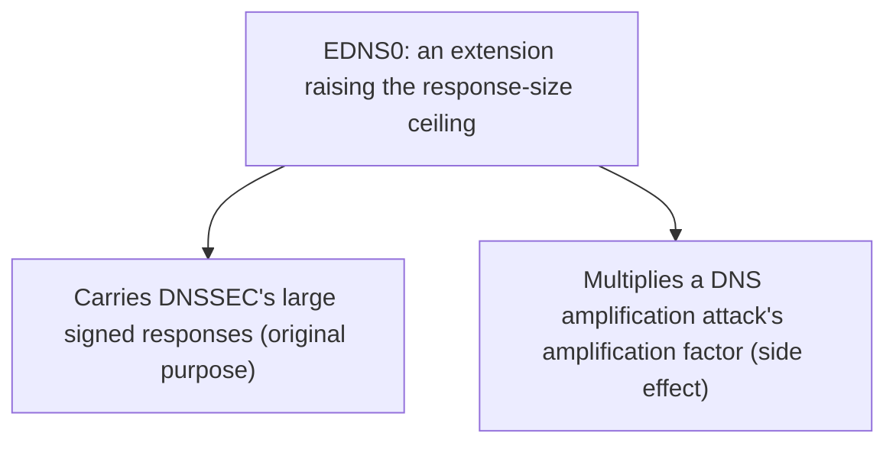

## Introduction

- **What You'll Learn From This Article**: Spanning both [Understanding DNSSEC From a Top 1% Perspective](/en/articles/dns-dnssec-fundamentals-guide) and the [DNS Amplification Attack Hands-On](/en/articles/dns-amplification-rrl-handson-guide), you'll systematically understand the role of an extension specification called **EDNS0**.
- **Intended Audience**: Readers who know DNSSEC's signatures are large data, but can't explain how traditional DNS became able to carry them.
- **Estimated Reading Time**: About 16 minutes

This article is part of the [Top 1% Series Complete Article Guide](/en/sitemap), and article 4.3 in the [DNS Infrastructure Series](/en/sitemap#series-list).

## Prerequisite Knowledge

- [Understanding DNSSEC From a Top 1% Perspective](/en/articles/dns-dnssec-fundamentals-guide): Understanding that a signed DNS response is far larger than a normal DNS response is a prerequisite.

## Getting the Big Picture

**Traditional DNS carried an old constraint: it limited a UDP response to 512 bytes.** **EDNS0 (Extension Mechanisms for DNS) is an extension specification that lets the client side tell the server "I can receive a larger response," effectively raising that 512-byte ceiling.** **DNSSEC's signatures (RRSIG) and keys (DNSKEY) often don't fit in 512 bytes, so EDNS0 is the essential foundation for operating DNSSEC practically. But this exact same ability to "make a response bigger" carries an entirely different face: it also multiplies the amplification factor of a DNS amplification attack.**

## Deep Dive Into the Fundamentals

### Without EDNS0, DNSSEC Isn't Practical

**Without EDNS0, a DNS response is limited to roughly 512 bytes, and exceeding that forces a fallback to TCP, losing DNS's major advantage — low-overhead querying over UDP.** **DNSSEC's signature (RRSIG) and DNSKEY records easily exceed that 512 bytes, so EDNS0's ability to let a client declare a larger buffer size, such as "I can receive up to 4096 bytes," is the precondition for operating DNSSEC practically at all.**

### The Same Extension Raises an Amplification Attack's Efficiency

**A DNS amplification attack sends a small query with a forged source IP address to a publicly reachable recursive resolver, getting it to send a response far larger than the original query to the forged victim's IP address.** **Before EDNS0 existed, response size was capped around 512 bytes, keeping the amplification factor around 8x — but once EDNS0 let servers return much larger responses, the amplification factor for the exact same technique rose dramatically.** **Response Rate Limiting (RRL), the countermeasure covered in the [DNS Amplification Attack Hands-On](/en/articles/dns-amplification-rrl-handson-guide), is a direct response to exactly this side effect of "being able to make a response bigger."**

Note: a mitigation of declaring a smaller response size, and its limits

**An authoritative DNS server operator can mitigate the amplification factor by declaring a small EDNS0 buffer size, around 1280 bytes.** **But since this doesn't stop the source-spoofed query itself, this alone is insufficient — the fundamental fix is widespread adoption of BCP 38 (Ingress Filtering) across the internet, which prevents source IP spoofing itself.**

## What a Pro Sees Here (Top 1% Understanding)

### An Extension That Enables Convenience Is Usually Abused for the Exact Same Reason

**EDNS0 is undeniably the hero that made DNSSEC, an important security feature, practical — but that exact same ability to "make a response bigger," riding on top of a spoofable UDP, also produced the side effect of raising an amplification attack's efficiency.** **When evaluating an extension specification, always pair "what does this make possible" with "what does this same property make possible when abused."** This is the perspective a top-1% engineer carries.

## Common Misconceptions and Pitfalls

- **Misconception 1: "EDNS0 is a dedicated extension that exists only for DNSSEC."**
  EDNS0 itself is a general-purpose extension that raises DNS's response-size ceiling; DNSSEC is just one prominent use case that benefits from it.
- **Misconception 2: "Declaring a small EDNS0 buffer size completely prevents amplification attacks."**
  Since source IP spoofing itself isn't prevented, limiting the buffer size alone is insufficient. A fundamental fix needs a mechanism like BCP 38 that prevents source spoofing itself.
- **Misconception 3: "DNSSEC operated fine even before EDNS0 existed."**
  Before EDNS0, the 512-byte constraint made carrying DNSSEC's large signed responses practically difficult.

## Troubleshooting Perspective

1. **Name resolution fails for some clients after enabling DNSSEC**: Check whether that client, or a firewall along the path, supports EDNS0 and allows large UDP packets.
2. **Your organization's authoritative DNS server is being used as a reflector for DNS amplification attacks**: Review your EDNS0 buffer size declaration and Response Rate Limiting (RRL) configuration.
3. **DNSSEC-related queries fail against an old resolver that doesn't support EDNS0**: Check whether the fallback to TCP is working correctly.

## Summary

- EDNS0 is an extension specification that raises DNS's UDP response-size ceiling (512 bytes).
- DNSSEC's large signed responses can't be operated practically without EDNS0.
- That same "can make a response bigger" property also carries the side effect of raising a DNS amplification attack's amplification factor.
- A fundamental countermeasure against amplification attacks needs source-spoofing prevention like BCP 38, not just buffer size limits.

**Takeaways to Apply Today**
1. When deploying DNSSEC, check whether EDNS0 is working correctly along the path (whether large UDP packets are being blocked).
2. When operating an authoritative DNS server, be aware of how your EDNS0 buffer size setting relates to the risk of being used as an amplification reflector.

## References

- [What Is a DNS Amplification Attack? | NameSilo](https://www.namesilo.com/blog/en/dns/what-is-a-dns-amplification-attack-ddos-reflection)
- [draft-ietf-dnsop-avoid-fragmentation | IETF Datatracker](https://datatracker.ietf.org/doc/html/draft-ietf-dnsop-avoid-fragmentation-16)
