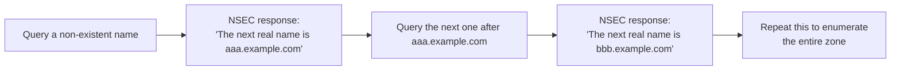

## Introduction

- **What You'll Learn From This Article**: [How DNSSEC works](/en/articles/dns-dnssec-fundamentals-guide) was a mechanism proving a response's authenticity through three record types — RRSIG, DNSKEY, and DS. In this article, you'll systematically understand an easily overlooked side effect: the **NSEC** record, which DNSSEC uses to prove "this record doesn't exist," unintentionally turns into **a map that lets you enumerate every single name in the zone.**
- **Intended Audience**: Readers who understand DNSSEC's basic mechanics, but don't know that the NSEC record can be used as a tool for enumerating information within a zone.
- **Estimated Reading Time**: About 17 minutes

This article is part of the [Top 1% Series Complete Article Guide](/en/sitemap), and article 4.2 in the [DNS Server Fundamentals Series](/en/sitemap#series-list).

## Prerequisite Knowledge

- [How DNSSEC Works](/en/articles/dns-dnssec-fundamentals-guide): Understanding the mechanism proving a response's authenticity through RRSIG, DNSKEY, and DS.

## Getting the Big Picture

**DNSSEC needs to cryptographically prove not just "this record exists," but also "this record doesn't exist." The NSEC record is responsible for this "proof of non-existence."** **NSEC responds in a form like: "the name you queried doesn't exist, but walking through the zone in sorted order, here's the next name that actually does exist."** **Simply following this "next name" chain, by repeatedly querying for non-existent names, lets you enumerate, in order, every single name that exists in the zone.** This technique is called "zone walking."

## Deep Dive Into the Fundamentals

### NSEC3: Chaining Hashed Values Instead of Real Names

**NSEC3 keeps the same "next name" mechanism NSEC uses, but chains a hashed value of the actual name, instead of the real name itself.** **This means walking the zone only ever gets you a sequence of hash values, not the original names themselves**, making casual enumeration substantially harder.

### NSEC3 Is Not a Complete Defense

**An NSEC3 hash isn't irreversible. An attacker can precompute hashes of likely names (a dictionary attack) and compare them against the published hash values, potentially identifying the original name.** Predictable names like `www`, `mail`, or `admin` are especially vulnerable to this kind of dictionary attack.

The Recommended Values for NSEC3's Salt and Iteration Count Have Changed Over Time

**NSEC3 has two parameters: a "salt," added before hashing, and an "iteration count," the number of times hashing repeats.** Increasing both used to be recommended as a way to strengthen resistance against dictionary attacks. **But the newer recommendation, RFC 9276, now recommends leaving the salt empty and setting the iteration count to zero.** This is based on the judgment that increasing the salt or iteration count makes key rollover more complicated, while no longer providing a meaningful security improvement against modern computing power.

## What a Pro Sees Here (Top 1% Understanding)

### A "Security Mechanism" Can Create a "Privacy Problem" Along an Entirely Different Axis

**DNSSEC was designed for one security goal — a response's authenticity — but its implementation (NSEC) created a new weakness along an entirely different, unintended axis: the confidentiality (privacy) of information within the zone.** **The perspective of always digging one layer deeper to consider the possibility that a map exposing the entire zone is hiding behind a seemingly simple, harmless-looking response — "this record doesn't exist"** — is the perspective a top-1% engineer carries.

## Common Misconceptions and Pitfalls

- **Misconception 1: "Deploying DNSSEC protects all information within the zone."**
  DNSSEC is a mechanism that proves a response's authenticity — using NSEC leaves every name within the zone in an enumerable state.
- **Misconception 2: "Using NSEC3 completely prevents zone walking."**
  An NSEC3 hash isn't irreversible, and a predictable name can potentially be identified through a dictionary attack.
- **Misconception 3: "More salt and more iterations for NSEC3 is always safer."**
  RFC 9276's current recommendation is to leave the salt empty and set the iteration count to zero.

## Troubleshooting Perspective

1. **A subdomain name within the zone that was never supposed to be public became known externally**: Check whether DNSSEC is using NSEC, and whether it could have been enumerated via zone walking.
2. **You've deployed NSEC3, but a specific name still got identified**: Check whether that name is a predictable string, easy to identify via a dictionary attack.
3. **You're unsure how to set NSEC3's parameters**: Check RFC 9276's current recommendation (empty salt, zero iterations).

## Summary

- NSEC is a mechanism that chains the names actually existing in the zone, in sorted order, to prove "non-existence."
- Following this chain in order enables "zone walking," letting you enumerate every single name in the zone.
- NSEC3 mitigates this problem by chaining hashed values instead of real names, but never fully prevents it.
- RFC 9276's current recommendation is to leave NSEC3's salt empty and set the iteration count to zero.

**Takeaways to Apply Today**
1. When deploying DNSSEC, first consider using NSEC3 instead of NSEC.
2. If your zone contains a subdomain name you don't want public, evaluate the zone-walking risk ahead of time.

## References

- [What Are NSEC and NSEC3 Records? | DNSimple](https://support.dnsimple.com/articles/nsec-nsec3-records/)
- [DNSSEC NSEC: The Accidental Treasure Map to Your Subdomains | Pen Test Partners](https://www.pentestpartners.com/security-blog/dnssec-nsec-the-accidental-treasure-map-to-your-subdomains/)
