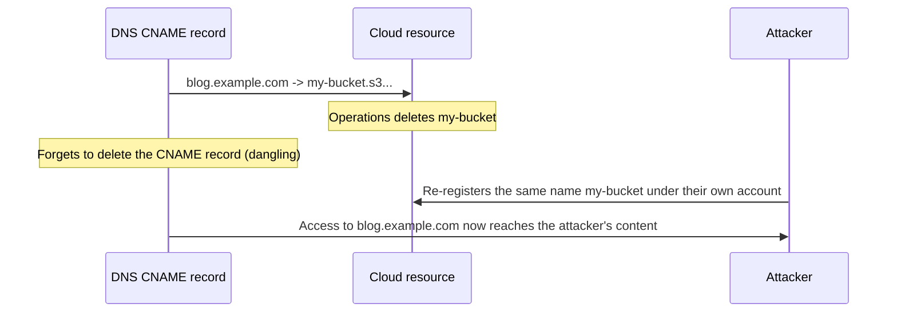

## Introduction

- **What You'll Learn From This Article**: The CNAME covered in [CNAME and the Apex Problem](/en/articles/dns-cname-apex-guide) was an "alias" from one name to another. In this article, you'll systematically understand **"subdomain takeover"** — an actively exploited attack where an attacker hijacks a CNAME left dangling after the cloud resource it points to gets deleted.
- **Intended Audience**: Readers who understand the basic mechanics of a CNAME record, but can't explain exactly how a subdomain takeover attack actually works.
- **Estimated Reading Time**: About 18 minutes

This article is part of the [Top 1% Series Complete Article Guide](/en/sitemap), and article 1.2 in the [DNS Series](/en/sitemap#series-list).

## Prerequisite Knowledge

- [CNAME and the Apex Problem](/en/articles/dns-cname-apex-guide): Understanding the basic mechanics of a CNAME record as an alias from one name to another is a prerequisite.

## Getting the Big Picture

**It's extremely common to configure a CNAME on a subdomain like `blog.example.com`, pointing it at a cloud service's resource name, like `example.herokuapp.com`.** **But if you delete that Heroku app, S3 bucket, or Azure App Service and forget to delete the CNAME record on the DNS side, that CNAME keeps hanging around "dangling."** **If an attacker re-registers that exact same resource name (the same bucket name, say) under their own cloud account, your company's own legitimate subdomain starts serving the attacker's content — and that's subdomain takeover.**

## Deep Dive Into the Fundamentals

### Why Re-Registering a Cloud Resource Can Hijack Someone Else's Domain

**Cloud services like S3, Heroku, and Azure App Service often manage resource names (bucket names, app names) within a single namespace shared across every single user.** **The instant a resource under some name gets deleted, that name goes right back to being available for anyone to claim — so if an attacker finds a name still left behind as a CNAME on the DNS side and creates a brand-new resource under that exact same name, the cloud side forwards access from that DNS name straight through to the resource the attacker just created.**

### A Real-World Incident: Over 8 Million Requests to Deleted S3 Buckets

**One study re-claimed around 150 deleted S3 buckets for research purposes, and received over 8 million requests in total, including requests looking for software updates.** **In 2025, a threat actor group known as Hazy Hawk was reported to be abusing dangling DNS records, attacking targets including government agencies and large enterprises.** **A hijacked subdomain gets treated as part of a domain your company legitimately owns, so it gets used for attacks that directly abuse the trust users place in that domain — phishing, malware distribution, cookie theft, and more.**

A Clue for Detection: a Cloud Service's Own Distinctive Error Message

**To detect a dangling CNAME, enumerate your subdomains and check whether each CNAME's target actually resolves to anything.** **On top of that, a service's own distinctive error message — like AWS's `NoSuchBucket` — is itself an important clue: "this resource name hasn't been claimed by anyone yet, and is available to be taken over."**

## What a Pro Sees Here (Top 1% Understanding)

### Always Treat Deleting a Resource and Deleting Its DNS Record as a Single, Inseparable Operation

**Deleting a cloud resource and deleting the DNS record that pointed at it tend to happen on separate teams, or at separate times — and exactly that "dangling window" in between is an entry point for an attacker.** **The discipline of always deleting the DNS record first, or at the same time, before deleting the resource itself** is the perspective a top-1% engineer uses to prevent a breach that isn't even really a misconfiguration — just a simple thing forgotten.

## Common Misconceptions and Pitfalls

- **Misconception 1: "Deleting a cloud resource automatically invalidates the DNS configuration that pointed at it."**
  A CNAME record on the DNS side exists completely independently of the cloud resource's own deletion, so it keeps dangling unless someone manually deletes it.
- **Misconception 2: "Subdomain takeover is a sophisticated attack that requires unauthorized access to the DNS server itself."**
  An attacker needs no unauthorized access to the DNS server at all — the takeover succeeds just by re-registering a resource under the same name on the cloud service's own side.
- **Misconception 3: "A hijacked subdomain looks suspicious, so users notice right away."**
  A hijacked subdomain displays as part of your company's own legitimate domain, so users generally can't tell anything's wrong just by looking.

## Troubleshooting Perspective

1. **Your own subdomain is displaying unintended content**: Check whether the cloud resource that subdomain's CNAME points to has already been deleted and re-registered by someone else.
2. **You're planning to delete a cloud resource**: Before deleting it, inventory whether any DNS record points to it, and delete the DNS record first.
3. **You want to continuously monitor the state of every subdomain your company owns**: Set up a system that enumerates subdomains and periodically checks whether each CNAME resolves, along with watching for each cloud service's own distinctive error messages.

## Summary

- Subdomain takeover is an attack where an attacker claims a dangling DNS record — left behind after the cloud resource its CNAME pointed to was deleted — by re-registering a resource under that exact same name.
- Many cloud services manage resource names within a single namespace shared across every user, so a deleted name immediately becomes available for anyone to claim again.
- A hijacked subdomain gets treated as part of a legitimate domain, so it's genuinely hard for users to notice anything's wrong just by looking, even when it's being abused for phishing or malware distribution.
- The basic prevention is deleting the DNS record that points at a cloud resource first, or at the same time, before deleting that resource itself.

**Takeaways to Apply Today**
1. When deleting a cloud resource, always treat deleting the DNS record that points to it as part of the same, single operation.
2. Consider setting up a system to periodically inventory your company's subdomains and what their CNAMEs actually point to.

## References

- [Test for Subdomain Takeover | OWASP Web Security Testing Guide](https://owasp.org/www-project-web-security-testing-guide/latest/4-Web_Application_Security_Testing/02-Configuration_and_Deployment_Management_Testing/10-Test_for_Subdomain_Takeover)
- [How to Detect Dangling DNS and Prevent Subdomain Takeovers | IONIX](https://www.ionix.io/writing-center/how-to-detect-dangling-dns-and-prevent-subdomain-takeovers-in-2026)
