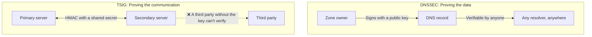

## Introduction

- **What You'll Learn From This Article**: Beyond the primary-secondary zone transfer covered in the [BIND Server Hands-On](/en/articles/dns-server-handson-guide), you'll systematically understand **TSIG** (Transaction SIGnature) — the mechanism that protects it from third parties.
- **Intended Audience**: Readers who understand DNSSEC's mechanics, but can't explain how TSIG differs from DNSSEC, or why it's needed separately.
- **Estimated Reading Time**: About 18 minutes

This article is part of the [Top 1% Series Complete Article Guide](/en/sitemap), and article 2.1 in the [DNS Series](/en/sitemap#series-list).

## Prerequisite Knowledge

- [BIND Server Hands-On](/en/articles/dns-server-handson-guide): A basic understanding of primary-secondary zone transfer is a prerequisite.

## Getting the Big Picture

**TSIG uses a shared secret (a key both parties already know ahead of time), combined with HMAC, to authenticate the message itself, exchanged between two specific servers.** **This lets you verify that a zone transfer request/response, or a dynamic update request, genuinely came from an authorized party.** **Where DNSSEC proves "this data was signed by the zone's owner, and is legitimate," TSIG proves "this specific communication, exchanged between these two specific parties, hasn't been tampered with"** — they prove entirely different things.

## Deep Dive Into the Fundamentals

### TSIG's Trust Premise: the Shared Secret Must Be Distributed Out of Band, Ahead of Time

**TSIG's key distribution itself falls entirely outside the protocol's own specification.** **An administrator needs to distribute the same shared secret to both the primary and secondary ahead of time, out of band (through a channel separate from the DNS protocol itself).** **Because of this, TSIG suits authentication between a small, specific set of servers, but authenticating against an unspecified, large number of parties becomes impractical, since the number of key combinations needed explodes.**

### Why DNSSEC Alone Can't Protect a Zone Transfer

**What DNSSEC protects is the data of a signed record itself — glue records and unsigned records fall outside its protection.** **And DNSSEC is never a mechanism for access control over the transfer itself — deciding who is allowed to request a zone transfer from which server.** **TSIG restricts a zone transfer so only a specific secondary server can request it, covering the entire exchange (glue records included) — a role complementary to DNSSEC.**

DNSSEC and TSIG Aren't Competing Choices — They're Meant to Be Combined

**DNSSEC and TSIG aren't a matter of choosing one or the other — combining them covers the range each one leaves unprotected.** **Using TSIG to protect the primary-secondary zone transfer itself, while using DNSSEC to let anyone on the internet verify the authenticity of the published DNS records — applying two different layers of defense at once — is the standard, real-world practice.**

## What a Pro Sees Here (Top 1% Understanding)

### The Word "Authenticated" Alone Never Tells You What's Actually Being Proven

**Saying "it's safe because DNSSEC authenticates it" or "it's safe because TSIG authenticates it" alone never tells you concretely what's being proven, to whom.** **The habit of digging one layer deeper to check "is this authentication proving the data's authenticity, or proving this is a communication between these two specific parties"** is the perspective a top-1% engineer carries.

## Common Misconceptions and Pitfalls

- **Misconception 1: "Deploying DNSSEC automatically protects zone transfers too."**
  DNSSEC protects a signed record's own data, and never performs access control over the zone transfer itself.
- **Misconception 2: "TSIG is just a simpler alternative to DNSSEC."**
  TSIG uses a shared secret to prove a communication between two specific parties, proving something entirely different from DNSSEC, which anyone on the internet can verify.
- **Misconception 3: "TSIG's key distribution also gets handled automatically by the DNS protocol itself."**
  TSIG's key distribution falls outside the protocol, so an administrator needs to distribute the same shared secret to both servers out of band.

## Troubleshooting Perspective

1. **A zone transfer is getting requested by an unintended third party**: Deploy TSIG to restrict zone transfer requests to a specific secondary server only.
2. **A zone transfer fails even after configuring TSIG**: Check whether the exact same shared secret is correctly configured on both the primary and the secondary.
3. **You're worried about zone transfer security even after deploying DNSSEC**: Since DNSSEC and TSIG play complementary roles, consider deploying both together.

## Summary

- TSIG uses a shared secret to authenticate the message itself, exchanged between two specific servers.
- DNSSEC proves data authenticity, while TSIG proves a communication between two specific parties — they prove entirely different things.
- TSIG's key distribution falls outside the protocol, requiring an administrator to distribute it out of band.
- DNSSEC and TSIG aren't competing choices — combining them covers the range each one leaves unprotected.

**Takeaways to Apply Today**
1. If you expose zone transfers externally, deploy access control via TSIG.
2. Whenever you see the word "authenticated," always dig one layer deeper to check what's actually being proven, to whom.

## References

- [RFC 8945: Secret Key Transaction Authentication for DNS (TSIG) | IETF](https://datatracker.ietf.org/doc/rfc8945/)
