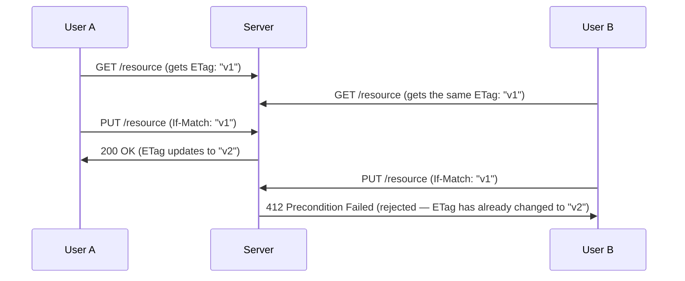

## Introduction

- **What You'll Learn From This Article**: The property that PUT is idempotent, covered in [the hands-on building a simple RESTful API yourself](/en/articles/restful-api-handson-guide), only guarantees **that sending the same request twice produces the same result.** But **the "lost update" problem — where two users update the same resource at the same time, and one's change silently gets completely overwritten by the other's — isn't prevented by idempotency at all.** This article systematically covers how **ETags** and **conditional requests** (`If-Match`/`If-None-Match`) aren't just for caching efficiency — they're also an implementation of **optimistic locking**, detecting and preventing this concurrent-update conflict using HTTP's own standard mechanism.
- **Intended Audience**: Readers who know ETags are used for caching, but can't explain the other use case — preventing concurrent-update conflicts.
- **Estimated Reading Time**: About 17 minutes

This article is part of the [Top 1% Series Complete Article Guide](/en/sitemap), and article 3.2 in the [Web/API Series](/en/sitemap#series-list).

## Prerequisite Knowledge

- [The Hands-On Building a Simple RESTful API Yourself](/en/articles/restful-api-handson-guide): The premise that PUT is idempotent, converging to the same result even when the same request repeats.

## Getting the Big Picture

**Idempotency only guarantees safety for the case of "sending the same request repeatedly."** The "lost update" problem, by contrast, **is an entirely different kind of problem.** Say two users, A and B, both read the same resource at the same time, each make a different change, and each separately send a PUT. **Looked at individually, both PUT requests are perfectly idempotent — but whichever PUT gets sent later silently, completely overwrites the change made by whichever PUT was sent earlier.** A's change gets lost, with no warning at all — this is the lost update problem, something idempotency alone can never prevent. **ETags and conditional requests are HTTP's standard answer to this problem.**

## Deep Dive Into the Fundamentals

### What Is an ETag? A Unique Fingerprint for a Resource's State

**An ETag (Entity Tag) is a unique identifier a server issues for a resource's current state.** Even the slightest change to the resource's content changes the ETag's value too. The server includes this ETag, as of that point in time, in the response header to a GET request. From there, whenever the client references this resource again, it can **send back the ETag from the last time it fetched it, included in a request header.**

### If-None-Match: a Conditional Request for Caching Efficiency

When a client sends a GET request with an `If-None-Match: "v1"` header attached, **if the current ETag matches the value the client presented, the server never sends the response body at all — it only returns a `304 Not Modified` response, with no body.** As long as the resource's content hasn't changed, the client can keep using the cache it already has, saving both bandwidth and processing cost.

### If-Match: a Conditional Request for Detecting a Concurrent Update

**The `If-Match` header is used for the exact opposite purpose of `If-None-Match`.** When a client sends an update or delete request — PUT, PATCH, or DELETE — with an `If-Match: "v1"` header attached, **the server only executes that request if the current ETag exactly matches the value the client presented.** If, after the client fetched the resource, someone else changed that resource, and the current ETag has since changed, **the server never executes the update — it returns a `412 Precondition Failed` error instead.** This lets **the client itself detect that "I was about to update based on the state I read, but that premise has already fallen apart."**

This Is HTTP's Concrete Implementation of What's Called "Optimistic Locking"

You might remember a design pattern in the database world called "Optimistic Locking" — **instead of acquiring a lock ahead of time, you check right before the update whether "the state I last saw still matches the current state," and reject the update if it doesn't.** **The combination of an ETag and `If-Match` is exactly this optimistic locking, implemented using HTTP's own standard mechanism.** Being able to provide this same safety at the HTTP layer, instead of implementing a separate version-number column on the database side, is a real-world advantage.

## What a Pro Sees Here (Top 1% Understanding)

### Idempotency and Optimistic Locking Are Separate, Mutually Complementary Safety Measures

**Idempotency guarantees "it's safe to resend a request of the same intent, any number of times," while optimistic locking (If-Match) guarantees "the premise I intended still holds right now."** These two look similar, but **what they each protect against is entirely different** — a distinction worth keeping clearly separate. For example, say a PUT's response never arrives due to a network failure, and the client resends the same PUT request — **idempotency itself makes that resend safe. But if a different user changed that resource during the time between the resends, without `If-Match`, that change gets silently overwritten.** This contrast shows that **designing a genuinely safe update API in real-world practice needs more than idempotency alone — it needs optimistic locking combined in, as a separate safety axis.**

## Common Misconceptions and Pitfalls

- **Misconception 1: "If PUT is idempotent, overwriting accidents from concurrent updates can't happen."**
  Idempotency only guarantees safety for resending the same request — the lost update problem, where two different requests conflict, happens regardless of idempotency.
- **Misconception 2: "ETags are used purely for caching efficiency."**
  ETags serve two distinct purposes: caching efficiency via `If-None-Match`, and detecting concurrent-update conflicts via `If-Match`.
- **Misconception 3: "412 Precondition Failed is a kind of server error."**
  412 is a client error (in the 4xx range), signaling that the state the client assumed didn't match the actual current state — the client should re-fetch the latest state and redo its change.

## Troubleshooting Perspective

1. **When multiple people edit the same resource, one person's change goes missing**: Check whether the update API requires a conditional request via `If-Match`, and whether it's implemented on the server side.
2. **You attached `If-Match`, but unexpectedly get a `412`**: Check whether the ETag the client is holding matches the current latest state, re-fetch it with a fresh GET, and try the update again.
3. **Caching is supposed to be working, but the full response body comes back every single time**: Check whether the client is correctly sending the `If-None-Match` header along with the ETag it already fetched.

## Summary

- Idempotency only guarantees safety for resending the same request — it can't prevent the lost update problem, where two different requests conflict.
- An ETag is a unique identifier a server issues for a resource's current state.
- `If-None-Match` is a conditional request for caching efficiency, returning `304 Not Modified` if the ETag matches.
- `If-Match` is a conditional request for detecting a concurrent-update conflict — HTTP's standard optimistic lock, returning `412 Precondition Failed` if the ETag doesn't match.

**Takeaways to Apply Today**
1. When designing an update API, don't stop at idempotency alone — consider whether optimistic locking via `If-Match` is needed too.
2. When you hit a `412 Precondition Failed`, don't assume it's a server error — re-fetch the latest state first.

## References

- [RFC 7232: HTTP/1.1 Conditional Requests](https://www.rfc-editor.org/rfc/rfc7232)
- [ETag | MDN Web Docs](https://developer.mozilla.org/en-US/docs/Web/HTTP/Headers/ETag)
