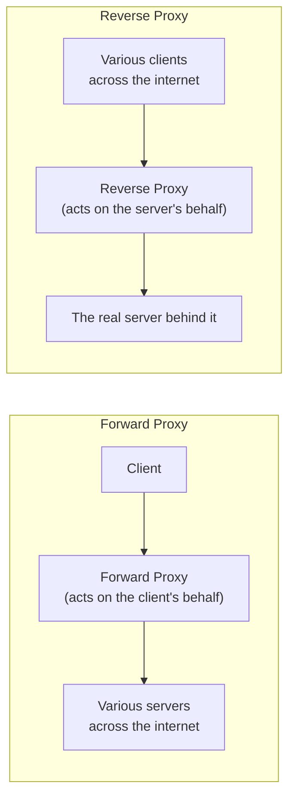

## Introduction

- **What You'll Learn From This Article**: In [the hands-on building an explicit proxy with Squid](/en/articles/squid-proxy-handson-guide) and [the hands-on building a transparent proxy](/en/articles/transparent-proxy-handson-guide), you'll notice that every proxy this series has built so far has been limited to just one kind: a "**forward proxy**." This article systematically covers the full picture: a proxy actually comes in two entirely opposite kinds — a **forward proxy, acting on behalf of the client**, and a **reverse proxy, acting on behalf of the server.**
- **Intended Audience**: Readers who've built a proxy with Squid in this series, but can't accurately explain the difference between a forward proxy and a "reverse proxy," even if they've heard the term.
- **Estimated Reading Time**: About 16 minutes

This article is part of the [Top 1% Series Complete Article Guide](/en/sitemap), and article 1.1 in the [Web Proxy / Caching Fundamentals Series](/en/sitemap#series-list).

## Prerequisite Knowledge

- [When to Use a Proxy Versus a Firewall](/en/articles/proxy-firewall-guide): The basic premise that a proxy is an entity that relays traffic.

## Getting the Big Picture

**Every proxy this series has covered so far (an explicit proxy with Squid, a transparent proxy) has been a "forward proxy" — standing on the client's side, acting on behalf of the client.** But the concept of a proxy also has another, **entirely opposite kind: the "reverse proxy."** **The axis separating the two is the direction of representation itself: which side's identity the proxy hides from the other.** **A forward proxy hides each individual client's identity from the server's perspective, acting on the client's behalf. A reverse proxy hides each individual server's identity from the client's perspective, acting on the server's behalf.**

## Deep Dive Into the Fundamentals

### Forward Proxy: the Client's Representative

**A forward proxy is deployed near the client, acting as its representative when that client accesses various, unspecified servers across the internet.** [The explicit proxy built with Squid](/en/articles/squid-proxy-handson-guide) and [the transparent proxy built with iptables](/en/articles/transparent-proxy-handson-guide) are both this type. **The number of destination servers is never limited — the client itself accesses any destination it wants, through one single forward proxy.** From the server's side, the original client's IP address is never visible — only the forward proxy's own IP address is.

### Reverse Proxy: the Server's Representative

**A reverse proxy is deployed near the server, acting as its representative, receiving unspecified clients across the internet trying to access it.** From the client's side, the reverse proxy looks exactly as if it were the real server itself — **the fact that an actual server exists behind it is never noticed at all.** **HAProxy and nginx, covered in [the Load Balancing Fundamentals Series](/en/sitemap#series-list), are a prime example of exactly this reverse proxy** — their ability to distribute traffic across multiple backend servers is just one applied use of the reverse-proxy role.

A CDN Can Also Be Understood as a Kind of Reverse Proxy

A **CDN (Content Delivery Network)**, covered in [the rise of HTTPS and the end of proxy caching](/en/articles/http-caching-cdn-guide), can also be understood structurally as **a reverse proxy, deployed in a massively distributed network.** From the client's perspective, a CDN's edge server behaves exactly as if it were the content's own source — but in reality, it merely proxies the request to the actual origin server behind it, and returns the cached result. You can think of this structure as the expanded version of what a single reverse proxy does, deployed across countless sites worldwide.

## What a Pro Sees Here (Top 1% Understanding)

### The Single Word "Proxy" Refers to Two Entirely Opposite Roles

**In real-world practice, when people just hear the word "proxy," some think of a forward proxy, and others think of a reverse proxy.** This isn't a matter of which one is correct — it's because **the word "proxy" by itself only refers to the abstract concept of "acting on behalf of," and that word alone never decides the direction of representation (on behalf of the client's side, or the server's side).** **When you encounter the word "proxy" in real-world practice, make it a habit to first judge from context whether this means a client-side representative (forward) or a server-side representative (reverse)** — the first step to accurately following a conversation in this field.

## Common Misconceptions and Pitfalls

- **Misconception 1: "The word 'proxy' only ever refers to the client-side kind, like what this series covered."**
  A proxy comes in two entirely opposite kinds: a forward proxy, acting on behalf of the client, and a reverse proxy, acting on behalf of the server.
- **Misconception 2: "A reverse proxy is just an advanced, upgraded version of a forward proxy."**
  The two serve entirely different purposes, since what they represent (the client's side or the server's side) is fundamentally different in the first place — it's not a hierarchy.
- **Misconception 3: "A CDN is an entirely separate, independent technology from a proxy."**
  A CDN can structurally be understood as the expanded version of a reverse proxy, deployed across countless sites worldwide.

## Troubleshooting Perspective

1. **You were told to "check the proxy settings," but don't know what to check**: First confirm whether that proxy is client-side (forward) or server-side (reverse), to correctly identify which config file or tool you should actually check.
2. **A server's access log never records the client's original IP address**: If it's going through a forward proxy, only the proxy's own IP address is ever visible from the server's side.
3. **Accessing the server's IP address directly, as seen from the client, doesn't give the expected response**: That IP address may belong to a reverse proxy itself — check for a separate path to actually reach the real server behind it.

## Summary

- A forward proxy is deployed near the client, relaying its access to various servers across the internet, acting on the client's behalf.
- A reverse proxy is deployed near the server, receiving access from various clients across the internet, acting on the server's behalf.
- The axis separating the two is the direction of representation itself: which side's identity the proxy hides from the other.
- HAProxy, nginx, and CDNs are prime examples of a reverse proxy, with load balancing and content delivery as applied uses of that role.

**Takeaways to Apply Today**
1. When you encounter the word "proxy," make it a habit to first judge from context whether it's a forward proxy or a reverse proxy.
2. When working with a load balancer or CDN, keep in mind that they're reverse proxies — the opposite direction of the forward proxy covered in this series.

## References

- [Reverse Proxy vs. Forward Proxy | Cloudflare](https://www.cloudflare.com/learning/cdn/glossary/reverse-proxy/)
- [What Is a Forward Proxy? | Fortinet](https://www.fortinet.com/resources/cyberglossary/forward-proxy)
