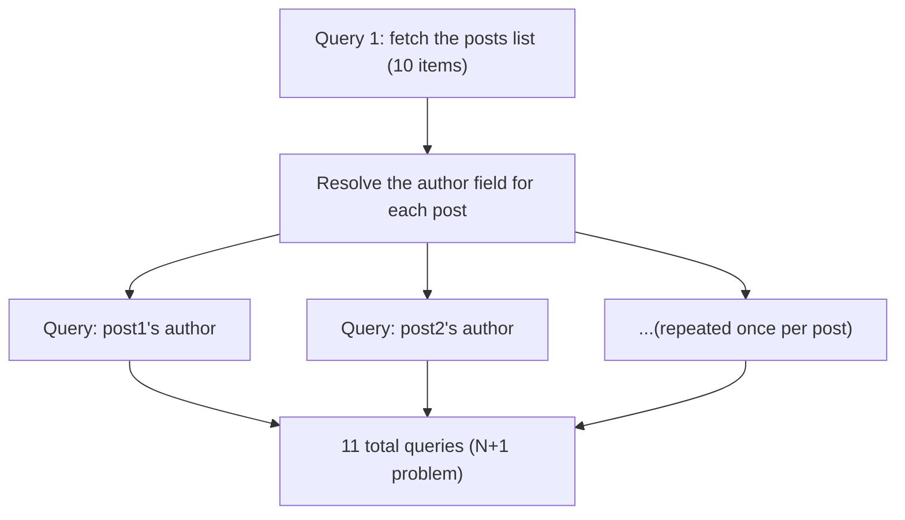

## Introduction

- **What You'll Learn From This Article**: You'll systematically understand the **N+1 problem** — an unexpected side effect of the flexibility, covered in [The Difference Between GraphQL and RESTful APIs](/en/articles/graphql-vs-rest-guide), that eliminates over-fetching and under-fetching — and **DataLoader**, the mechanism that solves it.
- **Intended Audience**: Readers who understand GraphQL's basic advantages, but can't explain why the N+1 problem happens or how it gets solved.
- **Estimated Reading Time**: About 20 minutes

This article is part of the [Top 1% Series Complete Article Guide](/en/sitemap), and article 5.1 in the [Web/API Series](/en/sitemap#series-list).

## Prerequisite Knowledge

- [The Difference Between GraphQL and RESTful APIs](/en/articles/graphql-vs-rest-guide): A basic understanding of GraphQL's resolver mechanism is a prerequisite.

## Getting the Big Picture

**A GraphQL resolver operates independently, per field.** **For example, in a query that fetches a list of multiple posts along with each post's author information in one go, after the single query that fetches the posts list, an additional query to fetch the author information ends up getting fired once for every single post in that list.** **That's 1 (fetching the list) + N (one additional query per item) — a performance problem called the N+1 problem.**

## Deep Dive Into the Fundamentals

### How DataLoader Works: Combining Batching and Caching

**DataLoader runs batching: within a single tick of the event loop, it collects every key (an author ID, say) individually requested by separate resolvers, and converts them into one combined lookup, like `WHERE id IN (...)`.** **This shrinks N+1 queries down to always just 2 (fetching the list, plus one batched fetch), regardless of the list's size.** **On top of that, it also does deduplication: if the same key gets requested multiple times within the same request, only the first one actually fetches it, and every subsequent request gets the cached result instead.**

### DataLoader Needs to Be Freshly Rebuilt for Every Single Request

**Sharing a DataLoader instance globally across requests creates a real information-leak risk: a cached result could get returned as-is to a different user with a different authorization scope.** **To avoid this danger, DataLoader must always be rebuilt as a brand-new instance for every single request.**

Using DataLoader in Only Some Resolvers Has Limited Effect

**Unless every single resolver that could cause an N+1 problem consistently uses DataLoader, batches don't aggregate properly, and the performance benefit ends up limited.** **Rather than adopting it piecemeal in just some resolvers, having a consistent policy across the whole team matters.**

## What a Pro Sees Here (Top 1% Understanding)

### One Flexibility Can Solve One Problem While Creating an Entirely New One

**The flexibility of a GraphQL resolver operating independently per field is the exact same mechanism that solved the over-fetching/under-fetching problem. But that same flexibility is also exactly what causes an entirely new performance problem: N+1.** **The habit of not stopping at just the problem a mechanism solved, but digging one layer deeper to ask "what other new problem might this same mechanism be causing"** is the perspective a top-1% engineer carries.

## Common Misconceptions and Pitfalls

- **Misconception 1: "GraphQL solves over-fetching/under-fetching, so no performance problem can happen."**
  The very design of a GraphQL resolver operating independently can itself cause an entirely different performance problem, the N+1 problem.
- **Misconception 2: "DataLoader is just a simple caching mechanism."**
  DataLoader combines caching with batching — aggregating individual resolver requests into one combined lookup.
- **Misconception 3: "A DataLoader instance should be created once at server startup and kept around."**
  Sharing a DataLoader instance globally across requests creates a risk of leaking information between users with different authorization scopes.

## Troubleshooting Perspective

1. **A GraphQL API's response is slow, with an abnormally high number of database queries**: Check whether the N+1 problem is occurring, and whether the relevant resolver uses DataLoader.
2. **Query count didn't drop as much as expected after adopting DataLoader**: Check whether every resolver that could cause an N+1 problem consistently uses DataLoader.
3. **Data that shouldn't be visible is leaking between different users**: Check whether the DataLoader instance is being shared globally across requests.

## Summary

- The N+1 problem is a performance issue where, after one query fetches a list, an additional query gets fired once for every item in that list.
- DataLoader solves this by combining batching — converting individual resolver requests into one combined lookup — with deduplicating caching.
- A DataLoader instance needs to be freshly rebuilt for every single request, to avoid an information leak.
- Every resolver that could cause an N+1 problem needs to consistently use DataLoader.

**Takeaways to Apply Today**
1. When implementing a GraphQL API, always check whether the resolver resolving a list's per-item fields is causing an N+1 problem.
2. Once you confirm a mechanism solved one problem, dig one layer deeper to check whether that same mechanism is causing a different new one.

## References

- [DataLoader in GraphQL | BrowserStack](https://www.browserstack.com/guide/dataloader-in-graphql)
- [Batching and Caching | GraphQL Golden Path](https://goldenpath.graphql.org/solutions/batching-caching/)
