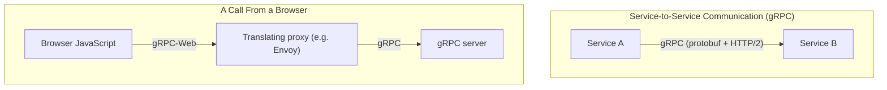

## Introduction

- **What You'll Learn From This Article**: Beyond [Understanding GraphQL's N+1 Problem and DataLoader From a Top 1% Perspective](/en/articles/graphql-n-plus-one-dataloader-guide), you'll systematically understand **gRPC** — yet another API design option distinct from REST and GraphQL — and the structural constraint it carries.
- **Intended Audience**: Readers who've heard gRPC described as "a fast API communication method," but can't explain why it can't be called directly from a browser.
- **Estimated Reading Time**: About 18 minutes

This article is part of the [Top 1% Series Complete Article Guide](/en/sitemap), and article 5.2 in the [Web/API Series](/en/sitemap#series-list).

## Prerequisite Knowledge

- [Understanding GraphQL vs RESTful API From a Top 1% Perspective](/en/articles/graphql-vs-rest-guide): Understanding the concept of an API design option other than REST is a prerequisite.

## Getting the Big Picture

**gRPC is an RPC framework developed by Google that serializes data in a binary format called Protocol Buffers (protobuf) and communicates using HTTP/2 multiplexing.** **Compared to REST, which is predominantly JSON over HTTP/1.1, gRPC achieves faster communication thanks to its binary format and its ability to process multiple requests concurrently over a single TCP connection.** **But browser JavaScript carries a structural constraint — it cannot read the HTTP/2 trailers that gRPC uses to convey a call's final status — so a browser cannot call a gRPC server directly.**

## Deep Dive Into the Fundamentals

### Why Can't a Browser Speak gRPC Directly?

**gRPC conveys a call's final success or failure status through HTTP/2 "trailers" — a special header-like region sent after the body.** **But while the browser's Fetch API exposes ordinary headers via `response.headers`, the `response.trailers` property, despite having existed in the spec for years, isn't implemented in any major browser.** **Because of this constraint, browser JavaScript code simply cannot handle gRPC communication directly.**

### gRPC-Web: a Solution That Inserts a Translating Proxy

**gRPC-Web is a separate protocol that makes gRPC usable from a browser by re-embedding the information that would normally be sent as trailers into a special frame at the end of the response body.** **This requires a configuration with a translating proxy, such as Envoy, sitting in between to convert gRPC-Web requests into native gRPC — adding one more layer of infrastructure complexity compared to pure gRPC.** **And gRPC-Web doesn't support client-side streaming or bidirectional streaming at all — only server-side streaming is supported.**

Note: schema-first design is another major difference

**gRPC enforces a schema-first design, where an API's types and structure are strictly defined up front in a `.proto` file.** **This is a similar idea to GraphQL's schema, but with gRPC, both client and server code are automatically generated from that schema, giving it the advantage that a type mismatch is more likely to be caught at compile time.**

## What a Pro Sees Here (Top 1% Understanding)

### "Fast" Means Something Different Depending on Where You Use It

**gRPC genuinely is fast, but enjoying that speed for a publicly offered API communicating with a browser requires accepting the added complexity of gRPC-Web and a translating proxy.** **For service-to-service communication that never goes through a browser — internal microservice communication, for instance — this constraint doesn't arise at all.** **Never judge solely by the evaluation "gRPC is fast" — always first check "is the client calling this API a browser, or some other service."** This is the perspective a top-1% engineer carries. In real-world practice, a common combination is widely adopted: gRPC for internal service-to-service communication, and REST or GraphQL for externally exposed APIs.

## Common Misconceptions and Pitfalls

- **Misconception 1: "gRPC can be called directly from a browser, just like REST or GraphQL."**
  Browser JavaScript can't read gRPC's trailers, so a direct call isn't possible. gRPC-Web and a translating proxy are required.
- **Misconception 2: "Using gRPC-Web gives you the exact same functionality as regular gRPC."**
  gRPC-Web doesn't support client-side streaming or bidirectional streaming.
- **Misconception 3: "If gRPC is fast, every API should be replaced with gRPC."**
  A browser-facing public API needs the added infrastructure complexity of gRPC-Web, so you need to consider a combination with REST or GraphQL depending on the use case.

## Troubleshooting Perspective

1. **Trying to call a gRPC server directly from a browser and it fails**: Check whether a gRPC-Web client library and a translating proxy like Envoy are configured.
2. **Client-side streaming doesn't work via gRPC-Web**: Confirm that gRPC-Web's spec doesn't support client-side streaming or bidirectional streaming.
3. **After a gRPC schema change, client and server types no longer match**: Check whether you've regenerated the code for both the client and server after updating the .proto file.

## Summary

- gRPC achieves faster communication than REST/JSON through Protocol Buffers and HTTP/2.
- Browsers can't read HTTP/2 trailers, so they can't call gRPC directly — gRPC-Web and a translating proxy are required.
- gRPC-Web doesn't support client-side streaming or bidirectional streaming.
- In real-world practice, combining gRPC for internal service-to-service communication with REST or GraphQL for external public APIs is widely used.

**Takeaways to Apply Today**
1. When considering adopting gRPC, always first check whether the caller is a browser or some other service.
2. When using gRPC for a browser-facing use case, check gRPC-Web's functional limitations (its streaming restrictions) ahead of time.

## References

- [gRPC in the browser: gRPC-Web under the hood | Kreya](https://kreya.app/blog/grpc-web-deep-dive/)
- [Proxy still needed with HTTP/2 supported by most browsers? | grpc-web GitHub Discussions](https://github.com/grpc/grpc-web/discussions/1348)
