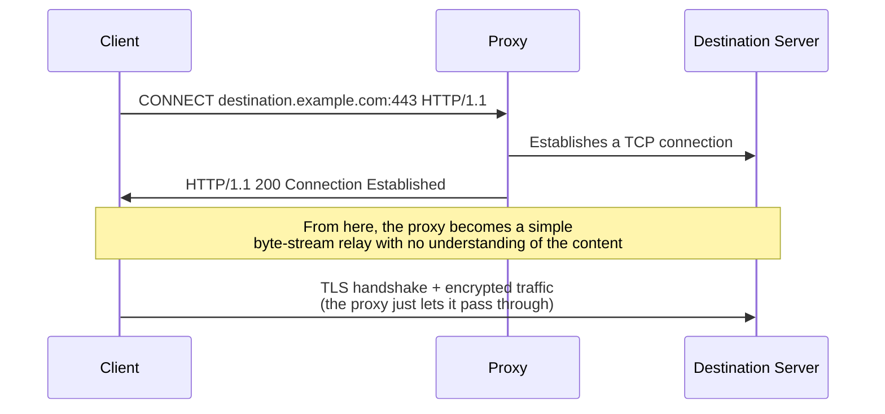

## Introduction

- **What You'll Learn From This Article**: After finishing [the hands-on building an explicit proxy with Squid and experiencing URL-based access control](/en/articles/squid-proxy-handson-guide), a question many people have is: "can that same URL-based control apply to HTTPS sites too?" This article covers the core mechanism behind the answer: the **CONNECT method**, built into HTTP itself. You'll systematically understand the reality that **a proxy merely digs a blind TCP tunnel between the client and server, never seeing the encrypted traffic's contents at all**, and its decisive difference from **SSL inspection** — covered in [when to use a proxy versus a firewall](/en/articles/proxy-firewall-guide) — which deliberately decrypts the contents.
- **Intended Audience**: Readers who understand that an explicit proxy can relay and control HTTP traffic at the URL level, but can't explain concretely how a proxy actually relays access to an HTTPS site.
- **Estimated Reading Time**: About 16 minutes

This article is part of the [Top 1% Series Complete Article Guide](/en/sitemap), and article 3.1 in the [Web Proxy / Caching Fundamentals Series](/en/sitemap#series-list).

## Prerequisite Knowledge

- [The Hands-On Building an Explicit Proxy With Squid](/en/articles/squid-proxy-handson-guide): The premise that a proxy can control access at the URL level for HTTP.
- [When to Use a Proxy Versus a Firewall](/en/articles/proxy-firewall-guide): The premise that SSL inspection is a technology that decrypts traffic once, inspects it, and re-encrypts it.

## Getting the Big Picture

**HTTP has a special method called CONNECT, whose purpose is fundamentally different from GET or POST.** When a client accesses an HTTPS site through a proxy, it first sends a request like `CONNECT destination.example.com:443 HTTP/1.1` to the proxy. **This is a request to "relay a TCP connection to this hostname and port" — not a request to forward an HTTP request at all.** Once the proxy receives this request, it establishes a raw TCP connection to the specified destination, and from that point on becomes **a simple tunnel that keeps relaying the byte stream flowing between the client and server, without ever understanding its meaning.** From here, a TLS handshake takes place between the client and proxy, and between the proxy and server, establishing an encrypted connection — but **the proxy itself never holds the key to that encrypted connection, so it can't read the contents at all.**

## Deep Dive Into the Fundamentals

### Why URL-Path-Level Access Control Isn't Possible for HTTPS Sites

The URL-level access control you experienced in [the Squid hands-on](/en/articles/squid-proxy-handson-guide) relied on the premise that **the proxy can read the HTTP request's content** (the request line, `GET /path/to/page HTTP/1.1`). **But once a tunnel is established via the CONNECT method, the proxy can't see the encrypted traffic's contents at all, and has no way of knowing the actual HTTP request (the full URL, including the path) the client is sending to the server.** All the proxy can ever know is **the destination hostname and port number, handed over at the time of the CONNECT request.** Because of this, **access control for HTTPS sites, by default, only ever works at the "hostname" level — the finer-grained control possible with HTTP, "allow or deny only this specific path on this host," can't be achieved with a CONNECT tunnel alone.**

The Relationship With TLS's SNI (Server Name Indication)

In a setup like a transparent proxy, where the client never explicitly sends a CONNECT request at all, the proxy instead reads the destination hostname from a field called **SNI** (Server Name Indication), sent in plain text at the very start of the TLS handshake. **The information available from SNI is also just the hostname**, so just as with the CONNECT method, path-level control isn't possible. The transparent proxy covered in [the hands-on building a transparent proxy](/en/articles/transparent-proxy-handson-guide) also relies on this same SNI-based, hostname-level control, when it comes to HTTPS sites.

### The CONNECT Method Also Requires Proxy Authentication

The 407 status code covered in [how proxy authentication works](/en/articles/proxy-auth-guide) gets returned not just for ordinary HTTP requests, but **for CONNECT requests too, in the same way.** When a proxy is configured to require authentication, the client first sends a CONNECT request, receives a 407 from the proxy, and resends the CONNECT request with credentials attached. **The tunnel only ever gets established once authentication completes**, so this prevents the scenario where an unauthenticated client could access any HTTPS site without limit, through the proxy.

## What a Pro Sees Here (Top 1% Understanding)

### A CONNECT Tunnel and SSL Inspection Are Two Entirely Different Operating Modes

As the explanation so far makes clear, **a blind tunnel via the CONNECT method is the proxy's default behavior.** [SSL inspection](/en/articles/proxy-firewall-guide), by contrast, is **an entirely different operating mode, where the proxy deliberately re-establishes a separate TLS session with the client, and another separate one with the server**, decrypting and inspecting the encrypted traffic's contents. **Performing SSL inspection requires getting the client to trust the certificate the proxy presents (installing an internal CA's root certificate, for instance)** — without doing this, the proxy stays in its CONNECT-tunnel state, unable to see the contents at all. **The misconception "deploying a proxy automatically lets you inspect HTTPS contents too" comes from not understanding that the CONNECT method is the default behavior, and SSL inspection is a separate mechanism that must be explicitly enabled.**

## Common Misconceptions and Pitfalls

- **Misconception 1: "As long as traffic goes through a proxy, access to an HTTPS site should be controllable at the URL path level too."**
  Under the default CONNECT tunnel, the proxy can only know the hostname — path-level control requires the additional mechanism of SSL inspection.
- **Misconception 2: "The CONNECT method is a special mechanism exclusive to HTTPS sites, unrelated to authentication."**
  A CONNECT request gets the same 407 status code as an ordinary HTTP request, and is subject to proxy authentication just the same.
- **Misconception 3: "A proxy that doesn't use SSL inspection does nothing at all for HTTPS traffic."**
  Even without SSL inspection, the proxy still acts as the relay for the TCP tunnel via the CONNECT method, and does perform hostname-level allow/deny control.

## Troubleshooting Perspective

1. **HTTP sites can be controlled at the URL path level, but HTTPS sites can't be controlled at the same granularity**: Check whether SSL inspection is enabled. If it isn't, re-examine your requirements with the premise that the CONNECT method's default behavior only allows hostname-level control.
2. **A proxy authentication popup appears when accessing an HTTPS site**: This is the 407 response to a CONNECT request — the same behavior as the ordinary proxy authentication flow.
3. **After enabling SSL inspection, a specific application alone started getting connection errors**: Check whether that application is rejecting the certificate the proxy presents, through a mechanism like certificate pinning.

## Summary

- The CONNECT method is a mechanism built into HTTP itself, requesting the proxy to "relay a TCP connection to this hostname and port."
- Once a CONNECT tunnel is established, the proxy can't see the encrypted traffic's contents at all, and knows only the destination hostname and port number.
- Because of this, access control for HTTPS sites, by default, only ever works at the hostname level.
- SSL inspection is a separate operating mode from the CONNECT tunnel, deliberately decrypting the traffic, and requires a certificate-trust configuration on the client side.

**Takeaways to Apply Today**
1. When considering access control for HTTPS sites, make explicit whether hostname-level control is sufficient, or path-level control is actually needed — and if it is, consider introducing SSL inspection.
2. Drop the assumption "deploying a proxy automatically lets you see HTTPS contents too," and keep in mind that the CONNECT method and SSL inspection are two separate operating modes.

## References

- [RFC 9110: HTTP Semantics - CONNECT](https://www.rfc-editor.org/rfc/rfc9110.html#name-connect)
- [Server Name Indication | MDN Web Docs](https://developer.mozilla.org/en-US/docs/Glossary/SNI)
