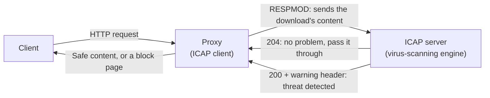

## Introduction

- **What You'll Learn From This Article**: The ACL covered in [Squid's open-proxy danger](/en/articles/squid-open-proxy-hardening-handson-guide) was URL-based access control. But a corporate proxy often also virus-scans downloaded files and runs DLP (data loss prevention) checks on uploaded content. In this article, you'll systematically understand **ICAP (Internet Content Adaptation Protocol)** — a mechanism where the proxy, instead of implementing these scanning features itself, **hands the whole job off to a separate, dedicated server.**
- **Intended Audience**: Readers who know a corporate proxy also provides features like virus scanning, but can't explain how that feature is actually implemented inside proxy software itself.
- **Estimated Reading Time**: About 17 minutes

This article is part of the [Top 1% Series Complete Article Guide](/en/sitemap), and article 10.1 in the [Web Proxy / Caching Fundamentals Series](/en/sitemap#series-list).

## Prerequisite Knowledge

- [Reproducing Squid's Open-Proxy Danger Yourself and Defending With an ACL](/en/articles/squid-open-proxy-hardening-handson-guide): The basic premise that a proxy has access-control capability.

## Getting the Big Picture

**A corporate proxy often provides advanced content-inspection features like virus scanning or DLP checks, but that inspection itself isn't performed by proxy software like Squid.** **ICAP is a simple relay protocol where the proxy (an ICAP client) sends a request's or response's entire content to a dedicated ICAP server, and gets back only the inspected or modified result.** **The proxy itself stays focused on its original job — relaying and caching HTTP — while content inspection, an entirely separate specialty, is split off to a dedicated server.**

## Deep Dive Into the Fundamentals

### REQMOD and RESPMOD: Two Directions, Differing in When Inspection Happens

**ICAP has two main processing directions. "REQMOD" (request modification) inspects a request the client is about to send** (such as upload content) **before it ever reaches the destination server.** **"RESPMOD" (response modification) inspects a response that comes back from the destination server** (such as a file being downloaded) **before it ever reaches the client.** Antivirus features mainly use RESPMOD, scanning the content of a downloaded file before it's handed to the client.

### 204 No Content: an Efficient Way to Say "No Change Needed"

**When the ICAP server judges the inspected content has no problem, it returns a "204 No Content" response, with no body.** **When the proxy receives this 204, it's defined to keep using the original request or response, completely unchanged.** This mechanism avoids having to send the entire content back from the ICAP server when it has no problem, keeping bandwidth usage down. When a problem is detected, a response such as "200 OK" with a warning header instructs the proxy to substitute a block page, among other actions.

A Large File Can Sometimes Make 204 Unusable

**For a proxy to accept a 204 response, it needs to hold a copy of the original HTTP message in memory.** **When the payload exceeds a certain size (64KB in Squid's implementation) or its size is hard to determine in advance, the proxy may not be able to accept a 204 at all, and instead has to have the ICAP server send back the entire inspected body.** This constraint comes less from ICAP's own design and more from implementation-level memory management — a real-world caveat to keep in mind.

## What a Pro Sees Here (Top 1% Understanding)

### ICAP Shows That "Relaying" and "Inspecting" Never Actually Coexist as One Specialty Inside the Proxy's Single Role

**Even though "this proxy can also virus-scan" looks like a single feature, in reality, the proxy's own specialty — relaying and caching HTTP — and the ICAP server's entirely separate specialty — inspecting content — are just connected by ICAP, a thin protocol.** **Knowing this structure explains why a real-world flexible configuration change — "swap out just the antivirus engine for a different vendor, without changing the proxy vendor" — is even possible at all.** The view that several independent specialized components coexist behind a single product name is a perspective that's come up repeatedly across this whole series.

## Common Misconceptions and Pitfalls

- **Misconception 1: "A proxy's virus-scanning feature is implemented by the proxy software itself."**
  In most cases, the proxy never performs the inspection itself at all — it hands the job off to a dedicated ICAP server via the ICAP relay protocol.
- **Misconception 2: "REQMOD and RESPMOD inspect the same content, at the same time."**
  REQMOD inspects a request from the client (such as an upload), while RESPMOD inspects a response from the server (such as a download) — at entirely separate times.
- **Misconception 3: "A 204 response is always accepted."**
  Due to implementation-level constraints, such as an oversized payload, there are cases where a 204 can't be accepted at all.

## Troubleshooting Perspective

1. **File downloads suddenly got slower, for no clear reason**: Check whether the RESPMOD inspection relay to the ICAP server has become a bottleneck.
2. **Scan results don't seem to apply correctly, but only for certain large files**: Check whether a payload-size constraint is preventing a 204 response from being used.
3. **The entire proxy stops functioning when the ICAP server goes down**: Check the fail-open/fail-closed setting for when the connection to the ICAP server fails.

## Summary

- ICAP is a relay protocol where the proxy sends a request's or response's entire content to a dedicated ICAP server, and gets back the inspected or modified result.
- REQMOD inspects a request (such as an upload) and RESPMOD inspects a response (such as a download), at entirely separate times.
- 204 No Content is a mechanism for efficiently signaling "no change needed," avoiding re-sending content that has no problem.
- Within the proxy's single role, relaying and content inspection — two independent specialties — are connected by ICAP, a thin protocol.

**Takeaways to Apply Today**
1. When you encounter the phrase "the proxy's virus-scanning feature," keep in mind that the inspection is actually happening in a separate component, the ICAP server.
2. Check ahead of time what happens when the ICAP server goes down (fail-open or fail-closed).

## References

- [Feature: ICAP (Internet Content Adaptation Protocol) | Squid Wiki](https://wiki.squid-cache.org/Features/ICAP)
- [ICAP | SafeSquid Documentation](https://docs.safesquid.com/admin_guide/security_scanners/icap.md)
