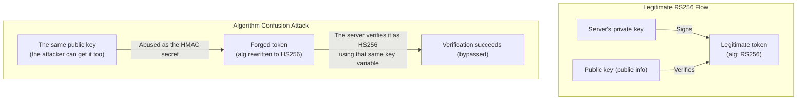

## Introduction

- **What You'll Learn From This Article**: [The hands-on reproducing the "alg: none" vulnerability](/en/articles/jwt-alg-none-handson-guide) covered an attack that completely disables signature verification. In this article, you'll reproduce yourself another attack carrying the same principle — the **algorithm confusion attack (RS256 → HS256).** You'll systematically understand the mechanism of breaking a forged token's signature by abusing RS256's **public key** as HS256's **secret key.**
- **Intended Audience**: Readers who understand JWT's "alg: none" vulnerability, but don't know there's a different kind of attack exploiting the difference between RS256 and HS256, two distinct signing schemes.
- **Estimated Reading Time**: About 23 minutes (hands-on)

This article is part of the [Top 1% Series Complete Article Guide](/en/sitemap), and article 9.1 in the [Web/API Series](/en/sitemap#series-list).

## Prerequisite Knowledge

- [The Hands-On Reproducing JWT's "alg: none" Vulnerability](/en/articles/jwt-alg-none-handson-guide): Understanding JWT's basic header/signature structure, and the principle "never trust the header's alg."

## Getting the Big Picture

**RS256 is an asymmetric signing scheme: a private key signs, and a public key verifies. HS256, by contrast, is a symmetric signing scheme using the same single secret key (a shared secret) for both signing and verification.** **RS256's public key is, true to its name, public — or anyone can obtain it from the server's JWKS endpoint or similar.** **Here's the problem: if the server's verification logic trusts the `alg` value written in the token's header, and ends up reusing the exact same "key" it had prepared for RS256 for HS256 verification too, an attacker can use the publicly available RS256 public key as the HMAC secret for HS256, and sign a forged token with it.**



## Hands-On: Reproduce the Algorithm Confusion Attack

### Step 1: Prepare a Legitimate RS256 Token Issuance/Verification Environment

On the server side, generate an RSA key pair, sign a JWT with the private key, and build a legitimate RS256 flow that verifies with the public key.

```python
import jwt
token = jwt.encode(payload, private_key, algorithm="RS256")
# Vulnerable verification code (relies on the header's alg)
decoded = jwt.decode(token, public_key, algorithms=["RS256", "HS256"])
```

**This is where the vulnerability's core lies. The `algorithms` parameter allows both `RS256` and `HS256`, and the exact same `public_key` variable gets reused for both verification paths.**

### Step 2: Obtain the Public Key and Sign a Forged Token as HS256

From an attacker's perspective, obtain the server's public key (often published, such as via a JWKS endpoint), and use that public key's string content itself as the HMAC secret for HS256, signing a forged token containing an arbitrary payload (such as `role: admin`).

```python
forged_token = jwt.encode({"user": "attacker", "role": "admin"}, public_key_pem, algorithm="HS256")
```

### Step 3: Confirm the Forged Token Bypasses the Server's Verification

Pass this forged token to Step 1's vulnerable verification code, and **the server reads the token header's `alg: HS256`, proceeds into the HMAC verification logic, and verifies using the `public_key` variable as the secret key.** **Since the key used to forge the token (the public key's string content) and the key used to verify it (that same public key's string content) match, signature verification succeeds.**

<details>
<summary>The Real Cause: "Key Type" and "Algorithm" Were Never Bound Together</summary>

**The root cause of this vulnerability is that the verification logic never distinguished which key was prepared for which algorithm, and instead changed how it used the key based on whatever `alg` value the token itself claimed.** This vulnerability actually existed in older versions (prior to 4.2.2) of Node.js's `jsonwebtoken` library. **Even after a library gets patched, a similar problem can resurface in a different shape if the calling code never explicitly specifies the `algorithms` parameter at verification time** — the only reliable defense is the principle: never rely on a library's default, and always explicitly restrict the allowed algorithm to a single one (or a small, fixed set per use case).

</details>

## Step 4: Implement the Defense and Confirm the Re-Attack Fails

Fix the verification code to pin `algorithms=["RS256"]` only, and to validate the key's own type so an RSA public key object can never be mistakenly interpreted as an HMAC string secret. With this in place, resend the exact same forged token from Steps 2 and 3, and confirm verification now reliably fails.

## What a Pro Sees Here (Top 1% Understanding)

### A Sense for the Asymmetry: "Public Information" Can Still Be Abused for a Different Purpose

**RS256's public key being "published for verification purposes" is safe, but the possibility of it being "abused as an HMAC secret" sometimes never gets considered at design time.** **The judgment "this information is public, so it's safe" is only correct as long as that information is used for its intended purpose — used for an unintended purpose (here, repurposed as an HMAC secret), it can become an entirely different vulnerability.** This is another concrete example of the same principle shared with [the "alg: none" vulnerability](/en/articles/jwt-alg-none-handson-guide): never trust what the token itself claims.

## Common Misconceptions and Pitfalls

- **Misconception 1: "RS256's public key is public information, so leaking it is no problem."**
  The public key's own exposure is expected behavior, but if the verification code doesn't distinguish how a key gets used per algorithm, that public key carries a risk of being abused as an HMAC secret.
- **Misconception 2: "As long as the JWT library is up to date, this kind of vulnerability can't occur."**
  Even with a patched library, a similar problem can resurface in a different shape if the calling code never explicitly specifies the `algorithms` parameter at verification time.
- **Misconception 3: "alg: none and the algorithm confusion attack require completely different countermeasures."**
  Both can be defended against by the shared principle: never trust the header's alg.

## Troubleshooting Perspective

1. **You're unsure which algorithm to allow when writing JWT verification code**: Explicitly specify only the single (or a small, fixed set of) algorithm you actually use.
2. **You're worried an RS256 public key might be getting reused for another purpose**: Check whether your verification code's implementation distinguishes key types (asymmetric key versus shared secret) at the implementation level.
3. **A security scan flagged the same issue even after updating the JWT library**: Check whether the verification code relies on the library's default instead of explicitly specifying the `algorithms` parameter.

## Summary

- RS256 is an asymmetric scheme, signing with a private key and verifying with a public key; HS256 is a symmetric scheme, using the same shared secret for both.
- RS256's public key is published for verification, but reusing it mistakenly as an HMAC secret lets it be abused to sign a forged token.
- The one reliable defense is explicitly pinning the allowed algorithm at verification time, never relying on the token's own header.
- Even after a library is patched, a similar problem can resurface depending on how the verification code calls it.

**Takeaways to Apply Today**
1. When writing JWT verification code, make it a habit to always explicitly specify the `algorithms` parameter.
2. Before concluding "this information is public, so it's safe," dig one layer deeper and consider the possibility of abuse for an unintended purpose.

## References

- [JWT Algorithm Confusion Attack (RS256 vs HS256) | Sourcery](https://www.sourcery.ai/vulnerabilities/jwt-algorithm-confusion)
- [3 Ways JWTs Get Forged, and the One Rule That Stops Them All | HackerNoon](https://hackernoon.com/3-ways-jwts-get-forged-and-the-one-rule-that-stops-them-all)
