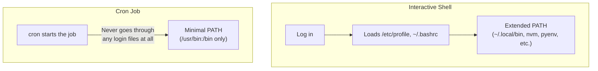

## Introduction

- **What You'll Learn From This Article**: [How a config file "takes effect"](/en/articles/linux-config-activation-guide) covered how a daemon loads a config file. In this hands-on, you'll reproduce yourself — and learn how to pinpoint the cause of — an extremely common real-world pitfall: **the cron daemon never inherits your interactive shell's environment variables (especially PATH) when it runs a job at all.**
- **Intended Audience**: Readers who've registered a job in crontab before, but either never ran into "it works manually, but fails under cron," or don't know how to systematically pinpoint the cause.
- **Estimated Reading Time**: About 19 minutes (hands-on)

This article is part of the [Top 1% Series Complete Article Guide](/en/sitemap), and article 8.1 in the [Linux/OS Fundamentals Series](/en/sitemap#series-list).

## Prerequisite Knowledge

- [How a Config File "Takes Effect"](/en/articles/linux-config-activation-guide): The basic understanding that a daemon operates in a context different from an interactive shell.

## Getting the Big Picture

**A script that runs fine when you execute it manually from the terminal can fail silently, with no error message at all, once you register it in crontab.** **The real cause of this is that cron runs a job without ever going through `/etc/profile`, `~/.bashrc`, or `~/.bash_profile` — the files loaded when a login shell starts up.** **The environment variables cron actually holds are limited to a bare minimum — something like `PATH=/usr/bin:/bin`.**



## Hands-On: Write Out Cron's Environment Yourself and Compare It

### Step 1: Write Out Your Interactive Shell's Environment Variables

```bash
env > ~/interactive-env.txt
```

### Step 2: Run That Same `env` Command as a Cron Job

Register a temporary job in crontab that runs every minute.

```bash
* * * * * env > /tmp/cron-env.txt 2>&1
```

Wait one minute, then confirm `/tmp/cron-env.txt` has been created.

### Step 3: Compare the Two Environment Variable Dumps

```bash
diff ~/interactive-env.txt /tmp/cron-env.txt
```

**Looking at this diff, you can confirm with your own eyes that PATH is drastically shorter, SHELL is set to `/bin/sh`** (even if your interactive shell is bash or zsh), **and any environment variable you configured yourself in your login shell simply doesn't exist on the cron side at all.**

### Step 4: Actually Reproduce a Failure With a PATH-Dependent Script

Prepare a simple script that calls a command existing only on your interactive shell's PATH (for instance, a script placed in `~/.local/bin`, or a binary managed by nvm or pyenv), and first confirm it runs successfully when executed manually. Next, register that exact same script as a cron job, and confirm **it fails silently, without even a "command not found" error ever being output.**

<details>
<summary>Why Doesn't Even an Error Message Show Up?</summary>

**By default, cron never displays a job's standard output or standard error anywhere at all.** In an environment with no mail delivery configured (`MAILTO`), even the fact that an error occurred never gets recorded anywhere — the failure is genuinely "silent." **The first step toward making this problem investigable is adding an explicit output redirect, something like `>> /path/to/log 2>&1`, to the job definition itself.**

</details>

## What a Pro Sees Here (Top 1% Understanding)

### "It Should Work" Is Really a Mix-Up Over "Which Environment Did You Actually Confirm It In"

**"It worked when I ran it manually" is, in reality, nothing more than confirming it worked under your interactive shell's full set of environment variables. Whether it works under cron — an entirely different execution context — is a fact that needs to be confirmed separately, explicitly.** Carrying the perspective that **invisible preconditions like environment variables can change every time the execution context changes** is the attitude a top-1% engineer brings to calmly handling this kind of "unexplained failure."

## Common Misconceptions and Pitfalls

- **Misconception 1: "A script that works when run manually will always work under cron too."**
  Cron never goes through files like `.bashrc` that a login shell loads, running the job with only a minimal set of environment variables — so the result can differ from a manual run.
- **Misconception 2: "If a cron job fails, some kind of error message gets displayed."**
  By default, cron never displays a job's standard output or standard error anywhere, so an error is silently lost unless you've set up explicit redirection.
- **Misconception 3: "Cron's SHELL is the same shell I normally use."**
  Cron's default SHELL is `/bin/sh` on many systems, which can have different syntax behavior from the bash or zsh you normally use.

## Troubleshooting Perspective

1. **A cron job produces a different result than a manual run**: Add a temporary line to the cron job's definition that dumps environment variables, like `env > /tmp/cron-env.txt`, and compare it against your interactive shell's environment.
2. **A cron job appears to be failing with no error**: Add `>> /path/to/log 2>&1` to the job's definition, to record standard output and standard error.
3. **Only a specific command results in "command not found" under cron**: Specify that command with its full path inside the script, or explicitly set PATH at the top of the script.

## Summary

- Cron never goes through files like `.bashrc` that a login shell loads, running a job with only a minimal set of environment variables.
- Cron's PATH is drastically shorter than your interactive shell's PATH, and its SHELL can differ from your interactive shell too.
- By default, a cron job's failure is never displayed anywhere — it's silently lost.
- Comparing the output of the `env` command lets you confirm, with your own eyes, the difference between your interactive shell's environment and cron's.

**Takeaways to Apply Today**
1. When registering a cron job, either explicitly set PATH inside the script, or specify commands with their full path.
2. Always set up redirection of standard output and standard error for a cron job, so a silent failure never slips past you.

## References

- [How to Debug a Cron Job That Runs but Exits Silently Because of PATH and Environment | DEV Community](https://dev.to/evvytools/how-to-debug-a-cron-job-that-runs-but-exits-silently-because-of-path-and-environment-53m0)
- [Why Crontab Scripts Are Not Working in Ubuntu | DEV Community](https://dev.to/stackallflow/why-crontab-scripts-are-not-working-in-ubuntu-1f11)
