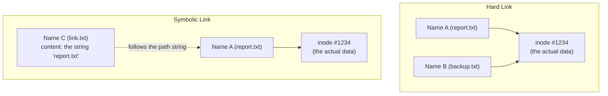

## Introduction

- **What You'll Learn From This Article**: Building on [What Is a Permission (chmod)?](/en/articles/linux-file-permissions-guide), which covered the kernel inspecting an inode (metadata), you'll systematically understand that **a filename isn't actually the file's substance itself — it's just a "label" pointing at an inode, the file's real substance.** **A hard link adds one more, perfectly equal label pointing at the same inode**, while **a symbolic link is an entirely separate, independent file whose only content is a path string.** Understanding this difference lets you explain a real-world phenomenon you've probably hit before: **deleting a log file that somehow never frees up disk space.**
- **Intended Audience**: Readers who've created a hard link or symbolic link with the `ln` command, but can't explain the difference between the two starting from the concept of an inode.
- **Estimated Reading Time**: About 17 minutes

This article is part of the [Top 1% Series Complete Article Guide](/en/sitemap), and article 4.1 in the [Linux/OS Fundamentals Series](/en/sitemap#series-list).

## Prerequisite Knowledge

- [What Is a Permission (chmod)?](/en/articles/linux-file-permissions-guide): The premise that a file's owner/group/mode bits are recorded in metadata called an inode.

## Getting the Big Picture

**Many people think a "filename" is the file's substance, but this isn't accurate.** In a Linux filesystem, **a file's actual data and attributes (owner, permissions, size, pointers to data blocks, and so on) are stored inside an entity managed by number, called an inode.** And **the "filename" you see inside a directory is nothing more than a "label" (a directory entry) pointing at that inode number.** Starting from this premise, **you can see that hard links and symbolic links — two kinds of "links" — are entirely different mechanisms.**

## Deep Dive Into the Fundamentals

### A Hard Link: Another Equal Name for the Same Inode

**A hard link (the `ln` command, with no options) creates a new directory entry pointing at the same inode number as an existing file.** Between the two names created, **there's no distinction at all between "the original name" and "the link" — they're two perfectly equal entry points into the exact same file.** **An inode keeps track of the number of directory entries pointing at it (a link count), and deleting either name with the `rm` command only decrements that link count by one — the inode itself and the data inside it never get deleted until the link count reaches zero.**

The Real Identity of "Deleting a Log File That Somehow Never Frees Up Disk Space"

Here's a phenomenon you've probably hit in real-world work: **you delete a huge log file with `rm`, but checking with the `df` command shows no increase in free disk space at all.** The cause is usually **a process still running with that log file still open (still holding a file descriptor for it).** **The `rm` command only deletes the directory entry (the name) and decrements the link count by one — as long as a process's file descriptor, a separate path to the inode distinct from the name, still references it, the link count never reaches zero, and the actual data blocks never get freed.** The fix is to restart that process, or identify the deleted-but-still-open file with a command like `lsof | grep deleted` and restart whatever process is holding it.

### A Symbolic Link: an Independent File Whose Only Content Is a Path String

**A symbolic link (the `ln -s` command) works through an entirely different mechanism from a hard link.** A symbolic link is **itself a completely independent file with its own inode, whose content is nothing more than "a string representing the path to the target."** When you access a symbolic link, the kernel performs **one extra layer of indirect processing: it first reads that file's content (the path string), then follows that path again to actually reach the real target file.** As a result, **if the real target gets deleted or moved, the symbolic link itself keeps existing, but becomes a "dead link" (a dangling link), pointing at nothing at all** — a behavior that contrasts directly with a hard link.

## What a Pro Sees Here (Top 1% Understanding)

### A Hard Link Carries Structural Constraints a Symbolic Link Doesn't Have

**A hard link can only ever be created within the same filesystem (partition).** This is because **inode numbers are only managed uniquely within each individual filesystem.** Trying to create a hard link to a different filesystem fails, since there's no corresponding inode number to reference at all. **Also, most implementations prohibit hard links to directories.** This is because allowing a hard link to a directory would create a cycle inside the directory tree, risking an infinite loop in a tree-traversal command like `find`. **A symbolic link, being an independent file whose only content is a path string, never carries any of these constraints — it can freely be created across different filesystems, and can freely point at a directory, both at once.** The usrmerge covered in [/etc and Linux's Directory Structure](/en/articles/linux-filesystem-hierarchy-guide), turning `/bin` into something pointing at `/usr/bin`, is implemented with a symbolic link rather than a hard link, and this difference in constraints is one of the reasons.

## Common Misconceptions and Pitfalls

- **Misconception 1: "A hard link is a copy of the original file, and deleting the original deletes the link too."**
  A hard link is a perfectly equal, separate name for the same inode. Deleting either one, you can keep accessing the data through whichever name remains.
- **Misconception 2: "Deleting a file with `rm` always frees up disk space immediately."**
  As long as a process is still running with that file open, the link count never reaches zero, and the data blocks never get freed.
- **Misconception 3: "A symbolic link and a hard link just look different, but work the same way internally."**
  A hard link is a new name for an existing inode, while a symbolic link is a separate file with its own inode, whose content is a path string.

## Troubleshooting Perspective

1. **You deleted a file with `rm`, but free disk space never increased**: Use `lsof | grep deleted` to identify a process still holding a deleted-but-open file.
2. **Following a symbolic link gives a "file not found" error**: Check whether the real target got deleted or moved, turning it into a dead link (a dangling link).
3. **Creating a hard link to a different partition fails**: Since a hard link can only be created within the same filesystem, use a symbolic link instead, or actually copy the file.

## Summary

- A filename isn't the file's substance itself — it's a "label" (a directory entry) pointing at an inode number.
- A hard link adds a perfectly equal new name pointing at the same inode, managed through the inode's link count.
- A symbolic link is an independent file with its own inode, whose only content is a path string.
- A hard link can only be created within the same filesystem and can never point at a directory, while a symbolic link carries neither constraint.

**Takeaways to Apply Today**
1. When you hit the issue "I deleted a file but disk space didn't go down," check whether any process is still holding that file open.
2. When choosing between a hard link and a symbolic link, first check whether you need to cross filesystems, or need to point at a directory.

## References

- [link(2) — Linux manual page](https://man7.org/linux/man-pages/man2/link.2.html)
- [symlink(7) — Linux manual page](https://man7.org/linux/man-pages/man7/symlink.7.html)
