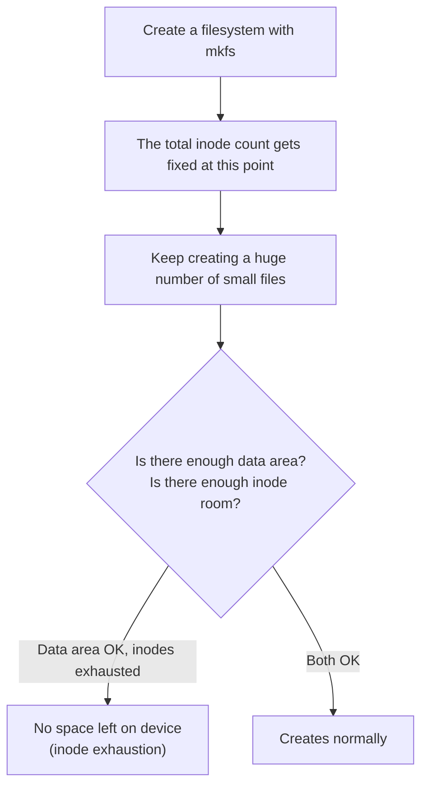

## Introduction

- **What You'll Learn From This Article**: Beyond the inode, a file's real identity, covered in [The Difference Between Hard Links and Symbolic Links](/en/articles/linux-hardlink-symlink-guide), you'll systematically understand a common real-world failure pattern: **inode exhaustion itself**.
- **Intended Audience**: Readers who've hit a "No space left on device" error despite `df -h` showing plenty of free disk space, without knowing the cause.
- **Estimated Reading Time**: About 18 minutes

This article is part of the [Top 1% Series Complete Article Guide](/en/sitemap), and article 4.2 in the [Linux Series](/en/sitemap#series-list).

## Prerequisite Knowledge

- [The Difference Between Hard Links and Symbolic Links](/en/articles/linux-hardlink-symlink-guide): Understanding the inode as a file's real identity, separate from its filename, is a prerequisite.

## Getting the Big Picture

**Every single file and directory on a filesystem consumes exactly one inode, regardless of its size.** **And the total number of inodes a filesystem can ever hold gets fixed the moment that filesystem is created (when `mkfs` runs), and can never be increased afterward.** **Because of this, keep creating a huge number of small files, and you can exhaust the inode count — a "row in the ledger" — even while the disk's data area still has plenty of free room, leaving you unable to create a single new file at all.**

## Deep Dive Into the Fundamentals

### The Diagnostic Command: Check df -i, Not Just df -h

**`df -h` displays the data area's usage rate, but never displays inode usage.** **To diagnose inode exhaustion, run `df -i` and check whether the `IUse%` column is approaching 100%.** **If `df -h`'s usage rate (`Use%`) is low, yet `df -i`'s `IUse%` has hit 100%, that's the classic signature of inode exhaustion.**

### A Common Real-World Cause: PHP Session Files, Mail Queues, Log Fragments

**A typical cause of inode exhaustion is a group of files that are small in size but extremely numerous — PHP session files, mail queue spool files like Postfix's, or unrotated, per-request log fragments.** **The standard real-world practice for identifying the offending directory is counting the number of files per directory, using a command like `find`.**

Even When Both df -h and df -i Look Fine, "No Space Left on Device" Still Appears

**If "No space left on device" still occurs even when both `df -h` and `df -i` look fine, the cause may be the phenomenon covered in [The Difference Between Hard Links and Symbolic Links](/en/articles/linux-hardlink-symlink-guide): "a file that should have been deleted never gets freed."** **As long as some process keeps a deleted file open as a file descriptor, that inode and its data area never get freed, and space only frees up once you restart the offending process.**

## What a Pro Sees Here (Top 1% Understanding)

### Behind "Running Out of Space," Two Entirely Separate Resources Can Each Run Out

**Many admins, on seeing an "out of space" symptom, reflexively check only the data area's free space — but in reality, the data area and inodes are two separate resources that can each independently run out.** **The habit of checking not just the data area, but also the inode resource, every single time you see a "No space left on device" error** is the perspective a top-1% engineer carries.

## Common Misconceptions and Pitfalls

- **Misconception 1: "If df -h shows plenty of free space, creating a file can never fail."**
  The data area and inodes are independent resources, so exhausted inodes still prevent creating a new file, even with plenty of data area free.
- **Misconception 2: "If inodes run short, you can just add more inodes to the existing filesystem."**
  The total inode count gets fixed the moment the filesystem is created, and can never be added to afterward — fixing this requires recreating the filesystem.
- **Misconception 3: "Deleting a large file always resolves an inode shortage too."**
  An inode shortage is usually caused not by large files, but by an extremely large number of small ones — deleting one large file barely changes the inode count consumed.

## Troubleshooting Perspective

1. **"No space left on device" occurs despite df -h showing free space**: Run `df -i` and check whether `IUse%` is approaching 100%.
2. **You want to identify the directory causing inode exhaustion**: Use a command like `find` to count files per directory, and look for an abnormally high count.
3. **A space shortage occurs despite both df -h and df -i looking fine**: Check whether some process is still holding a deleted file open as a file descriptor.

## Summary

- Every file on a filesystem consumes exactly one inode regardless of size, and the total inode count gets fixed when the filesystem is created.
- `df -h` displays data area usage, and `df -i` displays inode usage, separately.
- A typical cause of inode exhaustion is a group of files that are small in size but extremely numerous.
- You always need to be aware that the data area and inodes are two independent resources that can each separately run out.

**Takeaways to Apply Today**
1. When you hit an "out of space" error, always check `df -i`, not just `df -h`.
2. When operating an application that generates a huge number of small files (session management, logging, queues, and similar), periodically monitor inode consumption.

## References

- [No Space Left on Device While df Command Shows a Lot of Free Space | The Geek Diary](https://thegeekdiary.com/linux-no-space-left-on-device-while-df-command-shows-a-lot-of-free-space)
- [Knowledge Base: No Space Left on Device While There Is Plenty of Space Available | Gentoo Wiki](https://wikitest.gentoo.org/wiki/Knowledge_Base:No_space_left_on_device_while_there_is_plenty_of_space_available)
