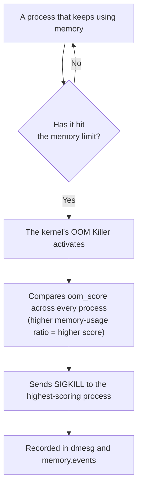

## Introduction

- **What You'll Learn From This Article**: [The hands-on building Linux cgroups yourself](/en/articles/linux-cgroups-handson-guide) let you experience a memory limit through `memory.max`. So **what actually happens when that memory limit actually gets exceeded**? In this article, you'll actually trigger the kernel's **OOM Killer (Out-Of-Memory Killer)** mechanism, and pinpoint what happened yourself, from `dmesg` and cgroup v2's `memory.events`.
- **Intended Audience**: Readers who've already experienced memory restriction with cgroups, and want to confirm with their own hands what actually happens once that memory limit gets exceeded.
- **Estimated Reading Time**: About 20 minutes

This article is part of the [Top 1% Series Complete Article Guide](/en/sitemap), and article 19.2 in the [Linux/OS Fundamentals Series](/en/sitemap#series-list).

## Prerequisite Knowledge

- [The Hands-On Building Linux cgroups Yourself](/en/articles/linux-cgroups-handson-guide): Understanding the `memory.max` memory limit setting itself.
- [How to Investigate Error Logs With journalctl](/en/articles/linux-journalctl-guide): The basic pattern of tracing a cause from logs.

## Getting the Big Picture

**A process that exceeds a memory limit doesn't exit abnormally on its own. The kernel's OOM Killer detects a system-wide memory shortage (or a cgroup's memory limit being exceeded), judges "which process should be terminated" based on a score, and forcibly terminates it with SIGKILL.** **When a container suddenly restarts with exit code 137 (128 + 9, meaning termination by SIGKILL), that container wasn't crashing from its own bug — the OOM Killer "killed" it** — that's the real identity of this phenomenon.



## Hands-On: Actually Trigger the OOM Killer and Pinpoint the Cause

### Step 1: Prepare a cgroup With a Memory Limit

Using the same approach as [the cgroups hands-on](/en/articles/linux-cgroups-handson-guide), create a cgroup with `memory.max` set to a small value (e.g., 100MB).

```bash
sudo mkdir /sys/fs/cgroup/oom-test
echo "104857600" | sudo tee /sys/fs/cgroup/oom-test/memory.max
```

### Step 2: Run a Process That Deliberately Devours Memory, Inside That cgroup

Prepare a simple script, in Python or similar, that just keeps growing its allocated memory without ever freeing it, register its PID into the cgroup's `cgroup.procs`, then run it.

```python
data = []
while True:
    data.append(bytearray(10 * 1024 * 1024))  # Allocate 10MB at a time
```

### Step 3: Confirm the OOM Killer Fired, via `dmesg`

Once the memory limit is hit, the process suddenly terminates. **Checking `dmesg` shows a line reading "Out of memory: Killed process," along with which process (PID, process name) was chosen, and in which cgroup it happened.**

### Step 4: Confirm It From the cgroup Side Too, via `memory.events`

```bash
cat /sys/fs/cgroup/oom-test/memory.events
```

**The `oom` and `oom_kill` counters in here show how many times the OOM Killer actually fired for this cgroup.** Checking both `dmesg` (a system-wide log) and `memory.events` (a per-cgroup record) lets you confidently pinpoint: "it was this cgroup's memory limit that caused it."

<details>
<summary>Which Process Gets Chosen Is Decided by a Metric Called oom_score</summary>

**The OOM Killer compares each process's `oom_score` (ranging 0 to 1000) and picks the highest-scoring one to terminate.** This score is calculated based on **what fraction of the allowed memory that process is using** — and when a cgroup's memory limit is set, the baseline isn't the system's total memory, but **that cgroup's own usage ratio against its `memory.max`.** You can also adjust this by changing `/proc/<pid>/oom_score_adj` (ranging -1000 to 1000) — "prioritize killing" a specific process, or make it "never get killed" (by setting -1000).

</details>

## What a Pro Sees Here (Top 1% Understanding)

### The OOM Killer Isn't a Bug — It's a Deliberate Design to Prevent the Whole System From Locking Up

**Leaving a genuinely exhausted memory state unaddressed either sends the whole system into thrashing — stuck doing nothing but swap reads and writes — or makes it hang completely. The OOM Killer is a deliberate design, sacrificing one process to protect the whole system's responsiveness, to avoid that worst-case scenario.** During an incident investigation, when you find yourself thinking "I don't know why this process died," **checking `dmesg` first, not just that process's own logs or stack trace,** is the first move a top-1% engineer makes.

## Common Misconceptions and Pitfalls

- **Misconception 1: "A container dying with exit code 137 means a bug in the application itself."**
  Exit code 137 means termination by SIGKILL — you should first check whether it was forcibly terminated by the OOM Killer.
- **Misconception 2: "The OOM Killer always indiscriminately picks whichever process is using the most memory."**
  oom_score isn't based on raw usage — it's calculated from the usage ratio against allowed memory, and can also be adjusted with `oom_score_adj`.
- **Misconception 3: "Exceeding a cgroup's memory limit makes the entire system a target for the OOM Killer."**
  Under cgroup v2, the OOM Killer fires within the scope of that cgroup itself, with no effect on processes in other cgroups.

## Troubleshooting Perspective

1. **A process suddenly terminated, leaving no log at all**: First check `dmesg` for a line reading "Out of memory."
2. **A container keeps restarting with exit code 137**: Check the container's memory limit (`memory.max`) and the `oom_kill` counter in `memory.events`.
3. **You never want one specific critical process to ever be an OOM Killer target**: Consider setting that process's `/proc/<pid>/oom_score_adj` to `-1000`.

## Summary

- A process that exceeds a memory limit gets forcibly terminated with SIGKILL by the kernel's OOM Killer.
- Exit code 137 means termination by SIGKILL — a strong clue pointing to a forced termination by the OOM Killer.
- Which process gets chosen is decided by `oom_score`, a metric based on the usage ratio against allowed memory.
- Checking `dmesg` and cgroup v2's `memory.events` lets you pinpoint the OOM Killer's occurrence and cause.

**Takeaways to Apply Today**
1. When a process terminates for an unknown reason, make it a habit to check `dmesg` first.
2. When a container's exit code is 137, put the memory limit and the OOM Killer at the top of your list of investigation candidates.

## References

- [proc_pid_oom_score_adj(5) | man7.org](https://man7.org/linux/man-pages/man5/proc_pid_oom_adj.5.html)
- [RFC: cgroup-aware OOM killer | lkml.iu.edu](https://lkml.iu.edu/hypermail/linux/kernel/1706.0/00899.html)
