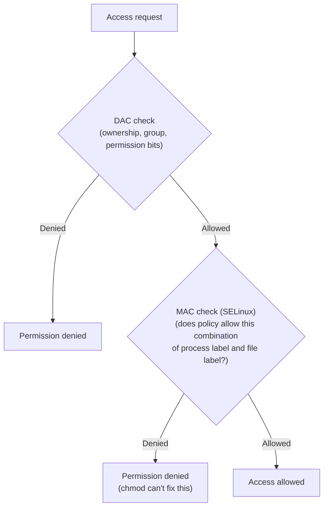

## Introduction

- **What You'll Learn From This Article**: Beyond DAC (Discretionary Access Control), covered in [What Is a Permission (chmod)?](/en/articles/linux-file-permissions-guide), you'll systematically understand SELinux's **MAC (Mandatory Access Control)** mechanism.
- **Intended Audience**: Readers who've hit the "still can't access it even after chmod 777" phenomenon and were stuck because permission knowledge alone couldn't explain it.
- **Estimated Reading Time**: About 17 minutes

This article is part of the [Top 1% Series Complete Article Guide](/en/sitemap), and article 4.05 in the [Linux/OS Fundamentals Series](/en/sitemap#series-list).

## Prerequisite Knowledge

- [What Is a Permission (chmod)?](/en/articles/linux-file-permissions-guide): Understanding DAC (Discretionary Access Control) — access control based on ownership, groups, and permission bits — is a prerequisite.

## Getting the Big Picture

**Ordinary Linux permissions (chmod, ownership, groups) are called DAC (Discretionary Access Control) — a mechanism where a file's owner decides access rights at their own discretion.** **SELinux implements an entirely independent, one-layer-higher check called MAC (Mandatory Access Control), which forcibly decides whether policy allows access based on a "security context (label)" assigned to both the process and the file, completely regardless of the file owner's intent.** **Since both checks must pass for access to be allowed, fully opening up the DAC side with `chmod 777` still leaves access denied if the MAC side's policy denies it.**

## Deep Dive Into the Fundamentals

### A Typical Case: a Mislabeled File Under /var/www/html

**A common case is Apache (the httpd process) running under the `httpd_t` domain (the process-side label), while a file placed under `/var/www/html` ends up carrying a different label, like `user_home_t`, instead of the expected `httpd_sys_content_t`.** **Since no policy rule allows `httpd_t` to read a `user_home_t` file, SELinux denies this access.** **You can check a file's assigned label with the `ls -Z` command.**

### Identifying the Cause and the Correct Fix

**The simplest way to confirm whether SELinux is the cause is to temporarily switch to permissive mode with `setenforce 0` (which logs instead of denying) and see if the problem goes away.** **The `sealert` command translates raw AVC denial logs into a human-readable explanation and a suggested fix.** **The correct fix is the `restorecon` command (e.g., `restorecon -Rv /var/www/html/`), which resets a label back to what the policy expects — disabling SELinux itself is not the recommended fix.**

Note: use chcon/semanage fcontext when write access is needed

**When you need a label that carries write access (e.g., `httpd_sys_rw_content_t`) instead of the read-only default, you can temporarily change the label with the `chcon --type=httpd_sys_rw_content_t` command.** **But a `chcon` change gets reverted by running `restorecon` or on a reboot, so a permanent change requires registering it into the policy's own rules with the `semanage fcontext` command.**

## What a Pro Sees Here (Top 1% Understanding)

### "Widening Permissions Doesn't Fix It" Is a Signal to Suspect Another Layer

**DAC and MAC are two entirely independent checks, and fully opening up one while the other denies still leaves access denied.** **When you hit "I set permissions to 777 and it's still denied," the move isn't to widen DAC further — it's to suspect one layer up: "is there an access control other than DAC, like MAC, enabled on this system?"** This is the perspective a top-1% engineer carries. Never forget that disabling SELinux doesn't remove the problem — it removes the defense itself.

## Common Misconceptions and Pitfalls

- **Misconception 1: "chmod 777 guarantees access in any environment."**
  In an environment with SELinux enabled, fully opening DAC still leaves access denied if the MAC side's policy denies it.
- **Misconception 2: "When SELinux causes a problem, disabling it is the correct fix."**
  The recommended fix is restorecon, which resets the label to its correct value, or semanage fcontext, which registers a permanent exception into policy. Disabling it sacrifices the defense itself.
- **Misconception 3: "A label changed with chcon stays permanent going forward."**
  A chcon change is temporary — it reverts after running restorecon or on a reboot. Making it permanent requires semanage fcontext.

## Troubleshooting Perspective

1. **"Permission denied" persists even after chmod 777**: Check whether SELinux is enabled with `getenforce`, and confirm whether temporarily disabling it with `setenforce 0` resolves the issue.
2. **You can't tell which policy rule is denying access**: Use the `sealert` command to translate the AVC denial log into a human-readable form and check the suggested fix.
3. **A file is placed in the correct location but still can't be accessed**: Check the file's current label with `ls -Z`, and if it differs from what's expected, fix it with `restorecon`.

## Summary

- SELinux is MAC (Mandatory Access Control), another layer of access control entirely independent of DAC (permissions).
- Access is only allowed when both the DAC and MAC checks pass.
- You can confirm whether SELinux is the cause by temporarily checking with setenforce 0.
- The correct fix is restorecon/semanage fcontext to fix the label — disabling SELinux isn't recommended.

**Takeaways to Apply Today**
1. When you hit "widening permissions doesn't fix it," check first whether a MAC like SELinux/AppArmor is enabled.
2. When fixing a SELinux issue, prioritize restoring the correct label over disabling it.

## References

- [SELinux Troubleshooting | OneUptime](https://oneuptime.com/blog/post/2026-02-13-selinux-troubleshooting/view)
- [Data Directory Is Not Writable Even After chmod | Deskpro Support](https://support.deskpro.com/kb/articles/450)
