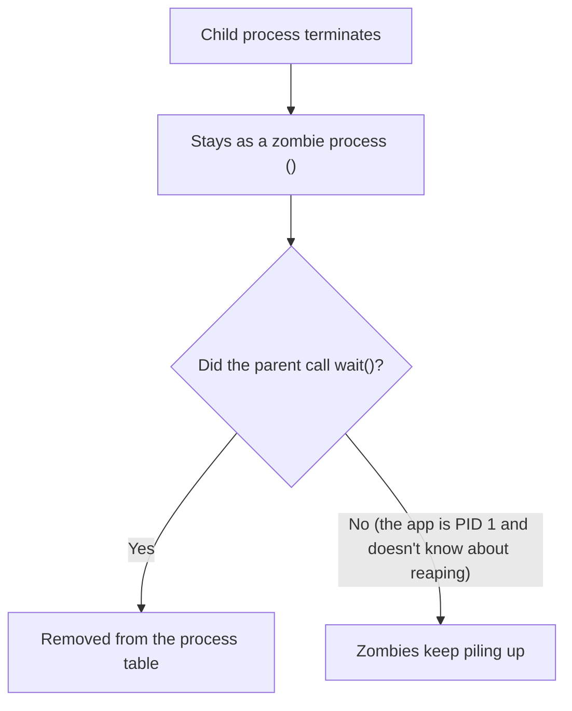

## Introduction

- **What You'll Learn From This Article**: Beyond how a process inside a container behaves as PID 1, covered in the [Linux Namespaces Hands-On](/en/articles/linux-namespaces-handson-guide), you'll get hands-on and systematically understand **zombie processes and PID 1's own special responsibilities** — a problem that comes up constantly in real-world practice.
- **Intended Audience**: Readers who've seen `<defunct>` in `ps` output before, but can't explain what it means or how to resolve it.
- **Estimated Reading Time**: About 25 minutes (budget about 40 minutes if you're building this hands-on as you go)
- **Hands-On Prerequisite Environment**: A Linux environment running Docker

This article is part of the [Top 1% Series Complete Article Guide](/en/sitemap), and article 19.3 in the [Linux Series](/en/sitemap#series-list).

## Prerequisite Knowledge

- [Linux Namespaces Hands-On](/en/articles/linux-namespaces-handson-guide): Understanding that a process inside a container behaves as PID 1 within its own independent PID namespace is a prerequisite.

## Getting the Big Picture

**When a child process terminates, its exit status keeps sitting in the process table until its parent process calls `wait()` (or `waitpid()`) to "reap" it.** **A process in this state — terminated, but still waiting to be reaped — is called a zombie process (`<defunct>`).** **Normally, the init process (PID 1) takes over any orphaned process that lost its parent and calls `wait()` on its behalf, but inside a container, the application itself often runs as PID 1, so this reaping responsibility falls on the application itself.**



## Deep Dive Into the Fundamentals

### Hands-On: Create a Zombie Process Yourself, and Confirm kill -9 Doesn't Remove It

1. **Prepare a simple shell script that spawns a child process, and leaves its parent without ever calling `wait()`.**

```bash
#!/bin/bash
sleep 1 &
CHILD_PID=$!
sleep 30
```

2. **From another terminal, run `ps aux` to check the state of the child process while this script is running.** From the moment `sleep 1 &` finishes until the parent's `sleep 30` ends, the child shows `Z` (zombie) in the `STAT` column.

```bash
ps aux | grep sleep
# yourname  12345  ...  Z+   0:00 [sleep] <defunct>
```

3. **Try running `kill -9` against this zombie process.**

```bash
kill -9 12345
# No error, but the process never disappears
```

**A zombie process has already finished executing — the very code that would receive and process a signal no longer exists.** **`kill -9` can't "kill something already dead" a second time, and the only genuine fix is for the parent process to call `wait()`, or for the parent itself to terminate so the zombie gets reparented to PID 1, which reaps it instead.**

### PID 1's Other Special Responsibility: Default Signal Handling Doesn't Apply

**An ordinary process, on receiving `SIGTERM`, gets the kernel's default behavior (process termination) applied even without a registered handler.** **PID 1 alone is the exception — the kernel doesn't apply that default behavior to it, so it keeps silently ignoring `SIGTERM` unless it has explicitly registered a handler.** **This is the direct cause of the real-world symptom where running `docker stop` (which internally sends SIGTERM) fails to stop the container, leaving nothing but a forced `SIGKILL` after the default timeout.**

<details>
<summary>The Fix: Use a Lightweight Init Wrapper Like tini or dumb-init as ENTRYPOINT</summary>

**`tini` and `dumb-init` are lightweight wrappers that run as a container's PID 1, taking on the two responsibilities an ordinary init process normally handles: reaping zombie processes and correctly forwarding signals.** **Docker also provides the `docker run --init` option, which automatically injects one of these into ENTRYPOINT, and Docker Compose's `init: true` setting — letting you fix this problem without ever rewriting the application itself.**

</details>

## What a Pro Sees Here (Top 1% Understanding)

### "An Ordinary Process" and "PID 1" Get Treated Completely Differently by the Kernel

**Most applications are written assuming they'll run as an ordinary process, with no deliberate implementation at all for PID 1's two special responsibilities — reaping and signal handling.** **The habit of asking, when running an application in a container environment, "was this process actually written with the assumption that it might run as PID 1"** is the perspective a top-1% engineer uses to prevent zombie accumulation and an unresponsive `docker stop` before they ever turn into a seemingly unexplainable mystery.

## Common Misconceptions and Pitfalls

- **Misconception 1: "A zombie process can be force-killed with `kill -9`."**
  A zombie process has already finished executing, with no code left to process a signal, so `kill -9` can never remove it.
- **Misconception 2: "PID 1 gets the same default signal handling applied as any other process."**
  PID 1 is the exception — the kernel never applies default signal handling to it, so it keeps silently ignoring signals like SIGTERM unless an explicit handler is registered.
- **Misconception 3: "Even a single zombie process means something seriously wrong with the system."**
  A temporary zombie process is a normal occurrence — the real problem is when a parent never reaps them and they keep accumulating, straining the process table.

## Troubleshooting Perspective

1. **`<defunct>` processes in `ps aux` keep growing in number**: Check whether the parent process correctly calls `wait()` on its children, or whether PID 1 is fulfilling its reaping responsibility.
2. **`docker stop` leaves the container running until timeout**: Check whether the application itself, running as PID 1, is responding to SIGTERM, or whether an init wrapper like tini/dumb-init is in place.
3. **A zombie process still won't disappear even after `kill -9`**: A zombie is already a dead process — there's no fix besides the parent process reaping it.

## Summary

- A zombie process is a state where a terminated child process's exit status keeps sitting in the process table, waiting for its parent to call `wait()`.
- `kill -9` can't remove a zombie process. The only genuine fix is reaping by the parent, or handoff to PID 1.
- PID 1 alone is the exception to the kernel's default signal handling, and keeps ignoring SIGTERM unless it has an explicit handler.
- Using a lightweight init wrapper like `tini` or `dumb-init` as ENTRYPOINT fixes this problem without ever rewriting the application itself.

**Takeaways to Apply Today**
1. When a containerized application runs as PID 1, consider adopting `tini`, `dumb-init`, or `docker run --init`.
2. When you hit a `docker stop` that doesn't work, suspect PID 1's signal handling first.

## References

- [Docker and the PID 1 Zombie Reaping Problem | Phusion](https://blog.phusion.nl/docker-and-the-pid-1-zombie-reaping-problem/)
- [When Containers Kill Nodes: Understanding Zombie Processes and PID 1 | DEV Community](https://dev.to/shailendra_verma/when-containers-kill-nodes-understanding-zombie-processes-and-pid-1-3o7f)
