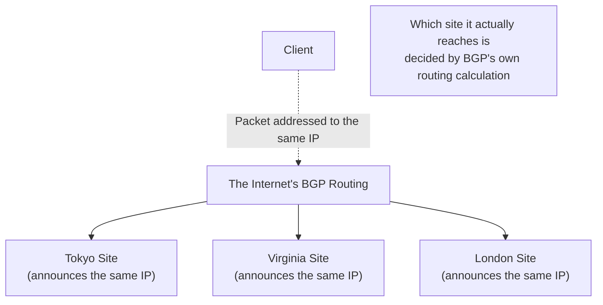

## Introduction

- **What You'll Learn From This Article**: The technique covered in [How GSLB (Global Server Load Balancing) Works](/en/articles/load-balancing-gslb-guide) — having the authoritative DNS server return a different IP address depending on the querying client's situation — is just one way to achieve global distribution. This article systematically covers **Anycast**, **a mechanism achieving the same goal at an entirely different layer.** You'll cover the idea of announcing the exact same single IP address via BGP simultaneously from multiple sites around the world, and letting the internet's own routing decide which site actually receives it.
- **Intended Audience**: Readers who understand that GSLB achieves site distribution by rewriting DNS responses, but can't explain Anycast, a different approach entirely.
- **Estimated Reading Time**: About 17 minutes

This article is part of the [Top 1% Series Complete Article Guide](/en/sitemap), and article 6.1 in the [Load Balancing Fundamentals Series](/en/sitemap#series-list).

## Prerequisite Knowledge

- [How GSLB (Global Server Load Balancing) Works](/en/articles/load-balancing-gslb-guide): The premise that the authoritative DNS server returns a different IP address depending on the querying client's situation.

## Getting the Big Picture

**GSLB made the decision of "which site to send traffic to" at the layer of DNS name resolution.** **Anycast, by contrast, achieves the exact same goal at an entirely different layer — the layer of BGP (Border Gateway Protocol), which handles the internet's own routing.** **With Anycast, routers at multiple sites distributed around the world each independently announce the exact same single IP address (prefix) via BGP.** From the client's perspective, multiple sites across the internet all claim to be the same IP address — but **the packets a client actually sends end up, as a result of BGP's own routing calculation, reaching whichever site is normally closest to that client along the network path (with the shortest AS path).**

## Deep Dive Into the Fundamentals

### GSLB and Anycast Differ Fundamentally in Failover Speed

**Since switching sites with GSLB happens by rewriting DNS responses, the switchover doesn't take effect until the old DNS record's TTL, cached on the client or resolver's side, expires.** Depending on the TTL's length, a meaningful delay can exist between an actual failure and the switchover taking effect. **With Anycast, by contrast, switching sites happens simply by having the failed site stop announcing that IP address via BGP — the internet's routing tables then normally recalculate routes to the remaining healthy sites within seconds to tens of seconds.** **Because this switchover happens through the network's own re-convergence, not dependent on DNS caching, Anycast generally achieves faster failover.**

### Anycast's Weakness: "Close" and "Not Busy" Don't Necessarily Match

**What Anycast decides is purely "closeness" in terms of BGP routing (distance along the network path) — it never considers "load" at all, how congested a site currently is, or how much processing capacity it has left.** **Even if a site is overloaded, traffic concentration on it never stops, as long as BGP's routing doesn't change.** This stands in contrast to [how GSLB can exclude an overloaded site from its responses, based on health-check results](/en/articles/load-balancing-gslb-guide) — a structural constraint unique to Anycast.

Another Weakness: Anycast Can't Maintain a Connection's State

**Anycast has no mechanism for maintaining the state of an individual connection (session).** If BGP's routing changes for any reason, **the exact same, still-ongoing connection could end up reaching a different site, mid-stream.** In the context of a TCP connection, this can be a fatal problem. In real-world practice, the common setup is to use Anycast for UDP-based, stateless traffic (DNS queries, for instance) or short-lived HTTP requests, and for connections needing long-lived state maintenance, **use Anycast only to decide the initial destination, then hand off within that site to a separate, regular load balancer** — combining multiple mechanisms together.

## What a Pro Sees Here (Top 1% Understanding)

### In Real-World Practice, GSLB and Anycast Are Often Combined, Not Competing Options

**GSLB and Anycast aren't an either-or choice — in real-world practice, they're commonly used together.** For example, [a large-scale service like Cloudflare or Google's public DNS (8.8.8.8)](https://developers.google.com/speed/public-dns) builds a foundation with Anycast, so that accessing it from anywhere in the world automatically routes to a physically nearby site — and **within each site, uses a regular load balancer or a GSLB-like mechanism for finer-grained load distribution control.** **Anycast excels at "roughly routing to a nearby site," but isn't well suited to fine-grained control, like "which server within that site, under what condition."** Understanding that these two mechanisms solve problems at entirely different levels of abstraction is the foundation for designing an actual global distribution infrastructure.

## Common Misconceptions and Pitfalls

- **Misconception 1: "Anycast and GSLB basically do the same thing — they're nearly identical mechanisms."**
  GSLB is a mechanism that rewrites DNS responses, while Anycast uses routing itself — an entirely different layer. They differ on multiple points, including failover speed and whether connection state can be maintained.
- **Misconception 2: "If Anycast routed me to a 'close' site, that site should be lightly loaded too."**
  What Anycast decides is purely closeness along the network path — it never considers a site's load status at all. A nearby site can always be overloaded.
- **Misconception 3: "Anycast can be safely used for long-lived connections as-is."**
  Anycast has no mechanism for maintaining an individual connection's state — a routing change can cause the exact same connection to reach a different site, mid-stream.

## Troubleshooting Perspective

1. **Traffic keeps concentrating on a site even after a failure there**: Check whether that site has actually stopped announcing the BGP route. Anycast's automatic switchover never happens unless the announcement is actually withdrawn.
2. **One specific site is clearly more congested than the others**: In a setup relying purely on Anycast, traffic can concentrate on a specific site purely because it's "close" along the BGP routing — consider an additional load-balancing mechanism within that site.
3. **A long-lived connection application experiences unstable communication**: Check whether the Anycast route switched mid-connection, and if needed, redesign to limit Anycast's use to stateless purposes.

## Summary

- GSLB achieves site distribution by rewriting DNS responses, while Anycast announces the same IP address from multiple sites via BGP, leaving the distribution decision to routing itself.
- Anycast's failover is generally faster than GSLB's, since it doesn't depend on DNS caching.
- Anycast only considers "closeness" along the network path — it never reflects a site's "load" status at all.
- Since Anycast can't maintain an individual connection's state, real-world practice uses it for stateless purposes, or combines it with a separate load balancer within each site.

**Takeaways to Apply Today**
1. When designing a global distribution infrastructure, don't treat GSLB and Anycast as competing options — combine them, keeping in mind the difference in the level of abstraction each one solves.
2. When adopting Anycast, design load distribution within each site separately, on the premise that "close" and "not busy" are entirely separate problems.

## References

- [What is global server load balancing (GSLB)? | Gcore](https://gcore.com/learning/what-is-global-server-load-balancing)
- [Google Public DNS | Google for Developers](https://developers.google.com/speed/public-dns)
