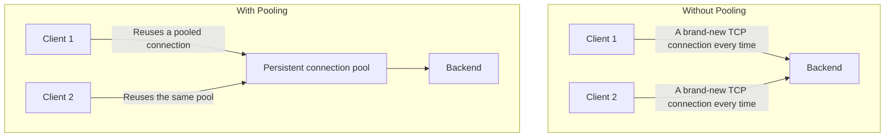

## Introduction

- **What You'll Learn From This Article**: Beyond how to handle the connection to a backend, covered in [How Connection Draining Works](/en/articles/load-balancing-connection-draining-guide), you'll systematically understand **connection pooling** — a performance optimization that reuses backend connections.
- **Intended Audience**: Readers who know a load balancer manages its connection to the client and its connection to the backend separately, but can't explain exactly how a backend connection gets reused.
- **Estimated Reading Time**: About 18 minutes

This article is part of the [Top 1% Series Complete Article Guide](/en/sitemap), and article 4.2 in the [Load Balancing Fundamentals Series](/en/sitemap#series-list).

## Prerequisite Knowledge

- [How Connection Draining Works](/en/articles/load-balancing-connection-draining-guide): Understanding the concept of a connection between a load balancer and a backend is a prerequisite.

## Getting the Big Picture

**If a load balancer opened a brand-new TCP connection to the backend for every single client request, the overhead of a TCP handshake (and a TLS handshake too, for encrypted traffic) would repeat every single time.** **This overhead occupies a disproportionately large share when the backend's own response is fast.** **Connection pooling pre-establishes and pools persistent connections to the backend, reusing that same connection, one after another, across multiple different clients' requests.**

## Deep Dive Into the Fundamentals

### The Pitfall on Nginx: Setting keepalive Alone Isn't Enough

**On Nginx, setting `keepalive` in the `upstream` block alone never reuses the backend connection.** **Nginx speaks HTTP/1.0 to the backend by default, so a persistent connection can't even exist in the first place — you additionally need `proxy_http_version 1.1;` and to explicitly clear the `Connection` header forwarded from the client.** **And the number you specify in `keepalive` is a per-worker-process limit, so a configuration with multiple worker processes ends up holding more total connections against the backend than that number alone would suggest.**

### This Performance Optimization Becomes a Prerequisite for HTTP Request Smuggling

**The attack covered in the [HTTP Request Smuggling Hands-On](/en/articles/load-balancing-request-smuggling-handson-guide) abuses the load balancer and the backend interpreting a request's boundary differently — but the reason that attack can affect an entirely unrelated client's request at all is exactly because a persistent connection gets reused across multiple clients' requests.** **When enabling connection pooling, especially in an environment with high security requirements, you need to verify whether the backend interprets a request's boundary using the exact same standard as the load balancer.**

A Diagnostic Clue: a Zero upstream_connect_time Means Reuse

**Whether a connection was actually reused can be checked with the `$upstream_connect_time` variable.** **A value of zero means an existing connection got reused; a nonzero value means a new handshake occurred.**

## What a Pro Sees Here (Top 1% Understanding)

### One Performance Optimization Can Also Become an Entirely Different Security Precondition

**Connection pooling often gets introduced purely as a performance optimization, but this exact same mechanism also turns out to be a mandatory precondition for HTTP request smuggling, an attack, to succeed at all.** **The habit of not evaluating a mechanism solely by the goal it was introduced for (here, performance), but digging one layer deeper to ask "what other precondition might this mechanism be creating"** is the perspective a top-1% engineer carries.

## Common Misconceptions and Pitfalls

- **Misconception 1: "Setting keepalive in the upstream block alone reuses the backend connection."**
  Nginx speaks HTTP/1.0 by default, so setting proxy_http_version 1.1 and clearing the Connection header are additionally required.
- **Misconception 2: "The number specified in keepalive is the total limit on backend connections across the whole load balancer."**
  The keepalive number is a per-worker-process limit, so with multiple worker processes, the total connection count exceeds that number.
- **Misconception 3: "Connection pooling is purely a performance feature, unrelated to security."**
  Reusing a persistent connection is a direct precondition for HTTP request smuggling affecting an entirely unrelated client.

## Troubleshooting Perspective

1. **Connections aren't getting reused on Nginx, despite setting keepalive**: Check whether both proxy_http_version 1.1 and clearing the Connection header have been configured.
2. **The number of connections to the backend is higher than expected**: Recalculate the actual limit as the keepalive number multiplied by the number of worker processes.
3. **You want to assess the security risk before introducing connection pooling**: Check whether the backend's interpretation of a request's boundary matches the load balancer's.

## Summary

- Connection pooling is a performance optimization that pools persistent backend connections and reuses them across multiple clients' requests.
- On Nginx, setting keepalive alone isn't enough — proxy_http_version 1.1 and clearing the Connection header are also required.
- The keepalive number is a per-worker-process limit, something to watch for.
- Reusing a persistent connection is also a direct precondition for the HTTP request smuggling attack.

**Takeaways to Apply Today**
1. When introducing backend connection pooling, check not just the performance settings, but also your resilience against request smuggling.
2. When introducing a performance optimization, dig one layer deeper to ask what other precondition that mechanism might be creating.

## References

- [NGINX Upstream Keepalive: Eliminating Per-Request TCP and TLS Overhead | Netdata](https://www.netdata.cloud/guides/nginx/nginx-upstream-keepalive/)
- [Enable Keepalive Connections in Nginx Upstream Proxy Configurations | ma.ttias.be](https://ma.ttias.be/enable-keepalive-connections-in-nginx-upstream-proxy-configurations/)
