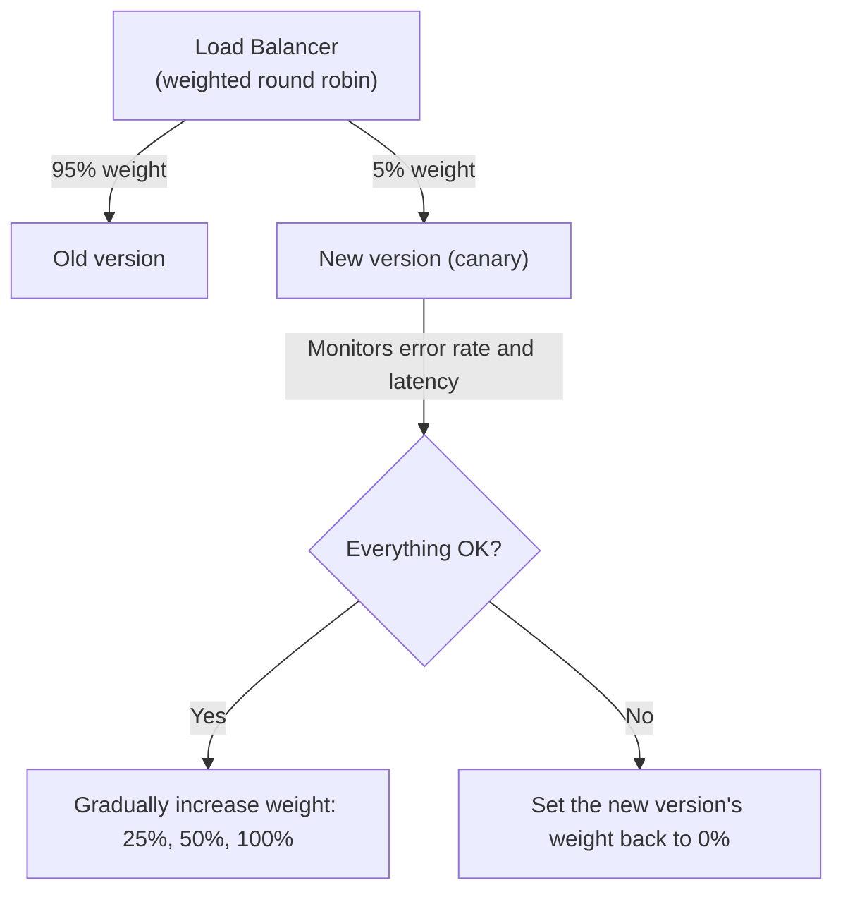

## Introduction

- **What You'll Learn From This Article**: The weighted round robin covered in [load balancing algorithms and health checks](/en/articles/load-balancing-algorithms-guide) was introduced as a mechanism for adjusting differences in server capacity. In this article, you'll systematically understand how **this exact same mechanism gets repurposed into canary deployment** — a release strategy that gradually increases traffic to a new version.
- **Intended Audience**: Readers who understand the weighted round robin mechanism itself, but don't know it also gets used as a release strategy.
- **Estimated Reading Time**: About 18 minutes

This article is part of the [Top 1% Series Complete Article Guide](/en/sitemap), and article 2.2 in the [Load Balancing Fundamentals Series](/en/sitemap#series-list).

## Prerequisite Knowledge

- [Load Balancing Algorithms and Health Checks](/en/articles/load-balancing-algorithms-guide): Understanding the weighted round robin mechanism itself.

## Getting the Big Picture

**Weighted round robin was a mechanism that distributes traffic according to a weight ratio configured per server.** **Use this exact same mechanism not for "distributing across multiple servers with different capacity," but for "distributing between two different pieces of code — a new version and an old one" — and you get canary deployment, a safe release strategy.** **You gradually increase the weight toward the new version — 5% → 25% → 50% → 100% — monitoring error rate and latency at each step, and only advancing to the next step if nothing goes wrong.**

## Deep Dive Into the Fundamentals

### The Difference Between Canary Deployment and Blue-Green Deployment

**Blue-green deployment prepares two entirely independent environments, old and new, and switches all traffic to the new environment instantly, just by changing the load balancer's switchover setting.** Rolling back is just as instant, by reverting that same setting — but **it carries a trade-off: maintaining two environments simultaneously effectively doubles infrastructure cost.** **Canary deployment shares a single environment, gradually changing only the weight ratio**, keeping the increase in infrastructure cost down while detecting problems early, within a limited scope.

### Sticky Sessions Can Distort a Canary Deployment's Weight Ratio

**If session persistence (sticky sessions), covered in [load balancing algorithms](/en/articles/load-balancing-algorithms-guide), is enabled, a client already pinned to the old version keeps connecting to the old version, even after you change the weight ratio.** **This can cause the configured weight ratio and the actually observed percentage of traffic reaching the new version to no longer match.** When running a canary deployment, you need monitoring that accounts for this too.

Combining Per-Step Monitoring With Automatic Rollback

**Real-world canary deployment is recommended to combine monitoring metrics — error rate, latency — at each step, with an automatic rollback mechanism that resets the new version's weight to 0% the instant a predefined threshold is exceeded.** This is a design where, instead of a human constantly watching, a mechanical, metrics-based judgment handles safe promotion or rollback.

## What a Pro Sees Here (Top 1% Understanding)

### The Exact Same Technical Mechanism Can Get Repurposed for an Entirely Different Goal

**Weighted round robin, a single technical mechanism, works equally well for the static load-balancing goal of "adjusting server capacity differences," and for the dynamic release-strategy goal of "safely rolling out a migration to a new version."** **Not just understanding a mechanism's own workings, but digging one layer deeper to consider what goal it can be repurposed for, and how** — that's the perspective a top-1% engineer carries.

## Common Misconceptions and Pitfalls

- **Misconception 1: "Canary deployment and blue-green deployment are just two names for the same technique."**
  Blue-green deployment is an instant, all-at-once switchover between two independent environments, while canary deployment is a gradual weight change sharing a single environment — different techniques.
- **Misconception 2: "Weighted round robin can only ever be used for adjusting server capacity differences."**
  The exact same mechanism can also control traffic distribution between a new and old version, for canary deployment's release strategy.
- **Misconception 3: "Sticky sessions have no effect on canary deployment at all."**
  With sticky sessions enabled, a client already pinned to the old version keeps connecting to it even after you change the weight ratio, which can distort the observed traffic split.

## Troubleshooting Perspective

1. **The weight ratio configured for a canary deployment doesn't match the actual traffic split**: Check whether sticky sessions are enabled.
2. **The error rate spiked right after increasing the new version's weight**: Check whether the automatic rollback mechanism worked correctly, resetting the weight to 0%.
3. **You're unsure whether to choose canary or blue-green deployment**: Decide based on whether you prioritize infrastructure cost constraints or early problem detection.

## Summary

- Weighted round robin can be repurposed not just for adjusting server capacity differences, but also for canary deployment's release strategy.
- Blue-green deployment is an instant, all-at-once switchover between two independent environments; canary deployment is a gradual weight change sharing a single environment.
- With sticky sessions enabled, the ratio observed during a canary deployment can stop matching the configured weight.
- Combining per-step metrics monitoring with an automatic rollback mechanism is recommended in real-world practice.

**Takeaways to Apply Today**
1. When you learn a new technical mechanism, dig one layer deeper and consider whether it can be repurposed beyond its original goal.
2. When running a canary deployment, always check the sticky-session configuration.

## References

- [Blue-Green vs Canary vs Rolling Deployments in Kubernetes | CloudOptimo](https://cloudoptimo.com/blog/blue-green-vs-canary-vs-rolling-deployments-in-kubernetes-how-to-choose-the-right-one/)
- [Blue-Green Deployments With Application Load Balancer | AWS DevOps Blog](https://aws.amazon.com/blogs/devops/blue-green-deployments-with-application-load-balancer/)
