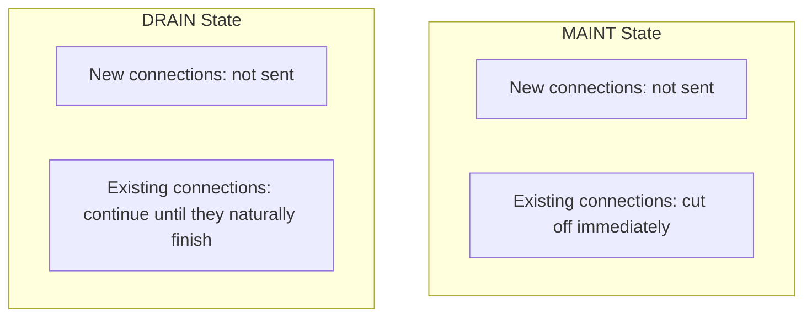

## Introduction

- **What You'll Learn From This Article**: After finishing [the hands-on building an L7 load balancer with HAProxy](/en/articles/load-balancing-haproxy-handson-guide), you inevitably run into this scenario in real-world practice: you need to safely pull one backend server out of the load balancer's rotation, for a deployment or maintenance window. This article systematically covers **connection draining (DRAIN)** — a mechanism that **lets existing connections finish naturally while only stopping new ones** — and its decisive difference from **the MAINT state, which cuts connections off immediately.**
- **Intended Audience**: Readers who've built a load balancer with HAProxy, but can't explain the concrete procedure for safely putting a live backend server into maintenance.
- **Estimated Reading Time**: About 16 minutes

This article is part of the [Top 1% Series Complete Article Guide](/en/sitemap), and article 4.1 in the [Load Balancing Fundamentals Series](/en/sitemap#series-list).

## Prerequisite Knowledge

- [The Hands-On Building an L7 Load Balancer With HAProxy](/en/articles/load-balancing-haproxy-handson-guide): The premise that HAProxy's basic behavior is routing requests across multiple backend servers.
- [How Load Balancing Algorithms and Health Checks Work](/en/articles/load-balancing-algorithms-guide): The basics of session persistence (sticky sessions) are a prerequisite.

## Getting the Big Picture

Many people's first instinct, for removing a backend server from a load balancer's rotation, is **deleting that server's entry from the config file and reloading.** But with this method, **any request that server is still processing, that hasn't returned a response yet, gets forcibly cut off without any regard for its state.** From the user's perspective, a request that should still have been in progress suddenly fails. **Connection draining (DRAIN) exists precisely to avoid this problem.** DRAIN is a state combining two distinct behaviors: "don't send new connections to this server" and "let the exchange on an already-established connection keep going until it naturally finishes."



## Deep Dive Into the Fundamentals

### The MAINT State: Cuts Off Immediately, Without Regard for State

**The MAINT (maintenance) state stops health checks to that server, and immediately blocks both new and existing connections alike, with no exception.** This is the right choice for an emergency scenario, where a hardware failure occurred and you need to stop all traffic to that server right now — but **using it for planned maintenance or a deployment forces every in-flight request to fail.**

### The DRAIN State: Stops Only New Connections, Watches Existing Ones Through to Completion

**The DRAIN state excludes that server from routing candidacy and stops sending any new connections to it at all, but for clients already connected to that server, lets the exchange on that connection keep going until it naturally finishes.** In HAProxy, you set the DRAIN state via the Runtime API (the stats socket), like this:

```bash
# Set the target server to the DRAIN state (via the stats socket)
echo "set server backend_name/server_name state drain" | socat stdio /var/run/haproxy.sock

# Check the current session count, and wait until it reaches 0
echo "show stat" | socat stdio /var/run/haproxy.sock | grep server_name
```

**By strictly following the order of confirming the session count has reached 0 before actually stopping that server or putting it into maintenance,** you can achieve a safe removal without losing a single in-flight request.

<details>
<summary>Why "Edit the Config File and Reload" Isn't Enough</summary>

Editing HAProxy's config file and reloading **switches over to a new process at the moment of reload**, so how the existing connections held by the pre-reload process get handled can become unpredictable, depending on the reload implementation and configuration. **Changing to the DRAIN state via the Runtime API involves no process restart at all — it just dynamically rewrites the internal state of the already-running HAProxy process**, so the continuity of existing connections is guaranteed far more reliably. For planned maintenance, using a Runtime API state change, rather than a config file change plus reload, is strongly recommended in real-world practice.

</details>

## What a Pro Sees Here (Top 1% Understanding)

### "Connection Draining" Is a Shared Concept That Goes by a Different Name in Every Load Balancer Implementation

**The word "DRAIN" itself is HAProxy-specific terminology, but the concept behind it — "stop new connections, let existing ones finish naturally" — is widely used across load balancer implementations, regardless of vendor.** AWS's ELB/ALB calls this mechanism **"Deregistration Delay,"** allowing a configured number of seconds for a deregistered target to keep responding to its existing connections. GCP's load balancer calls it **"connection draining timeout."** Kubernetes has no dedicated feature called a "DRAIN state," but achieves effectively the same result through a combination of two features: **removing a Pod that fails its readiness probe from the Service's endpoints, while simultaneously delaying the Pod's own termination by the duration set in `terminationGracePeriodSeconds`.** **The name differs by implementation, but the design philosophy of separating "stopping new inflow" from "waiting for existing work to complete" is remarkably consistent.** Understanding this shared pattern lets you quickly get to the heart of a new load balancer product or cloud service, by asking "what's the equivalent of DRAIN in this service?"

## Common Misconceptions and Pitfalls

- **Misconception 1: "Deleting the server from the config file and reloading, before putting it into maintenance, is enough."**
  This method risks forcibly cutting off in-flight requests. You need to strictly follow changing to the DRAIN state and waiting until the session count reaches 0.
- **Misconception 2: "MAINT and DRAIN are just two different names for the same thing."**
  MAINT cuts off existing connections immediately, while DRAIN lets existing connections keep going until they naturally finish — entirely different behaviors.
- **Misconception 3: "Connection draining is a mechanism unique to HAProxy."**
  The same concept exists widely, under different names depending on the implementation — AWS's "Deregistration Delay," GCP's "connection draining timeout," and Kubernetes's combination of a readiness probe with `terminationGracePeriodSeconds`.

## Troubleshooting Perspective

1. **Error reports come in from users during maintenance work**: Check whether the server was stopped immediately in the MAINT state, and whether changing to DRAIN and confirming the session count were strictly followed.
2. **The session count just won't reach 0, even though you set it to DRAIN**: Check whether there's traffic of a kind that holds connections open for a long time, like WebSocket or a long-lived API connection.
3. **A similar problem happened on a cloud load balancer**: Check whether that service's equivalent setting for "connection draining" (like deregistration delay) is set to an appropriate number of seconds.

## Summary

- The MAINT state blocks both new and existing connections immediately, and is meant for emergency scenarios.
- The DRAIN state stops only new connections while letting existing ones continue until they naturally finish, and is meant for planned maintenance.
- For planned maintenance, strictly follow the order of changing to DRAIN, confirming the session count reaches 0, and only then actually stopping the server.
- The design philosophy of separating "stopping new inflow" from "waiting for existing work to complete" is widely shared across HAProxy, AWS, GCP, and Kubernetes, even though each names it differently.

**Takeaways to Apply Today**
1. When putting a backend server into planned maintenance, use a change to the DRAIN state, not a config file deletion plus reload.
2. When you work with a new load balancer product or cloud service, make it a habit to first ask "what's the equivalent of DRAIN in this service?"

## References

- [HAProxy Management Guide | HAProxy Technologies](https://www.haproxy.com/documentation/haproxy-configuration-manual/latest/)
- [Deregistration delay for your target groups | AWS Documentation](https://docs.aws.amazon.com/elasticloadbalancing/latest/application/target-group-health-checks.html)
