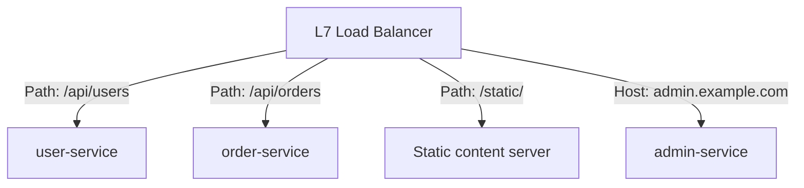

## Introduction

- **What You'll Learn From This Article**: Beyond the difference in what information L4 and L7 actually look at, covered in [Load Balancing Algorithms and Health Checks](/en/articles/load-balancing-algorithms-guide), you'll systematically understand **how an L7 load balancer actually uses a URL's path or hostname to route to a different backend**.
- **Intended Audience**: Readers who understand the difference between L4 and L7, but can't explain exactly what rules L7 actually uses to pick a backend.
- **Estimated Reading Time**: About 18 minutes

This article is part of the [Top 1% Series Complete Article Guide](/en/sitemap), and article 3.1 in the [Load Balancing Fundamentals Series](/en/sitemap#series-list).

## Prerequisite Knowledge

- [Load Balancing Algorithms and Health Checks](/en/articles/load-balancing-algorithms-guide): Understanding the difference in what information L4 and L7 actually look at is a prerequisite.

## Getting the Big Picture

**Host-based routing sends different hostnames, like `app.example.com` and `admin.example.com`, to different backend pools, respectively.** **Path-based routing sends different URL path prefixes, like `/api/` and `/static/`, to different backends.** **In a microservices setup, it's common to bundle multiple independent services behind a single load balancer this way — `/api/users` to the user-service, `/api/orders` to the order-service, and so on.**

## Deep Dive Into the Fundamentals

### Rules Get Evaluated Top to Bottom, and the First Match Wins

**Path-based/host-based rules typically get evaluated top to bottom, with the first matching rule winning.** **This evaluation order is exactly the typical pitfall when handling overlapping path prefixes.** **For example, placing a rule for `/api/` ahead of a more specific rule for `/api/admin/` means a request headed for `/api/admin/` unintentionally matches the `/api/` rule instead.** **Placing a more specific rule ahead of a more general one — the rule ordering design itself — is the precondition for achieving the correct routing.**

### You Can Combine Multiple Conditions Within a Single Rule

**On top of path and hostname, you can also combine multiple conditions — an HTTP method, a source IP address, a query parameter — within a single routing rule.** **This makes fine-grained routing possible, like "send only a request to this specific path, using this specific HTTP method, to this specific backend."**

L4 Can't Do This Kind of Routing at All

**An L4 load balancer looks only at the TCP/UDP header's IP address and port number, so it has no way at all to reference an HTTP request's own content, like its path or hostname.** **The fact that path-based/host-based routing is even possible is direct evidence of an L7 load balancer's ability to read an HTTP request's actual content.**

## What a Pro Sees Here (Top 1% Understanding)

### "Having Multiple Rules" and "the Rule Order Determining Behavior" Are Separate Understandings

**When configuring path-based/host-based routing rules, attention tends to focus solely on whether each individual rule is written correctly — but what actually determines behavior is the rule's content, combined with the order the rules are arranged in.** **The habit of re-asking, every time you add a new rule, "should this new rule be evaluated before or after each existing rule"** is the perspective a top-1% engineer carries.

## Common Misconceptions and Pitfalls

- **Misconception 1: "A path-based routing rule's priority is automatically decided by specificity, regardless of order."**
  Most implementations simply evaluate rules top to bottom, with the first match winning, so a more specific rule must be placed first.
- **Misconception 2: "An L4 load balancer can also do path-based routing, given the right configuration."**
  L4 only looks at the TCP/UDP header, so it has no way at all to reference an HTTP request's own content, like a path.
- **Misconception 3: "A single routing rule can only specify one condition."**
  Multiple conditions — path, hostname, HTTP method, source IP address, and more — can be combined within a single rule.

## Troubleshooting Perspective

1. **A request to a specific path is being routed to an unintended backend**: Check whether a more general path rule was placed ahead of a more specific one.
2. **Path-based routing isn't working on an L4 load balancer**: L4 can't reference an HTTP request's content at all, so switching to an L7 load balancer is required.
3. **Existing routing behavior changed after adding a new rule**: Check whether the new rule got inserted at a position evaluated before an existing rule, unintentionally intercepting requests meant for it.

## Summary

- Host-based routing sends different hostnames, and path-based routing sends different URL path prefixes, to different backends respectively.
- Rules typically get evaluated top to bottom, with the first match winning, so a more specific rule must be placed ahead of a more general one.
- Multiple conditions — path, hostname, HTTP method, source IP address, and more — can be combined within a single rule.
- An L4 load balancer has no way at all to reference an HTTP request's own content, like its path or hostname.

**Takeaways to Apply Today**
1. When adding a path-based/host-based routing rule, always check its evaluation order relative to existing rules.
2. When handling overlapping path prefixes, place the more specific rule first.

## References

- [What You Need to Know About AWS Application Load Balancer | CloudOptimo](https://cloudoptimo.com/blog/what-you-need-to-know-about-aws-application-load-balancer/)
- [ACL Routing Rules (ALB) | E2E Networks](https://docs.e2enetworks.com/docs/myaccount/load-balancer/manage/acl/)
