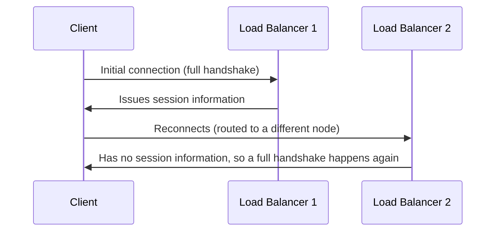

## Introduction

- **What You'll Learn From This Article**: Beyond [Understanding the Difference Between SSL Termination and SSL Passthrough](/en/articles/load-balancing-ssl-termination-guide), you'll systematically understand **TLS session resumption** and exactly how it breaks down once a load balancer becomes a multi-node setup.
- **Intended Audience**: Readers who understand SSL termination, but have seen TLS connection-establishment cost spike the instant they made their load balancer redundant, without being able to explain why.
- **Estimated Reading Time**: About 16 minutes

This article is part of the [Top 1% Series Complete Article Guide](/en/sitemap), and article 3.05 in the [Load Balancing Fundamentals Series](/en/sitemap#series-list).

## Prerequisite Knowledge

- [Understanding the Difference Between SSL Termination and SSL Passthrough](/en/articles/load-balancing-ssl-termination-guide): Understanding the concept of a load balancer acting as the TLS termination point is a prerequisite.

## Getting the Big Picture

**A new TLS connection requires a relatively heavy process called a "full handshake," including a key exchange.** **TLS session resumption skips that heavy process by reusing information from a previously established session (a session ID or a session ticket), completing reconnection with a shortened "abbreviated handshake."** **But when the load balancer is a multi-node setup, session information established on one node isn't shared with other nodes by default. If a reconnecting client gets routed to a different node than before, that node has no session information, resumption fails, and a full handshake happens after all.**

## Deep Dive Into the Fundamentals

### What "Sharing" Actually Means for Session IDs vs Session Tickets

**Resumption via a session ID is based on a server-side cache holding session information, so a multi-node setup needs that cache itself shared across nodes.** **Resumption via a session ticket doesn't hold session information server-side at all — it hands an encrypted ticket to the client instead — but in this case, the key used to encrypt and decrypt that ticket must match across every single node.** **Either way, session resumption doesn't work in a multi-node setup unless the premise of "keeping something synchronized across multiple nodes" is satisfied.**

### A Cache Silently Overflowing Degrades Performance Without Anyone Noticing

**When a session cache fills up, old sessions get quietly evicted, resumption's success rate gradually drops, and CPU usage climbs — a hard-to-spot degradation.** **One benchmark cited for a healthy production deployment is keeping the resumption success rate above 90%.**

Note: TLS 1.3 makes the ticket method the only option

**TLS 1.3 removed the traditional session ID method entirely — session resumption now happens only via the ticket method.** **Because of this, disabling the ticket feature in a TLS 1.3 environment eliminates session resumption as a feature altogether.**

## What a Pro Sees Here (Top 1% Understanding)

### Redundancy Improves Availability While Quietly Breaking a Different Premise

**Making a load balancer redundant with multiple nodes is the right call from an availability standpoint, but it quietly breaks the implicit premise another mechanism, TLS session resumption, depended on: "returning to the same node."** **Never settle for the fact "I made it redundant" — always check "did this redundancy quietly break some other mechanism's implicit premise."** This is the perspective a top-1% engineer carries.

## Common Misconceptions and Pitfalls

- **Misconception 1: "Making the load balancer redundant has no effect on TLS session resumption at all."**
  Unless session information is shared across nodes, resumption fails the instant a client gets routed to a different node, triggering a full handshake.
- **Misconception 2: "Using the session ticket method means the server side never needs to share anything."**
  The server side doesn't hold session information itself, but the key used to encrypt and decrypt the ticket must match across every node.
- **Misconception 3: "A session cache overflowing gets clearly detected as an error."**
  A cache overflow usually produces no explicit error at all — it shows up as a hard-to-spot drop in resumption success rate and a rise in CPU usage.

## Troubleshooting Perspective

1. **CPU usage from TLS handshakes rose after making the load balancer a multi-node setup**: Check whether the session cache (or ticket key) is shared across nodes.
2. **A client's reconnection always triggers a full handshake**: Check whether the load balancer uses sticky routing, or whether a mechanism for sharing session information is configured.
3. **Session resumption stopped working after migrating to TLS 1.3**: Check whether the ticket feature is disabled. TLS 1.3 has no session ID method at all.

## Summary

- TLS session resumption reuses previously established session information to skip a heavy full handshake.
- In a multi-node load balancer setup, resumption doesn't work unless session information is shared across nodes.
- The session ID method needs a shared cache; the ticket method needs a shared encryption key.
- A cache overflow shows up not as a clear error, but as a hard-to-spot performance degradation.

**Takeaways to Apply Today**
1. When making a load balancer redundant, always include how TLS session information (cache or ticket key) will be shared in your design.
2. If TLS-related CPU usage feels high, check the session resumption success rate.

## References

- [Speeding up TLS: Enabling Session Reuse | Vincent Bernat](https://vincent.bernat.ch/en/blog/2011-ssl-session-reuse-rfc5077)
- [NGINX SSL Session Cache: Improving TLS Resumption and Cutting CPU | Netdata](https://www.netdata.cloud/guides/nginx/nginx-ssl-session-cache/)
