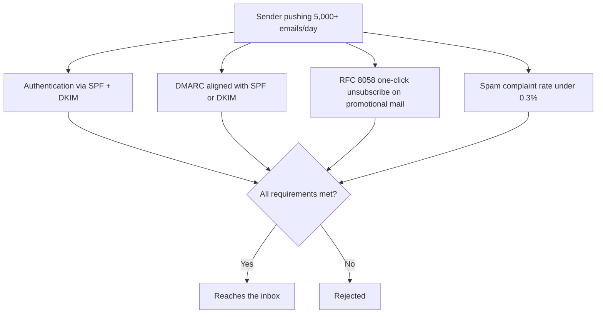

## Introduction

- **What You'll Learn From This Article**: The mechanisms covered in [How SPF/DKIM/DMARC Works](/en/articles/mail-spf-dkim-dmarc-guide) were originally introduced as anti-spoofing measures. In this article, you'll systematically understand **the bundled set of requirements Google and Yahoo mandated for bulk senders in 2024**, and how your existing SPF/DKIM/DMARC knowledge has been redefined as a mandatory gate.
- **Intended Audience**: Readers who understand the basic mechanics of SPF, DKIM, and DMARC, but can't explain exactly what Google's and Yahoo's bulk sender requirements actually mandate.
- **Estimated Reading Time**: About 18 minutes

This article is part of the [Top 1% Series Complete Article Guide](/en/sitemap), and article 4.3 in the [Messaging Series](/en/sitemap#series-list).

## Prerequisite Knowledge

- [How SPF/DKIM/DMARC Works](/en/articles/mail-spf-dkim-dmarc-guide): A basic understanding of the three mechanisms, SPF, DKIM, and DMARC, is a prerequisite.

## Getting the Big Picture

**In 2024, Google and Yahoo mandated, as one bundled set, multiple requirements for any "bulk sender" pushing 5,000 or more emails a day.** **This set consists of four pillars: (1) authentication via SPF and DKIM, (2) a DMARC record aligned with either SPF or DKIM, (3) an RFC 8058-compliant one-click unsubscribe implementation on promotional/marketing mail, and (4) maintaining a spam complaint rate under 0.3%.** **A sender failing to meet any of these requirements now gets outright rejected from reaching Gmail or Yahoo Mail at all.**

## Deep Dive Into the Fundamentals

### RFC 8058's One-Click Unsubscribe: Combining List-Unsubscribe and List-Unsubscribe-Post

**The one-click unsubscribe RFC 8058 defines gets achieved by combining the `List-Unsubscribe` header with a second header, `List-Unsubscribe-Post: List-Unsubscribe=One-Click`.** **With both headers present together, the mail client can complete the unsubscribe process instantly with a single "Unsubscribe" button, never redirecting the user to a login page or landing page at all.** **The unsubscribe request itself is required to actually be processed within 48 hours.**

### Why "Transactional Mail" Is Exempt From This Requirement

**Transactional mail — a direct response to a user's own action, like a password reset or an order confirmation — is exempt from the one-click unsubscribe requirement.** **But Google and Yahoo never automatically classify a sender's mail as "transactional" versus "promotional/marketing" for you — the responsibility for judging which category applies rests entirely on the sender.** **Misjudging this classification, and continuing to send what's effectively promotional mail without a one-click unsubscribe, carries the risk of being treated as a requirement violation.**

Once Assigned, the "Bulk Sender" Classification Stays Permanent

**Once Google or Yahoo classifies you as a "bulk sender," that classification is said to stay permanent, even if you later reduce your sending volume.** **If you're planning to scale up your sending volume eventually, the realistic countermeasure is building out the infrastructure to meet these requirements while your volume is still small.**

## What a Pro Sees Here (Top 1% Understanding)

### A Mechanism You Learned as "Anti-Spoofing" Can Turn Into "the Condition for Being Allowed to Deliver at All"

**SPF/DKIM/DMARC tend to get understood mostly as a sender-side, self-protective mechanism for preventing spoofed mail — but today, they've become a mandatory precondition for being allowed to reach a major provider's inbox at all.** **Not just understanding a technology's own mechanics, but periodically checking whether its standing has quietly shifted over time, from "recommended" to "mandatory,"** is the perspective a top-1% engineer carries.

## Common Misconceptions and Pitfalls

- **Misconception 1: "Setting up SPF/DKIM/DMARC satisfies every one of Google's and Yahoo's bulk sender requirements."**
  On top of SPF/DKIM/DMARC authentication, you also need to implement one-click unsubscribe and maintain a spam complaint rate — two entirely separate requirements.
- **Misconception 2: "One-click unsubscribe needs to be implemented on every single outgoing email."**
  Transactional mail is exempt, but the responsibility for correctly classifying mail as transactional versus promotional/marketing rests entirely on the sender.
- **Misconception 3: "The bulk sender classification gets lifted once you reduce your sending volume."**
  Once classified as a "bulk sender," that classification is said to stay permanent, regardless of any later change in sending volume.

## Troubleshooting Perspective

1. **Your delivery rate to Gmail or Yahoo Mail suddenly dropped**: Check SPF/DKIM/DMARC authentication status, one-click unsubscribe header implementation, and spam complaint rate, each separately.
2. **You want to determine whether your organization counts as a "bulk sender"**: Check whether your daily sending volume to Gmail exceeds 5,000 emails.
3. **You're not sure how to manage your spam complaint rate**: Set up the respective monitoring tool — Google Postmaster Tools for Gmail, the Complaint Feedback Loop for Yahoo.

## Summary

- In 2024, Google and Yahoo mandated, as one bundled set, SPF/DKIM/DMARC authentication, one-click unsubscribe, and a spam complaint rate under 0.3%, for any bulk sender pushing 5,000+ emails a day.
- One-click unsubscribe is achieved by combining two headers, List-Unsubscribe and List-Unsubscribe-Post, and requires processing within 48 hours.
- Transactional mail is exempt from one-click unsubscribe, but the responsibility for the classification rests on the sender.
- Once classified as a "bulk sender," that classification stays permanent, regardless of any later change in sending volume.

**Takeaways to Apply Today**
1. Check whether your organization's sending volume falls under Google's or Yahoo's bulk sender requirements.
2. Periodically revisit your SPF/DKIM/DMARC configuration not just as "anti-spoofing," but as "a precondition for being allowed to deliver at all."

## References

- [Requirements for Bulk Email Senders | Close](https://help.close.com/technical-support/email-deliverability/requirements-for-bulk-email-senders)
- [New Google Rules for Bulk Email Senders | Sender](https://www.sender.net/blog/new-google-rules-for-bulk-email-senders/)
