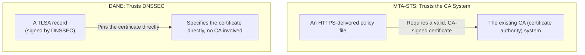

## Introduction

- **What You'll Learn From This Article**: [How MTA-STS works](/en/articles/mail-tls-encryption-guide) was a mechanism reinforcing opportunistic encryption's weakness by combining DNS and HTTPS. In this article, you'll systematically understand **DANE (DNS-based Authentication of Named Entities)** — an **entirely different answer** to the same problem: how do you trust a destination server's TLS certificate?
- **Intended Audience**: Readers who understand how MTA-STS works, but don't know there's another solution, DANE.
- **Estimated Reading Time**: About 18 minutes

This article is part of the [Top 1% Series Complete Article Guide](/en/sitemap), and article 6.2 in the [Mail Infrastructure Series](/en/sitemap#series-list).

## Prerequisite Knowledge

- [How MTA-STS Works](/en/articles/mail-tls-encryption-guide): Understanding opportunistic encryption's weakness and this other mechanism reinforcing it.
- [How DNSSEC Works](/en/articles/dns-dnssec-fundamentals-guide): Understanding this mechanism DANE builds on top of — proving a DNS response's own authenticity — will help you go deeper.

## Getting the Big Picture

**MTA-STS trusted the existing CA (certificate authority) system as its foundation of trust, through a policy file distributed over HTTPS.** **DANE is an entirely different mechanism, trusting DNSSEC as its foundation instead.** **The sending domain directly declares, inside a DNSSEC-signed DNS record called a `TLSA` record, "this is the correct certificate (or public key) the mail server for this domain should present."** This means **the certificate itself can be pinned directly inside DNS, with no CA intermediary at all.**

## Deep Dive Into the Fundamentals

### A TLSA Record: Specifying the Certificate Itself, Directly Inside DNS

**A TLSA record directly writes, into DNS, the hash of the certificate (or its public key) an SMTP server should present.** The profile recommended for SMTP is the combination "DANE-EE (specifying the end-entity certificate itself), SPKI (public key information), SHA-256." **For this mechanism to work, there's an absolute prerequisite: the TLSA record itself must be signed by DNSSEC, and the receiving side must be able to verify that signature.** In a zone where DNSSEC isn't deployed, a compliant implementation ignores the TLSA record.

### A Decisive Difference in Each Mechanism's Weakness

**DANE's weakness is that it depends completely on DNSSEC being correctly deployed across the entire zone, from the sender to the recipient.** **MTA-STS's weakness is that protection hasn't kicked in yet during the very first connection (the initial contact, TOFU) — before the policy file has ever been cached.**

Deploying Both Together Is Realistically Recommended

**DANE and MTA-STS aren't competing choices — deploying both, as complementary mechanisms covering each other's weakness, is recommended.** **DANE covers domains where DNSSEC is deployed, while MTA-STS covers domains where it isn't.** When both are deployed, there's also a rule: MTA-STS policy validation must never override a failing DANE validation result to allow the connection anyway. Microsoft announced DANE support for inbound SMTP in July 2024, and adoption among major providers is advancing.

## What a Pro Sees Here (Top 1% Understanding)

### Noticing the Fundamental Difference in "Who Do You Trust"

**MTA-STS and DANE share exactly the same goal — reinforcing opportunistic encryption's weakness — but underneath how each actually achieves it lies a fundamentally different premise: "do you trust an existing third-party system, the CA," or "do you trust DNS's own hierarchical structure, DNSSEC."** **The fact that multiple solutions, based on entirely different trust models, can exist in parallel for a single problem** is a perspective that leads to not settling for just one side when making a technology choice, but judging only after understanding both premises.

## Common Misconceptions and Pitfalls

- **Misconception 1: "Picking either DANE or MTA-STS alone is enough."**
  The two are complementary mechanisms covering each other's weakness, and deploying both together is realistically recommended.
- **Misconception 2: "DANE works even without DNSSEC deployed."**
  DANE has an absolute prerequisite — the TLSA record itself must be signed by DNSSEC — and it doesn't work in a zone where DNSSEC isn't deployed.
- **Misconception 3: "MTA-STS has no weakness like DANE's at all."**
  MTA-STS also has a weakness: protection hasn't kicked in yet during the very first connection, before the policy file has been cached.

## Troubleshooting Perspective

1. **You set up a TLSA record, but senders fail validation**: Check whether that zone itself is correctly signed by DNSSEC.
2. **You've deployed both DANE and MTA-STS, but behavior seems contradictory**: Check whether a DANE validation result is being overridden by the MTA-STS policy.
3. **You can't decide which mechanism to deploy first**: Consider DANE first if DNSSEC is already deployed, or MTA-STS first if it isn't yet.

## Summary

- MTA-STS trusts the existing CA (certificate authority) system as its foundation.
- DANE is an entirely different mechanism, trusting DNSSEC as its foundation and pinning the certificate directly via a TLSA record.
- DANE carries complete dependence on DNSSEC, while MTA-STS carries a lack of protection during the first contact — different weaknesses.
- Deploying both together is realistically recommended.

**Takeaways to Apply Today**
1. Even for a domain that's already deployed MTA-STS, consider adding DANE if DNSSEC is also deployed.
2. Always keep in mind the fundamental difference in "who do you trust" when making a technology choice.

## References

- [DANE for Email: Making SMTP TLS Actually Trustworthy | Unione](https://unione.io/en/blog/what-is-dane/)
- [MTA-STS vs DANE: Which Protocol to Choose for Securing Email Transport? | CaptainDNS](https://www.captaindns.com/en/blog/mta-sts-vs-dane)
