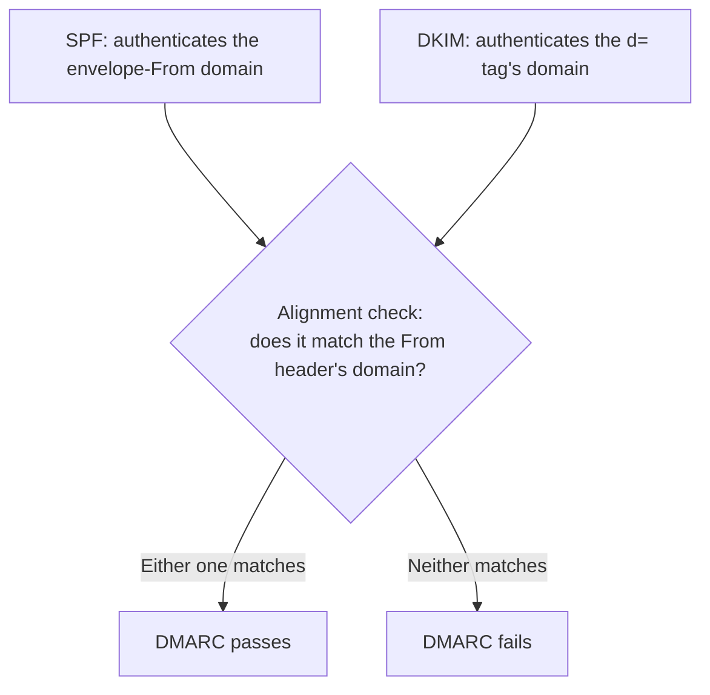

## Introduction

- **What You'll Learn From This Article**: Beyond [Understanding How SPF, DKIM, and DMARC Work](/en/articles/mail-spf-dkim-dmarc-guide), you'll systematically understand **alignment** — the mechanism DMARC actually uses to decide pass or fail.
- **Intended Audience**: Readers who've seen both SPF and DKIM reported as "pass" while DMARC alone fails, and can't explain why.
- **Estimated Reading Time**: About 16 minutes

This article is part of the [Top 1% Series Complete Article Guide](/en/sitemap), and article 4.05 in the [Mail Infrastructure Series](/en/sitemap#series-list).

## Prerequisite Knowledge

- [Understanding How SPF, DKIM, and DMARC Work](/en/articles/mail-spf-dkim-dmarc-guide): Understanding that SPF authenticates the envelope-From domain and DKIM authenticates the signing domain, each independently, is a prerequisite.

## Getting the Big Picture

**SPF and DKIM each authenticate an independent domain. SPF authenticates the envelope-From (Return-Path) domain, and DKIM authenticates the signing domain (the `d=` tag), each separately.** **But the sender a recipient actually sees on screen is the domain in the visible `From` header. DMARC alignment is the mechanism that checks whether the domain SPF or DKIM authenticated matches that visible `From` header's domain.** **DMARC passes if either SPF or DKIM is aligned — it's an OR condition.**

## Deep Dive Into the Fundamentals

### Two Matching Standards: Relaxed Mode and Strict Mode

**Alignment's matching standard comes in two modes, specified via the `aspf` (for SPF) and `adkim` (for DKIM) tags: relaxed and strict.** **Relaxed mode (the default) only requires the organizational domain — effectively the root portion registered with a registry — to match, so `mail.example.com` and `example.com` are judged aligned.** **Strict mode requires an exact match, so `mail.example.com` and `example.com` are judged unaligned even though they belong to the same organizational domain.**

### SPF Can Show "Pass" While DMARC Still Fails

**When sending through an email service provider (ESP), for instance, SPF might correctly authenticate the envelope-From domain (e.g., `bounce.esp-service.com`), but if that domain doesn't match the visible `From` header's domain (e.g., `example.com`) by the alignment standard, SPF passing on its own doesn't get counted toward DMARC at all.** **In that case, if DKIM's signing domain is aligned with the `From` header's domain, DMARC can still pass overall on DKIM's side.**

Note: why forwarding breaks alignment

**When a message is forwarded by a third party, SPF almost always fails because the sending IP address changes, and DKIM's signature can also become invalid if the body or headers get modified in transit.** **Because of this, a forwarded message tends to fail alignment on both SPF and DKIM, making it likely to fail DMARC overall — a structural weakness.**

## What a Pro Sees Here (Top 1% Understanding)

### "Each Check Passed" and "They Match Overall" Are Different Layers

**SPF and DKIM are mechanisms that each independently authenticate a separate domain, but DMARC is a layer above that, re-linking that authentication result to the domain the recipient actually sees in the `From` header.** **When hitting the issue "SPF passes, so why does DMARC fail," checking not just the individual SPF/DKIM results but one layer above that — "is that domain aligned with the From header's domain" — is the perspective a top-1% engineer carries.**

## Common Misconceptions and Pitfalls

- **Misconception 1: "If SPF and DKIM both pass, DMARC automatically passes too."**
  An SPF or DKIM pass only counts toward DMARC once the domain it authenticated is aligned with the From header's domain.
- **Misconception 2: "DMARC requires both SPF and DKIM to be aligned to pass."**
  DMARC passes on an OR condition — either SPF or DKIM being aligned is enough.
- **Misconception 3: "There's no practical difference between relaxed mode and strict mode."**
  Relaxed mode passes on an organizational-domain match, while strict mode requires an exact match, so results differ for sending via a subdomain.

## Troubleshooting Perspective

1. **Both SPF and DKIM show "pass," but DMARC fails**: Check whether the domain each one authenticated matches the From header's domain at the organizational-domain level.
2. **Only forwarded messages from third parties fail DMARC**: Check whether forwarding broke SPF and whether body/header changes invalidated the DKIM signature.
3. **Switching to strict mode suddenly fails even legitimate mail**: Check whether a legitimate sender using a subdomain no longer satisfies an exact match against the organizational domain.

## Summary

- DMARC alignment checks whether the domain SPF or DKIM authenticated matches the visible From header's domain.
- DMARC passes on an OR condition — either SPF or DKIM being aligned is enough.
- Relaxed mode (the default) matches at the organizational-domain level; strict mode requires an exact match.
- Mail forwarding is a structural weakness that tends to break both SPF and DKIM alignment.

**Takeaways to Apply Today**
1. When you hit "SPF passes but DMARC fails," check the alignment matching standard first.
2. Before switching to strict mode, check in advance whether any legitimate sender uses a subdomain.

## References

- [DMARC Alignment | PowerDMARC](https://powerdmarc.com/dmarc-alignment/)
- [DMARC Relaxed vs Strict Alignment | DuoCircle](https://www.duocircle.com/dmarc/dmarc-relaxed-vs-strict-alignment)
