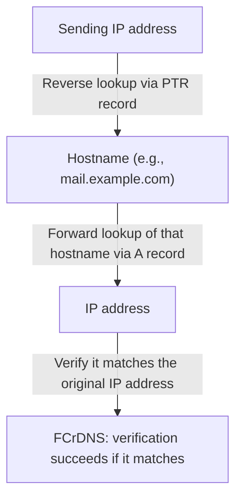

## Introduction

- **What You'll Learn From This Article**: After finishing [the hands-on building a mail server with Postfix and Dovecot](/en/articles/mail-server-handson-guide) and setting up [SPF, DKIM, and DMARC](/en/articles/mail-spf-dkim-dmarc-guide) correctly, **mail to Gmail and other major providers can still fail to arrive, or land in the spam folder.** This article helps you understand the reality that the cause, in many cases, is **a missing PTR record (reverse DNS) for the sending IP address.** Where SPF, DKIM, and DMARC are **domain-level authentication**, you'll systematically understand that **PTR and FCrDNS (forward-confirmed verification) form an entirely separate layer of verification, confirming the identity of the connecting IP address itself.**
- **Intended Audience**: Readers who've set up SPF, DKIM, and DMARC correctly, but have run into mail from their own self-built mail server having trouble reaching major providers.
- **Estimated Reading Time**: About 17 minutes

This article is part of the [Top 1% Series Complete Article Guide](/en/sitemap), and article 4.2 in the [Mail Infrastructure Series](/en/sitemap#series-list).

## Prerequisite Knowledge

- [The Hands-On Building a Mail Server With Postfix and Dovecot](/en/articles/mail-server-handson-guide): The premise that a mail server makes a direct SMTP connection to another mail server.
- [How SPF, DKIM, and DMARC Work](/en/articles/mail-spf-dkim-dmarc-guide): The premise that these are domain-level sender authentication mechanisms.

## Getting the Big Picture

**A PTR record is a DNS record for "reverse" lookups — deriving a hostname from an IP address, the opposite direction of an A record (hostname → IP address).** Many receiving mail servers, right after accepting an SMTP connection, **first check whether a PTR record even exists for the connecting IP address.** **A sending IP address with no PTR record at all gets treated as a typical characteristic of spam senders or a poorly managed server, and that alone can get the connection rejected outright, or counted heavily toward a spam classification.** **This verification is completely independent of domain-level mechanisms like SPF, DKIM, and DMARC — even if every domain-side setting is correct, missing a PTR record alone can get a message rejected right at that point.**

## Deep Dive Into the Fundamentals

### Why a Missing PTR Record Gets Treated as a Red Flag

**A mail server operated by a legitimate organization with a valid reason normally has a properly configured PTR record for its IP address.** On the other hand, **spam senders often send mass mail from countless IP addresses that are temporarily hijacked or dynamically assigned**, and these IP addresses almost always lack a proper PTR record. **From this empirical tendency, the industry-wide standard "suspect any sender with no PTR record first" has become widely adopted.** In fact, **starting in November 2025, Gmail strengthened its handling of senders lacking a PTR record, moving from a temporary deferral to a permanent rejection (a 550 error).**

### FCrDNS: Why a Reverse Lookup Alone Isn't Enough

**Merely having a PTR record isn't a sufficient verification yet.** That's because **the PTR record itself is a setting controlled by the IP address's administrator (usually a cloud provider or ISP), and in theory a sender could set up a convenient-looking hostname with just the right appearance.** To address this, mail servers performing stricter verification run a two-stage check called **FCrDNS (Forward-Confirmed reverse DNS, forward-match verification).**

1. **Reverse lookup**: Get the hostname from the connecting IP address's PTR record.
2. **Forward lookup**: Look up that hostname again, this time as an A record, and verify whether the resulting IP address **matches the original connecting IP address.**

**By requiring this round-trip match, only an organization actually and correctly managing both "the PTR record setting" and "the corresponding A record setting" can pass the check** — a far more reliable confirmation.

Practical Notes on Setting a PTR Record in an AWS EC2 Environment

On an AWS EC2 instance, the PTR record for an Elastic IP address **isn't set by default, and is managed by AWS itself, so you can't set it purely from your own DNS server's side.** If you want to set a PTR record, **you need to request the change through AWS Support Center.** Furthermore, **before AWS will set a PTR record, it requires the corresponding A record (forward lookup) for the hostname the PTR record points to, to actually already be set, pointing to that Elastic IP address.** In other words, note that there's an ordering constraint: **you can't even request the PTR record setting from AWS until you first prepare the forward A record.**

## What a Pro Sees Here (Top 1% Understanding)

### PTR/FCrDNS Verifies "the IP Address's Identity," While SPF/DKIM/DMARC Verifies "the Domain's Identity"

**Sorting out the layer difference between these two verifications: PTR/FCrDNS is an identity check on the IP address itself — "is this connection genuinely coming from the owner of the hostname it claims to have?" — while SPF/DKIM/DMARC is an identity check on the domain — "is the domain this mail claims to come from actually a sender that domain's own administrator has authorized?"** Modern major mail providers' basic design is that **only once both checks pass independently does a sender get judged sufficiently trustworthy.** **When you build your own mail server, it's easy to focus solely on SPF, DKIM, and DMARC settings — but you should first confirm, on the cloud provider or ISP's side, whether you can actually set a PTR record correctly (or whether an appropriate one is already assigned).**

## Common Misconceptions and Pitfalls

- **Misconception 1: "Setting up SPF, DKIM, and DMARC correctly guarantees mail deliverability."**
  PTR/FCrDNS is an identity check on the IP address itself, independent of SPF, DKIM, and DMARC. Missing it can get mail rejected even when the domain-side settings are all correct.
- **Misconception 2: "Having even one PTR record set is enough to pass verification."**
  A mail server performing strict verification runs a two-stage check called FCrDNS, confirming not just the PTR record's reverse lookup, but also whether that hostname's forward lookup matches the original IP address.
- **Misconception 3: "You can set a PTR record for any IP address, as long as you register it on your own DNS server."**
  A PTR record is set under the authority of the organization managing that IP address (a cloud provider or ISP) — you can't set it purely from your own DNS server's side.

## Troubleshooting Perspective

1. **Mail sent from your own self-built mail server doesn't reach Gmail and similar providers, or lands in spam**: Check whether a PTR record is set for the sending IP address, using something like `dig -x <IP address>`.
2. **A PTR record is supposedly set, but some strict receivers still reject the mail**: Check the hostname the PTR record returns via a forward lookup (an A record), to confirm it matches the original IP address (FCrDNS).
3. **You want to set a PTR record in a cloud environment**: Check in advance what procedure (a support ticket, a dedicated API) that cloud provider uses to accept PTR record changes.

## Summary

- A PTR record is a DNS record for deriving a hostname from an IP address, and many receiving mail servers check whether one exists for the sending IP address.
- A sending address with no PTR record gets treated as a typical characteristic of spam, becoming a major factor in connection rejection or spam classification.
- FCrDNS (forward-match verification) is a stricter two-stage check: looking up the hostname via a reverse lookup, then forward-looking it up again to confirm it matches the original IP address.
- PTR/FCrDNS is an identity check on the IP address itself, an entirely separate layer from SPF/DKIM/DMARC's identity check on the domain.

**Takeaways to Apply Today**
1. When building your own mail server, check whether a PTR record is correctly set for the sending IP address with the same priority as SPF, DKIM, and DMARC settings.
2. When building a mail server in a cloud environment, always check how that provider accepts PTR record changes, before you build it.

## References

- [Create a reverse DNS record for email on Amazon EC2 | AWS Documentation](https://docs.aws.amazon.com/AWSEC2/latest/UserGuide/Using_Elastic_Addressing_Reverse_DNS.html)
- [Forward-confirmed reverse DNS | Wikipedia](https://en.wikipedia.org/wiki/Forward-confirmed_reverse_DNS)
